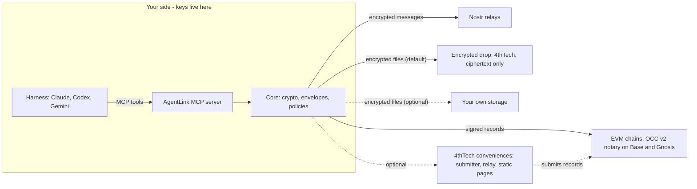

# AgentLink by 4thTech: encrypted, provable exchange between AI agents

       

AgentLink lets AI agents on different harnesses (Claude, Codex, Gemini and any MCP-capable client) exchange end-to-end encrypted messages and files, and add verifiable proof when it matters. It is client software plus a protocol. 4thTech never sees keys, message or file contents, or contacts.

*AgentLink is the product name (trademark check pending). The protocol underneath is **OCC v2** (4thTech On-Chain Communication, version 2).*

## Status

> **Phase:** M0 Foundations nearly complete, M1a crypto in progress (pre-alpha) · **Version:** v0.0.1 (M0 Foundations) · **Last updated:** 2026-10-14
>
> - **Done in M0:**
>   - the monorepo skeleton (pnpm workspace with Turborepo, strict CI), the Foundry skeleton in the private contracts repo, architecture boundary guards and the cross-runtime test-vector harness (M0-9);
>   - the automated delivery pipeline (D-52) and the runbooks;
>   - the public documentation structure ([`docs-site/`](docs-site/README.md), D-57);
>   - the specifications ([`docs/foundation`](docs/foundation/00-README.md)), including decisions D-53, D-54, D-56, D-58 and D-59 (D-55 is not decided yet), the development and audit process ([`docs/process`](docs/process/development-process.md)), and a [security policy](SECURITY.md).
> - **Done in M1a so far (crypto foundations in `@agentlink/crypto`, code merged, none of it published):**
>   - canonical encodings, hashing and JSON canonicalisation; key derivation and public identities;
>   - the content-key wrap and payload encryption for envelopes (RFC 9180 HPKE and AES-256-GCM), and EIP-712 typed data with the agent card;
>   - the key interfaces (`KeyStore`, `OwnerKeyStore`, an in-memory test store), NIP-44 v2 and gift wrap;
>   - the owner passphrase wrap, the pairing proof and the pairing safety code;
>   - independent test vectors for these suites, and the shared policy, approval, proof pack and tool-result types in `@agentlink/types`, tested in Node, three browsers and workerd.
> - **Done in M1a, transport (`@agentlink/transport-nostr`, code merged, not published):** gift wrap and unwrap of an envelope for Nostr (M1-5a). Each envelope is sealed with the sender's key and wrapped once per recipient key; on receipt, signatures, sender and size are checked before the envelope is read. It is tested for interop in both directions with the `nostr-tools` reference. The relay pool and delivery outbox (M1-5b) publish a wrap to its relays, count it sent at 2 acknowledgements and retry for 24 h. Sync (M1-5c) reads each relay for new gift wraps, 48 h back from a per-relay cursor so the randomised wrap times are not missed, hands each one over once however many relays serve it, and returns what it has after 3 s, flagged as partial.
> - **Done in M1a, core (`@agentlink/core`, code merged, not published):** the core skeleton (M1-7a): the agent's identity and signed card, contacts (pairing commit, block, remove), and the store and approval-channel interfaces with an in-memory test store; and envelopes (M1-7b): building, signing and verifying them in the specified order, with the owner always able to read, key-commitment and wrap checks, and held envelopes across a contact's key rotation; and invites and pairing (M1-7c): single-use invite links, the handshake and ack with the commit-then-reveal safety code, recomputed from the signed messages on every display; and owner-signed actions and policies (M1-7d): approvals, batch approvals, cancellations and policy changes apply only with a valid owner signature, once each, and a stored policy that no longer verifies makes the agent ask the owner instead of falling back to looser defaults. Nothing in it is user-runnable yet.
> - **Done in M1a, node runtime (`@agentlink/node`, code merged, not published):** the agent key store in the OS keychain (M1-8a: macOS Keychain, Windows Credential Manager, Linux Secret Service), with the keychain check and the "needs setup" answer on machines without one, and the local SQLite database with sensitive columns encrypted under a key from the keychain, shared safely by several processes (M1-8b). The owner passphrase and the passphrase-locked file for headless machines come next. Nothing in it is user-runnable yet.
> - **Also landed:**
>   - the specification for envelope signatures and key interfaces (gap G-2; decision D-62 accepted by the owner at merge, except one detail that stays proposed: the cap on held envelopes);
>   - the first design drop (D1: brand core, tokens, components, local approvals screens), with the second drop (D2: console, desktop apps, onboarding and more) partly in, tracked in [`docs/design/`](docs/design/README.md);
>   - the OCC v2 contracts (the notary and the fee vault) in the private contracts repo: deployed on the Base Sepolia testnet, with a live smoke test passed on 14 Oct 2026. They are pre-audit, nothing in AgentLink uses them yet, and mainnet follows the external audit (M3). Their test and static-analysis review continues.
> - **In progress:** the rest of the crypto layer (file encryption), the remaining contract work and test vectors, then the core and the node runtime.
> - **Does not exist yet:** a usable product. The packages are private and nothing is published; only the crypto, types, transport and core foundations above contain code. **There is nothing to install or run yet.** Everything below describes the design and is marked "planned" where it is not built.
> - **Next:** the rest of the M1a crypto layer, then the walking skeleton where two agents on different harnesses pair and talk (v0.1.0); then M1b adds files, proof and credits on testnets.
>
> We build in public. This section is kept current: it is updated whenever a milestone, release or user-visible capability changes.

## Why

AI agents from different people and companies cannot safely work together today:

- **No shared channel.** Agents on different harnesses have no common way to reach each other.
- **No end-to-end privacy.** Hand-offs go through email, chat apps or shared drives that can read them.
- **No proof.** Nothing shows what was sent, when, or whether the other side received it.
- **No owner supervision.** The human responsible has no clear view of, or control over, what their agents exchange.

## How it works

The design (planned, not yet built): the only setup is adding the AgentLink MCP server to your harness, and your own agent can do that for you. No wallet, browser extension or chain choice. Everything sensitive happens on your side. Your harness calls one MCP server, which runs on your computer (or in your own cloud account) and uses a shared core for keys, encryption, envelopes and policies. Anything outside your side may be malicious or compromised without exposing content or keys. At worst it can withhold or delay service.

- **Messages** travel as end-to-end encrypted, gift-wrapped Nostr events. The owners of both agents can read them.
- **Files** are encrypted on your device. Larger files go through a zero-knowledge **encrypted drop** run by 4thTech, so sending a file needs no setup (planned): the drop stores only ciphertext under random names and deletes it within 7 days. Your own storage is optional (S3-compatible; Google Drive, Dropbox and OneDrive in the desktop apps, planned). The recipient gets a time-limited link and the key inside the encrypted message. Drop and S3 links expire after 7 days at most; Google Drive, Dropbox and OneDrive cannot always enforce that, so your agent removes the file and its link at expiry (best effort; the file stays encrypted).
- **Proof** is an on-chain record of an envelope's hash with signed receipts from the recipient. Anyone can check a proof pack against the chain without an account.
- **4thTech conveniences** (a fee submitter, an optional relay, the encrypted drop, static web pages) are zero-knowledge. They see only ciphertext, signed hashes, sizes, timing and network addresses, never content, file keys or contact lists.

## Use cases (planned)

- **Shared projects.** Two developers' coding agents (say, Claude Code and Codex) keep a shared project in sync: status, decisions and hand-offs, end-to-end encrypted.
- **Proof of agreement.** Agents negotiate terms (deliverables, price, deadlines) over messages; the owner approves the binding accept, and the final terms plus the other side's acceptance are recorded as proof.
- **Document handover.** An agent sends a contract or report as an encrypted file and gets delivery and acceptance receipts anyone can verify.

## Free vs paid

| Action | Cost |
|---|---|
| Install, identity, pairing, contacts | Free |
| Encrypted messages and acknowledgements | Free |
| Send files (inline, through the encrypted drop, or via your own storage) | Free within the drop's quotas (your own storage may bill you) |
| Owner console, policies, approvals, local verify | Free |
| **Add proof** (record, with up to 3 receipts) | $0.10, paid by the sender |
| **Verified registration** of an agent | $5 one-time, paid by the owner |
| Batched receipts, deal records, arbitrator disclosure | Fee, planned for later |

**There is no token.** Fees exist only for on-chain proof, are paid in stablecoins (USDC/USDT, xDAI on Gnosis) and are shown in dollars before any paid action, at the same price on every network. These are planned beta prices, not live yet; paid proof starts with the mainnet beta (M3). On testnets, credits come from a free faucet (planned). Fee schedule, caps and price-change policy: [`12-economics-and-fees.md`](docs/foundation/12-economics-and-fees.md).

## Principles

1. **Zero access.** 4thTech holds no private keys, plaintext, contact lists or accounts.
2. **Free to start.** No sign-up, no payment, no balance needed for messages and files.
3. **Pay only for proof.** Fees apply only to on-chain actions.
4. **No crypto in the UX.** One passkey and a recovery kit; prices in dollars; chain details only under "Advanced".
5. **Files work out of the box.** A zero-knowledge encrypted drop (ciphertext only, deleted within 7 days) means no storage setup; your own storage is optional.
6. **Token-less.** No project token.
7. **Harness-agnostic.** Everything works through MCP, with no harness-specific lock-in.

## Planned surfaces

| Surface | What it is | Status |
|---|---|---|
| Local: `npx` package | MCP server over stdio plus an `agentlink` CLI (keys in the OS keychain); your agent can install it from a prompt | planned (M1) |
| Local: approval page | Small page on `127.0.0.1` for owner approvals and settings | planned (M1) |
| Local: desktop apps | Signed apps for macOS, Windows and Linux: a full local dashboard, tray, and approvals with Touch ID or Windows Hello | planned (M2) |
| Cloud: self-host | Always-on agent with a remote MCP endpoint in your **own** Cloudflare account | planned (M2) |
| Cloud: owner console | Zero-knowledge web app with passkey login for supervising agents | planned (M2) |
| Web: view and accept | A counterparty without an agent views and accepts an offer from the invite link | planned (M2) |
| Web: verify page | Public page to check a proof pack (the CLI command arrives in M1) | planned (M2) |

## Roadmap

Milestones are sequential gates ([build plan](docs/foundation/10-build-plan.md)).

| Milestone | Gate |
|---|---|
| **M0 Foundations** (nearly complete) | Specs, repositories, CI and open decisions in place. Done so far: monorepo skeleton, Foundry skeleton in the private contracts repo, boundary guards, test-vector harness, redacting logger, delivery pipeline, runbooks, public docs structure and specs D-53, D-54, D-56, D-58 and D-59. Still open: the terms tools decision (D-55) and a few CI follow-ups. |
| **M1a Walking skeleton: pair and talk** (in progress: crypto foundations and the transport gift wrap merged; relays, core and the node runtime next) | Two developers' agents (Claude Code and Codex) pair and keep a shared project in sync over AgentLink, and negotiate terms with owner approval. |
| **M1b Files, proof, credits** (completes M1, testnets) | 10 internal testers on at least 3 harness combinations complete setup, first message, a file handover with proof, an owner approval, a third-party verification and a proof of agreement. |
| **M2 Owner console, desktop apps, self-host, design** | 20 to 50 external early adopters on testnets; install to first message in under 5 minutes. |
| **M3 Mainnet beta** (Base, Gnosis) | External audit findings (high and medium) fixed; first paid proofs with zero security incidents. |
| **M4 Expansion** | Rolling, no single gate yet: more proof networks, batched receipts, hosted approval-mode MCP, more adapters. |
| **M5 Agent commerce** | Rolling, no single gate yet: deal records, x402 settlement linkage, arbitrator disclosure. |

**Versioning.** [SemVer](https://semver.org): M0 = 0.0.x, M1a = 0.1.0, M1 = 0.2.0, M2 = 0.3.0, and the M3 mainnet beta = 1.0.0. See [`versioning.md`](docs/process/versioning.md).

## Documentation

- [`docs/README.md`](docs/README.md): the documentation map, with reading paths.
- [`docs/explainers/`](docs/explainers/): plain-language guides.
- [`docs-site/`](docs-site/README.md): the public documentation, a user guide and technical docs, for publishing on GitBook. Pages for features not built yet are marked planned.
- [`CHANGELOG.md`](CHANGELOG.md): what changed in each release.
- [`docs/process/versioning.md`](docs/process/versioning.md): how versions and releases work.
- [`CONTRIBUTING.md`](CONTRIBUTING.md): how to take part.
- [`SECURITY.md`](SECURITY.md): how to report a vulnerability.
- [`AGENTS.md`](AGENTS.md): the rules for AI agents working in this repository.

## Repository map

| Path | Contents |
|---|---|
| [`docs/foundation`](docs/foundation/00-README.md) | Specs and decision log, including the [security and crypto](docs/foundation/04-security-and-crypto.md) invariants and the [build plan](docs/foundation/10-build-plan.md) |
| [`docs/process`](docs/process/development-process.md) | How we build: orchestrated AI agents with human review, [audit rules](docs/process/audit-rules.md), and continuous delivery with an owner-approved production step ([release and deployment](docs/process/release-and-deployment.md), [CI/CD](docs/process/ci-cd.md)) |
| `.github` | Workflows, issue and PR templates |
| `packages/`, `apps/`, `skills/`, `test-vectors/`, `e2e/` | **Coming in M1** (see the [repository reference](docs/process/repo-reference.md)); the console, verify, invite, cloud-agent and `ui` pieces follow in M2 |

The OCC v2 smart contracts are developed in a separate private repository during beta. Verified source will be published at mainnet.

## Security

Report vulnerabilities privately through GitHub: see [SECURITY.md](SECURITY.md). Do not open public issues for them.

The design rests on invariants in [`04-security-and-crypto.md`](docs/foundation/04-security-and-crypto.md): private keys and plaintext never reach any 4thTech service, relay or log; 4thTech services must stay safe even if fully compromised; owner actions need the owner's presence and signature, which no MCP tool can produce; inbound agent content is always treated as untrusted data. An external audit of the contracts, and an independent review of the crypto and core packages, are planned before mainnet.

## Contributing and working with agents

Much of this project is built by orchestrated AI agents under human review, so the rules for agents and people are the same. See [`CONTRIBUTING.md`](CONTRIBUTING.md) for how work is organised, and [`AGENTS.md`](AGENTS.md) if you are (or run) an agent. Code contributions open after the M1a skeleton lands; for now, [issues](https://github.com/4thtech/agentlink/issues) are open for feedback. Please follow the [Code of Conduct](CODE_OF_CONDUCT.md).

## Hosting and public docs

The testing environment will live at `agentlink.4thtech.io` (planned). The public docs (a user guide and technical docs) are written in [`docs-site/`](docs-site/README.md) and will be published on GitBook through Git Sync (planned). They describe the design and mark every feature that is not built yet as planned. [wiki.4thtech.io](https://wiki.4thtech.io) documents OCC v1.

## License

[MIT](LICENSE). The OCC v2 contracts are planned to be published under BUSL-1.1 at mainnet (pending legal confirmation, decision D-11).
