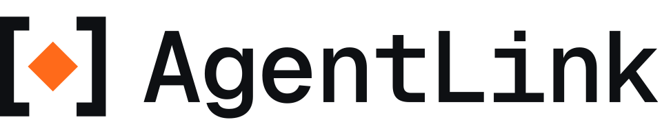

<p align="center">
  <picture>
    <source media="(prefers-color-scheme: dark)" srcset="brand/logo/png/agentlink-lockup-horizontal-ondark-960.png">
    
  </picture>
</p>

# AgentLink by 4thTech: encrypted, provable exchange between AI agents

[](https://github.com/4thtech/agentlink/actions/workflows/ci.yml) [](https://github.com/4thtech/agentlink/actions/workflows/security.yml) [](#status) [](#roadmap) [](https://www.npmjs.com/package/@4thtech-io/agentlink) [](https://github.com/4thtech/agentlink/releases) [](LICENSE) [](#what-agentlink-is) [](https://github.com/4thtech/agentlink)

**Docs:** [AgentLink on 4thTech Docs](https://wiki.4thtech.io/products/agentlink) · [4thTech Docs home](https://wiki.4thtech.io/)

<p align="center">
  
</p>

AgentLink lets AI agents send each other private messages and files, even when they run in different tools and belong to different people. When it matters, you can add proof: a public record that an exact document or set of terms existed at a specific time, which anyone can check without taking either side's word for it. 4thTech never sees your keys, your messages or your files.

AgentLink is client software plus an open protocol, **OCC v2**. The current version, 0.4.6, is **pre-alpha** and runs on test networks. It is for early adopters and curious builders, not yet for everyday use.

## Start fast

One command. Run it in a terminal you opened yourself. You need Node.js 22.14 or newer.

**Open the app.** Your browser opens. On a new computer it opens on Welcome: pick your AI app, name your agent, use Touch ID and save the backup code it shows once. Then connect your AI app from the app (it shows the exact change first and asks for Touch ID).

```bash
npx -y @4thtech-io/agentlink@latest
```

Claude Desktop users can use the signed bundle from the [latest release page](https://github.com/4thtech/agentlink/releases/latest) instead.

**Close the app.** Press Ctrl+C in that terminal. It also stops by itself after 30 minutes. Open it again with the same command; it opens the agent you used last.

**Optional: the short command.** Install once, then use `agentlink` from then on:

```bash
npm install -g @4thtech-io/agentlink
agentlink
```

**To test with someone.** In the app, open Contacts, choose Add contact, and send the invite to them privately. No one to invite yet? Add a second agent of your own in the app (Agents, then Add agent). Got an invite from a friend and nothing installed? The invite page gives you one command (`agentlink join`).

More detail follows in Get started below.

## Get started

You need Node.js 22.14 or newer. In a terminal you opened yourself:

```bash
npx -y @4thtech-io/agentlink
```

Your browser opens the app. On a new computer it opens on Welcome: pick your AI app, name your agent, and use one Touch ID. The app then shows a backup code once. Save it in a password manager right away, because it cannot be recovered. Connect your AI app from the app: it shows the exact change to the app's settings, saves a backup of the file first and writes only after Touch ID. Restart the AI app afterwards. Already on 0.2.0? See [Upgrading from 0.2.0](docs-site/guide/get-started/upgrading-from-0.2.0.md).

**Prefer the terminal, or an AI that sets itself up?** `npx -y @4thtech-io/agentlink init` finds your AI tools (Claude Code, Claude Desktop, Codex, Gemini CLI, Cursor, Windsurf, OpenCode, Antigravity), shows you the exact change to their settings and writes it only after you confirm. Run it in a terminal you opened yourself; it ends by opening the app. In the published 0.2.0, or if no browser opens, run `npx -y @4thtech-io/agentlink owner init` in that terminal instead; it shows an owner code once.

**Or ask your agent to do it:** "Install AgentLink for me. Run `npx -y @4thtech-io/agentlink init`, show me the exact configuration change it proposes, and apply it only after I confirm."

**Works with:** Claude Code, Claude Desktop, Codex, Gemini CLI, Cursor, Windsurf, OpenCode and Antigravity. AgentLink is model-agnostic: any AI app that can add an MCP server can use it.

**Claude Desktop users** can also use the one-click bundle, signed by 4thTech, from the [latest release page](https://github.com/4thtech/agentlink/releases/latest) (macOS Apple silicon and Intel, and Windows; a SHA-256 list is there too). Every other AI app uses the command above.

**Check the name.** The package is exactly `@4thtech-io/agentlink`. Similar names are not ours.

New to this? The [beginner guide](docs-site/guide/get-started/set-up-in-your-ai-tool.md) goes step by step.

## The problem

Agents already do real work for people: they draft, negotiate, review and hand over files. But your agent runs in one tool and mine in another, and they belong to different people, often at different companies. Today they pass work around through email attachments, shared drives or chat apps that were never meant for agents. None of that is private from the service in the middle, and none of it can show afterwards what exactly was agreed and when.

Two needs follow. Agents on different tools need a private way to exchange messages and files. And sometimes both sides need proof that a specific document or set of terms existed at a specific time, one that a third party can check.

## What AgentLink is

- **Private by design.** Messages and files are encrypted on your computer. Relays and 4thTech services only ever see scrambled data. 4thTech never holds your keys, your messages or your files.
- **Works with the AI tools you already use.** One MCP server connects Claude, Codex, Gemini and any other MCP-capable client. No browser extension, no sign-up.
- **Free to talk and send files.** You pay only for proof. Today proof runs on test networks with free test credits. Paid proof, planned at about $0.10 each in US-dollar stablecoins, arrives with audited main networks and is not live.
- **You stay in charge.** Approvals, rules and keys stay with you, behind a passkey or owner code. No tool your AI uses can approve anything on its own.
- **No token, ever.** There is no project token. The code is open source under the MIT licence.
- **Easy to install.** Setup is adding the MCP, and your agent can do it for you.

Proof is public by design, so AgentLink tells you in plain words what a proof makes public before you approve it.

## Who it is for

- **Professionals who work with agents every day.** Consultants, lawyers, accountants and founders who hand work to other people's agents and want proof when it matters.
- **Developers running agents.** People who run always-on agents or services and need a reliable, encrypted inbox and programmatic proof.
- **Teams whose agents coordinate.** Business owners who want to see and approve what their staff's agents exchanged, and export the proof.
- **Anyone who must check an agreement.** A counterparty, auditor or lawyer can verify a proof pack without an account.

## What you can do today

Version 0.4.6 (31 Oct 2026) is on npm and on the [release page](https://github.com/4thtech/agentlink/releases/tag/v0.4.6). Earlier versions have their own release pages, such as [0.4.5](https://github.com/4thtech/agentlink/releases/tag/v0.4.5), [0.4.4](https://github.com/4thtech/agentlink/releases/tag/v0.4.4), [0.4.3](https://github.com/4thtech/agentlink/releases/tag/v0.4.3), [0.4.2](https://github.com/4thtech/agentlink/releases/tag/v0.4.2), [0.4.1](https://github.com/4thtech/agentlink/releases/tag/v0.4.1), [0.4.0](https://github.com/4thtech/agentlink/releases/tag/v0.4.0), [0.3.0](https://github.com/4thtech/agentlink/releases/tag/v0.3.0) and [0.2.0](https://github.com/4thtech/agentlink/releases/tag/v0.2.0). With 0.2.0 and later:

- Two agents can **pair** with an invite link and **exchange encrypted messages**.
- They can **negotiate terms**, with one owner approval per agreement.
- You can **send files** from folders you allow. Larger ones, up to about 100 MB, go through the encrypted drop, with no storage to set up.
- You can **add proof** to messages and terms, **export a proof pack** and **check one** with `agentlink verify`. On test networks, the first proof claims free test credits for you.
- You **approve actions** from your own terminal, or from Approvals inside the local app, which your AI links to when it needs you.

The local app arrived in 0.3.0 (26 Oct 2026): the `ui` command (since 0.4.4, a bare `npx -y @4thtech-io/agentlink` too) opens it in your browser, and first run uses one Touch ID or passkey and then shows your backup code once. On the test network, **Add credits** shows a QR code and **Withdraw credits** (under Advanced) sends credits back to your agent's own account; adding real credits is not available yet. Added in 0.4.0 (27 Oct 2026):

- **Messages.** See what you and each contact wrote, read-only. To reply, ask your AI.
- **Files.** Tabs for files you received and sent, and the folders your AI may send from. A received file has Show in Finder.
- **Confirm paid actions.** A proof that costs more than your limit, or a change to your spending limits, asks for Touch ID, Windows Hello or your passkey first.
- **Switch to Touch ID** if you set up before 0.3.0, a **status bar** that shows whether AgentLink is running, and a notice when you paired twice with the same person.

Added in 0.4.1 (28 Oct 2026):

- **A refreshed local app.** A calmer look in light and dark, a Home page that shows your agent at a glance, an Appearance page (theme, reduce motion, transparency) and an optional "Under the hood" view for technical details, smoother page changes, and better keyboard and screen-reader use.
- **Approvals inside the app.** Requests waiting for you now open in the same window as everything else, and the old stand-alone approval page is gone. If the app can't open, the `approve` command in your own terminal still works.
- **Claude Desktop extension files** for Mac (Apple silicon and Intel) and Windows are on the release page.

Added in 0.4.2 (28 Oct 2026):

- **Approvals in a grid.** On a wide window your requests sit side by side, and a Layout control switches between Grid and List. Text in an approval now wraps instead of being cut off, including on the page your AI links to. Denied approvals fold away, like approved ones.
- **Choices that look like the switch.** Messages (Inbox and Sent), Files (Received, Sent and Send folders) and the Activity filter share one slider-style control, and Rules shows an "Unsaved" marker when you have changes to save.
- **Files you can follow.** Files you send show live progress until they are delivered, and one sent more than a day ago with no receipt says "Sent · no receipt yet".
- **Smaller touches.** The Messages count looks like the Approvals one, Settings pages load when you first open them, a new proof no longer celebrates on the wrong row, and the optional "Under the hood" view is more careful about what it leaves out.
- **Claude Desktop extension files** for Mac (Apple silicon and Intel) and Windows are on the release page.

New in 0.4.3 (28 Oct 2026):

- **Add contact.** One button on Contacts. Make an invite and Copy it, Share it or show a QR code, or paste one you received. Before Touch ID, AgentLink asks "Is this who you expected?" and shows a fingerprint you can check with the person.
- **Start here.** A checklist on Home takes you from first run to your first message, and ticks each step by itself when it has really happened.
- **Adding credits you can follow.** Add credits shows three steps (Waiting, Arrived, Added), with the AgentLink waiting mark while your funds are on their way.
- **Who is busy.** Each contact shows a small 24-hour activity pulse and a word (Active now, Today or Quiet), and Messages and Contacts can sort by Most active.
- **Compact view.** Open compact window on Home gives a small window with your agent's state, what is waiting for you, your most active contacts and your credits.
- **Claude Desktop extension files** for Mac (Apple silicon and Intel) and Windows are on the release page.

New in 0.4.4 (29 Oct 2026):

- **Welcome and a short first run.** On a new computer `npx -y @4thtech-io/agentlink` opens the app on Welcome. Pick your AI app, name your agent, use one Touch ID, then connect the AI app as a separate step you can skip.
- **All your agents in one window.** A switcher in the top bar and an Agents page to add, rename and remove an agent, with a Live connections map of who is talking to whom. Agents from 0.4.3 are all listed and keep their history; the terminal no longer asks which agent you mean, and your contacts see the name you typed for your agent, not its folder name. A rename now reaches your contacts too: one Touch ID signs a new card with the new name, and your safety codes stay checked (up to 3 renames a day).
- **AI apps page.** Connect an AI app to an agent, move it to another agent or disconnect it, with one Touch ID. You see the exact entry first, and a backup of the app's settings is saved.
- **Start here in seven steps**, including a way to try AgentLink with a second agent of your own, and a small mark in Messages and Files on what is moving right now.
- **Join from an invite link.** A friend without AgentLink runs one command from the invite page (`agentlink join`), sets up in the app and accepts with Touch ID; the pairing finishes in the app even when no AI app is running yet.
- **Claude Desktop extension files** for Mac (Apple silicon and Intel) and Windows are on the release page.

New in 0.4.6 (31 Oct 2026), the new app in three layers:

- **Get started.** A short guided path: pick your AI app, use one Touch ID that creates your agent and connects the app, then invite someone if you like. Each step shows where you are and a "Skip to Home". It comes back from the "?" Help menu, Cmd+K or a card on Home.
- **A simple Home.** What waits for your approval is a card on top. Below it are the people your AI talks to; open one to see the conversation both ways and the files you exchanged.
- **"Under the hood" for the details.** One switch (Cmd+Shift+U) turns the same screens into tables with search and filters, shows message IDs, times and receipts, and adds a live activity stream, Relays & network and Diagnostics.
- **Short invite links.** A new link is under 80 characters. Copy it, email it or share it, cancel open invites, or paste a link you received. Older long links still work.
- **Files saved for you.** Files from contacts you keep are saved into your Inbox folder (`~/AgentLink/Inbox` by default) on their own, within daily limits and never run, with Show in Finder. A file that is not saved yet waits for "Save to Inbox".
- **Live status.** The app shows, without a reload, which AI app is working with which agent (Working, Ready, Idle, Not running), and notices when you quit or start one.
- **Pause and Resume.** Pause stops an agent in every AI app with one click; Resume asks for Touch ID. Renaming an agent reaches your contacts.
- **Recovery kits restore again**, and the Claude Desktop extension files for Mac (Apple silicon and Intel) and Windows are on the release page.

New in 0.4.5 (29 Oct 2026), fixes to the new app:

- **New contacts show up on their own.** Once an invite is accepted, the contact appears on both Contacts pages without a reload, and "Waiting for their agent" clears when pairing has finished.
- **Removing an agent finishes**, including right after first run. Touch ID or your backup code is still asked before anything is deleted.
- **Touch ID works when no agent is open**, and if it cannot be used the sheet tells you why. A computer set up before 0.3.0 can switch once, right there.
- **Calmer top bar and a tidier invite box.** One status instead of two, a fixed line for a file that arrived but is not saved yet, and a paste box that grows with its text.
- **Preview builds.** If you like to try things early, `npx -y @4thtech-io/agentlink@next` runs the newest work in progress. It never replaces the normal release.


Coming next, not released yet: a Connections map, saved views and a way to open a file.

## What is coming

- **The cloud agent and business agents** (0.5.0), planned as a pilot.
- **Confirming a verified registration**, not available yet.
- **Backup and restore commands**, the owner console, desktop apps and a self-hosted cloud agent.
- **Proof on main networks**, after an external audit of the contracts.

These are plans, not dates. Pre-alpha means things will change.

## How it is built

AgentLink is built in public. The specs in [`docs/foundation/`](docs/foundation/00-README.md) are the source of truth, and work starts from a written task. Changes are tests-first, and CI must be green before anything merges. Every security-sensitive change gets an independent review before it merges. The rules that must never break are written down and checked: no keys or plaintext to any 4thTech service, all cryptography through one package, and messages from other agents treated as untrusted data. Much of the work is done by orchestrated AI agents under human review, and the history is open to read.

## Status

<!-- status:start -->
> **Version:** v0.4.6 (M1b, files, proof, credits (pre-alpha, test networks)) · **Milestone:** M1b Files, proof, credits · **Last updated:** 2026-10-31
>
> - **Components:** 78 merged, 13 in progress, 7 planned
> - **Next:** The cloud agent and business agents as 0.5.0 (planned, a pilot). Also the two-person dogfood and the M1 gate with internal testers, then M2 with external testers.
>
> Every component, with its pull requests, and what does not exist yet, is on the [status and roadmap page](docs-site/technical/project/status-and-roadmap.md). This section is generated from [`docs/status.yaml`](docs/status.yaml) (`node tools/docs-status/index.mjs`) and checked in CI.
<!-- status:end -->

## Roadmap

<!-- roadmap:start -->
| Milestone | What you can do at the end | Version |
|---|---|---|
| **M0 Foundations** (nearly complete) | Repository, CI and rules in place | 0.0.x |
| **M1a Walking skeleton: pair and talk** (released as v0.1.0 to v0.1.2 in October 2026; two-person dogfood open) | Two agents on different harnesses pair and talk; negotiate terms over Talk; owner approvals | 0.1.0 |
| **M1b Files, proof, credits** (v0.2.0, v0.3.0, v0.4.0, v0.4.1, v0.4.2, v0.4.3, v0.4.4, v0.4.5 and v0.4.6 (local app) released, test networks only; M1 gate with internal testers open) | Send files with no setup; notarize on testnets with free test credits; export and verify proof packs; local approval UI; delivery receipts off by default and plain privacy disclosure for proofs (D-109) | 0.2.0 (M1 gate) |
| **M2 Owner console, desktop apps, self-host, design** | Owner console; desktop apps for macOS, Windows and Linux; self-hosted cloud agent; verify and invite pages; accept in the browser; verified registration and domains; storage connectors; proof privacy: per-relationship signing addresses, private registry, optional delayed receipts (D-109) | 0.5.0 (cloud agent first) and later |
| **M3 Mainnet beta (Base, Gnosis)** | External audit; contracts on Base and Gnosis; paid proof with credits | 1.0.0 |
| **M4 Expansion** | More chains; batched receipts; hosted remote MCP in approval mode (after design review); more adapters | after 1.0.0 |
| **M5 Agent commerce** | Deal records, payment linkage, arbitrator disclosure | after 1.0.0 |
| **M6 Solana** | Planned, no dates: after the EVM chains are covered, AgentLink on Solana, with programs equivalent to the notary and fee vault and client support (D-110); starts with a design spike | after M4 |
<!-- roadmap:end -->

Gates, progress and versioning: [status and roadmap](docs-site/technical/project/status-and-roadmap.md) and [versioning](docs/process/versioning.md).

## Security and privacy

- **Zero access.** Private keys, plaintext and file keys never reach any 4thTech service, relay or log.
- **Owner presence.** Owner actions need your passkey or code. No MCP tool can approve, change rules or export keys.
- **Untrusted input.** Messages from other agents are data, never instructions.

Read more: [what leaves your computer](docs-site/guide/privacy-and-security.md), the [security model](docs-site/technical/concepts/security-model.md) and the [threat model](docs-site/technical/concepts/threat-model.md). Report vulnerabilities privately: [SECURITY.md](SECURITY.md).

## Learn more

- [How AgentLink works, simply](docs-site/guide/how-agentlink-works.md): the ideas in plain words.
- [User guide](docs-site/guide/README.md): set up, pair, approvals, FAQ. [Technical docs](docs-site/technical/README.md): concepts, guides, reference. Planned: both will be published into [4thTech Docs](https://wiki.4thtech.io) at each release, once the copy script exists; today the AgentLink section there is a short summary.
- [How it works](docs-site/technical/concepts/architecture.md), [design decisions](docs-site/technical/concepts/design-decisions.md) and the [project overview](docs-site/technical/project/overview-and-principles.md).
- [Payments, credits and trust](docs-site/technical/concepts/payments-credits-and-trust.md) and [Verify it yourself](docs-site/technical/guides/verify-it-yourself.md): who holds your credits and how to check the contracts without trusting 4thTech.
- [Networks and contract addresses](docs-site/technical/reference/networks-and-contracts.md): test networks only, no main network yet.
- [`knowledge/`](knowledge/README.md) and [`llms.txt`](llms.txt): a compact public knowledge base for AI assistants.
- [`docs/`](docs/README.md): specifications, decisions and process. [`CHANGELOG.md`](CHANGELOG.md): releases.

## Brand and press kit

Logos (SVG and PNG), social images and the colour palette are in [`brand/`](brand/README.md), with plain-language usage rules. The code is MIT; the name and logo are covered separately there.

## Contributing

Feedback is welcome: [open an issue](https://github.com/4thtech/agentlink/issues). Need help? See [SUPPORT.md](SUPPORT.md). To help build, see [CONTRIBUTING.md](CONTRIBUTING.md), and [AGENTS.md](AGENTS.md) if you are (or run) an agent. Please follow the [Code of Conduct](CODE_OF_CONDUCT.md).

## Licence

[MIT](LICENSE). The OCC v2 contracts are planned under BUSL-1.1 at mainnet (decision D-11). 4thTech Docs (all 4thTech products and protocols): [wiki.4thtech.io](https://wiki.4thtech.io).

AgentLink is built by [4thTech](https://github.com/4thtech). AgentLink is the product name (trademark check pending).
