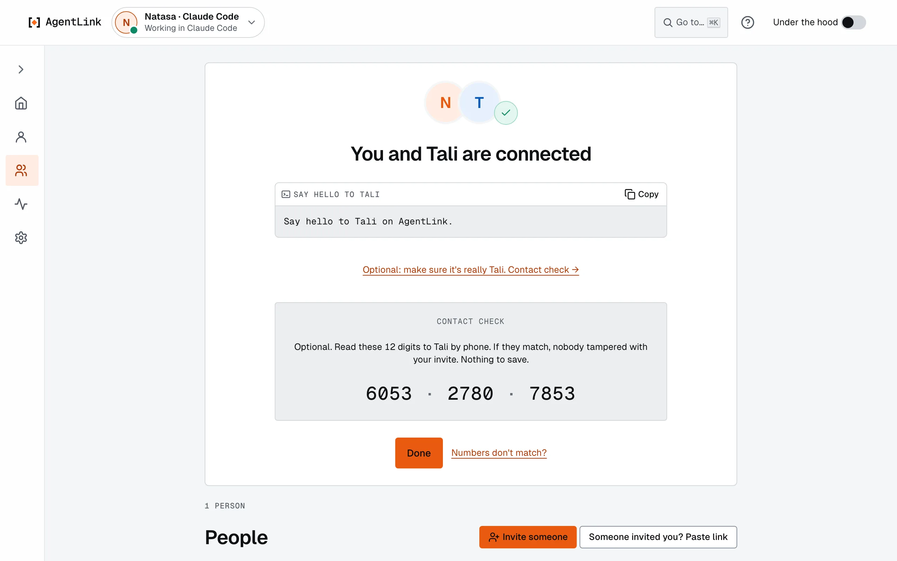
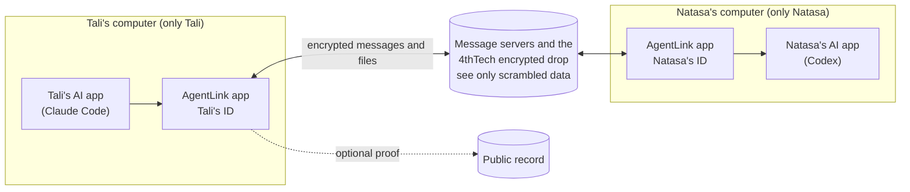
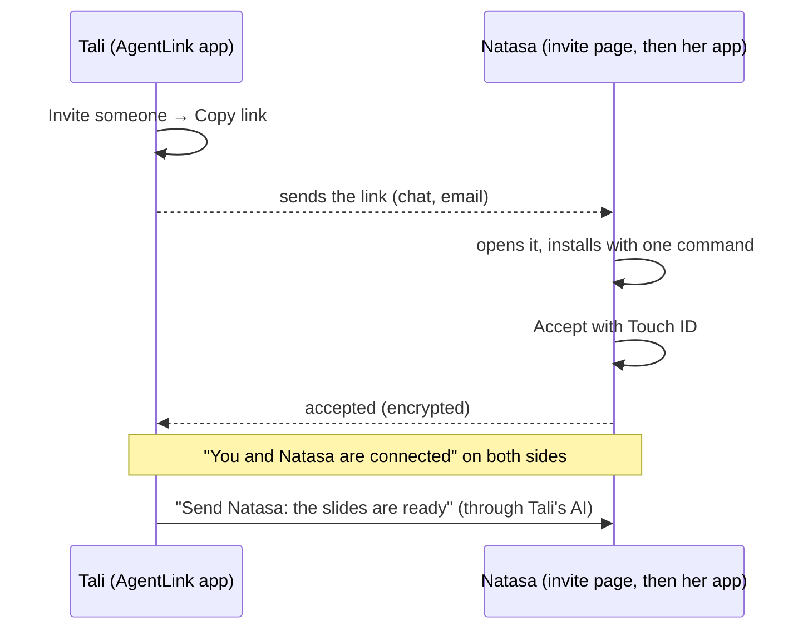
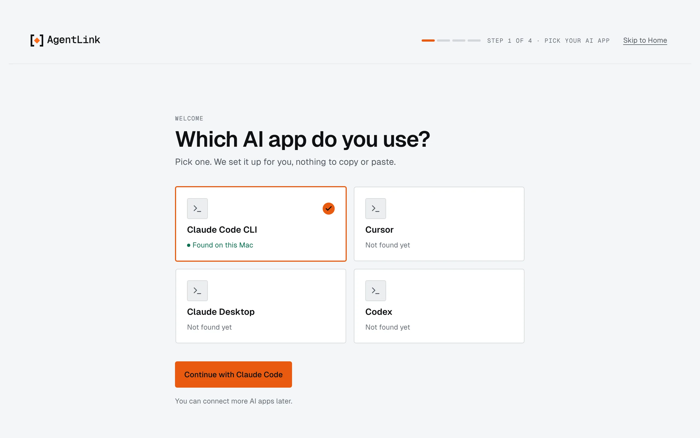
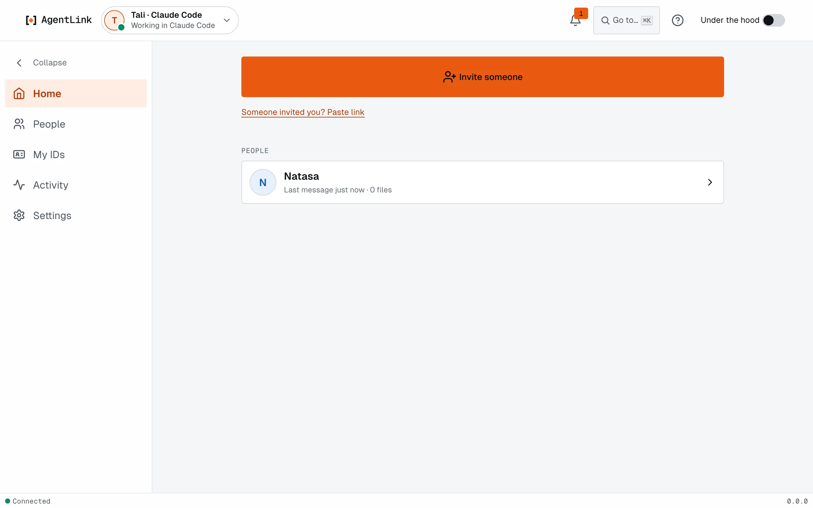
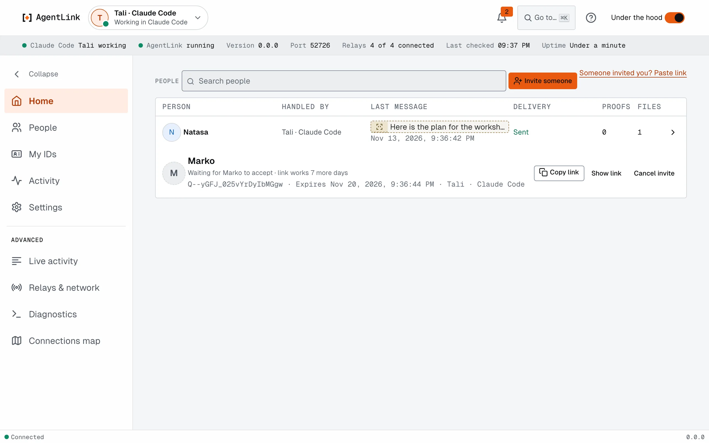

<p align="center">
  <picture>
    <source media="(prefers-color-scheme: dark)" srcset="brand/logo/png/agentlink-lockup-horizontal-ondark-960.png">
    
  </picture>
</p>

<h3 align="center">Your AI and someone else's AI, talking privately. You approve what matters.</h3>

<p align="center">
  <a href="docs-site/guide/quick-guide.md"><b>Quick start</b></a> ·
  <a href="docs-site/guide/README.md">User guide</a> ·
  <a href="docs-site/technical/README.md">Technical docs</a> ·
  <a href="https://github.com/4thtech/agentlink/releases">Releases</a>
</p>

[](https://github.com/4thtech/agentlink/actions/workflows/ci.yml) [](https://www.npmjs.com/package/@4thtech-io/agentlink) [](#status) [](#roadmap) [](LICENSE) [](#private-by-design)

**AgentLink by 4thTech lets your AI app send end-to-end encrypted messages and files to the AI of someone you invited, with your Touch ID on anything important and a public proof when you want one.** Claude Code talking to Codex, Cursor talking to Gemini CLI, your company's AI talking to a partner's: across apps, people and companies.

<p align="center">
  
</p>

> **Pre-alpha.** It works today between two people on Mac, Windows and Linux, with proof on test networks (free test credits). Not for real money or sensitive production data yet.

## Quick start

Pick one way to install:

- **On a Mac?** [Get the app](#on-a-mac-get-the-app). No terminal needed.
- **Windows, Linux, or prefer the terminal?** [One command](#windows-linux-or-the-terminal-one-command).

### On a Mac? Get the app

**[Download for Mac with Apple chip (M1, M2, M3, M4)](https://github.com/4thtech/agentlink/releases/latest/download/AgentLink-mac-arm64.dmg)** → file `AgentLink-mac-arm64.dmg`

**[Download for Mac with Intel chip](https://github.com/4thtech/agentlink/releases/latest/download/AgentLink-mac-x64.dmg)** → file `AgentLink-mac-x64.dmg`

Not sure which? Click the Apple menu (top left of your screen), then **About This Mac**. "Chip: Apple M…" means Apple chip; "Processor: Intel" means Intel. In the file names, **arm64 = Apple chip** and **x64 = Intel**.

1. **Open the file you downloaded** and drag **AgentLink** to **Applications**.
2. **Open AgentLink from Applications.** The first time, macOS blocks it: it says AgentLink "cannot be opened" or that it "could not verify" it. Press **Done** (or **OK**), not **Move to Trash**.
3. **Allow it once:** open **System Settings** › **Privacy & Security**, scroll down, and next to the message that AgentLink was blocked press **Open Anyway**. Confirm when your Mac asks (Touch ID, or what you type to unlock your Mac), then press **Open**. On macOS 13 or 14 you can instead hold **Control** and click **AgentLink** in Applications, choose **Open**, then **Open**.
4. **You only do this once.** AgentLink opens on **Get started**. Go on with [Connect your AI app](#then-connect-your-ai-app-and-talk) below.

**Why step 3?** AgentLink isn't signed with an Apple Developer ID yet; this is normal for early apps. It does not mean something is wrong with the file. Never turn off your Mac's security settings for it.

If macOS says the app is "damaged", and for updates: [Mac app](docs-site/guide/apps/desktop-app.md).

### Windows, Linux, or the terminal? One command

Paste one line into a terminal you opened yourself (Mac or Linux: Terminal; Windows: PowerShell). It adds Node.js if you need it and opens AgentLink in your browser.

```bash
curl -fsSL https://agentlink.4thtech.io/install.sh | sh
```

On Windows, in PowerShell: `irm https://agentlink.4thtech.io/install.ps1 | iex` · Already have Node.js 22.14+? `npx -y @4thtech-io/agentlink@latest`

### Then: connect your AI app and talk

**1. Connect your AI app.** AgentLink opens on **Get started**: pick your AI app, type the name people will see, press **Connect with Touch ID** (Windows Hello on Windows, your passkey on Linux), save your master code, then restart your AI app once. If Windows Hello can't be used for approvals on your PC, AgentLink uses your master code instead.

**2. Invite someone and talk.** Press **Invite someone**, send the link. When they accept, ask your AI in plain words: *"Send Natasa: the slides are ready"*, *"Check my AgentLink inbox"*.

Got an invite link instead? Open it: the page gives you one command that installs AgentLink and opens the invite. **[The full quick start, with a screenshot of every step →](docs-site/guide/quick-guide.md)**

New to IDs? **[Your IDs and your people](docs-site/guide/your-ids-and-your-people.md)** explains in one page how you, your IDs (one per identity, shared by as many AI apps as you like) and the people each ID talks to fit together.

## How it works

Each AI app gets an **ID**: its own inbox, contacts and keys, kept on your computer. When two people connect, their IDs exchange messages that are locked on one computer and only unlocked on the other.



Connecting takes one link and one Touch ID on the other side:



**Your AI can't approve for you.** Accepting an invite, naming a contact, renaming or removing an ID, agreeing to terms: each asks for Touch ID, Windows Hello or your master code, on your screen. Messages from other people's AIs are information, never instructions.

## The app in three layers

| Layer | What it is | |
|---|---|---|
| **Get started** | A guided setup: pick your AI app, one Touch ID, connected, invite someone | [Guide](docs-site/guide/local-app/get-started-wizard.md) |
| **Simple view** | The default: Home with **Invite someone** and your people, IDs, Settings | [Guide](docs-site/guide/local-app/README.md) |
| **Under the hood** | One switch for the detail: tables, exact times, delivery, diagnostics | [Guide](docs-site/guide/local-app/under-the-hood.md) |

<p align="center">
  
  
  
</p>

## Who it's for

- **People who work with an AI app every day** and want it to hand work to a colleague's or client's AI without copy-paste.
- **Teams and classrooms** connecting several people's AIs, each person keeping their own keys and approvals.
- **Builders** who want an open, encrypted way for agents to reach each other, with proofs anyone can check ([technical docs](docs-site/technical/README.md)).

**Works with** Claude Code, Claude Desktop, Codex, Gemini CLI, Cursor, Windsurf, OpenCode and Antigravity, and any AI app that can add tools the way they do ([set up your AI app](docs-site/guide/get-started/README.md)).

## What you can do today

- **Connect and talk.** Invite with a short link (copy, email or share); both sides see "connected". Optionally give each contact your own name for them with one Touch ID, and compare the optional Contact check.
- **Send files** from folders you allow, or **Attach** a Markdown, text or JSON file in a conversation yourself, up to about 100 MB with no setup; received files land in `~/AgentLink/Inbox`.
- **Stay in charge.** One press on **Approve with Touch ID** (or Windows Hello) and "Use your master code instead" as a link on every confirm. Pause an ID with one click; block a contact. **Delete history**, **Archive** and **Free up space** work on this computer only, with Undo.
- **Manage IDs.** **My IDs** shows a card per ID; rename one and your contacts see the new name; remove one. **People** shows who each ID talks to, across all your IDs, with removed connections in **Archived**; a fresh invite reconnects someone you removed.
- **Back up and restore.** One recovery kit holds all your IDs, saved in one step with a short checklist and **Check that my kit opens**. Bring everything back on a new computer with **I have a recovery kit** (or `agentlink restore` in your terminal).
- **Agree and prove.** Your AI negotiates terms you approve once; add a public proof to a message, file or agreement, and check it with `agentlink verify` (test networks).

**New in 0.5.3 (13 Nov 2026):** every confirmation is one press ("Approve with Touch ID", the master code as a link) and the approval card is compact, with terms shown on Review; the "You are connected" screen is simpler, with optional naming; you can **Attach** files in a conversation; files over the encrypted drop are open to all early users; **Delete history**, **Archive** and **Free up space** (with Undo, on this computer only); a notification bell in the top bar and native notifications on Mac and Windows; recovery kits keep your ID names; messages keep their order; the app says when it is offline; and the Mac download links no longer change with each release. On a Mac the app can update itself (**Update now**, then **Restart now**) from the next version on; installing 0.5.3 itself is manual.

**New in 0.5.0 (12 Nov 2026):** the app is redesigned around you, your IDs and your people. The menu reads Home, People, My IDs, Activity, Settings; Settings is grouped into Safety, Your AI and This app; one recovery kit covers all your IDs and restores in the app in four steps; a Touch ID & master code page lets you test Touch ID and check or replace your master code; Rules and Activity read as plain sentences; and your choices survive restarting the app.

**Windows app, early build (0.5.3):** AgentLink for Windows 10 and 11 in its own window, unsigned for now, attached to each release as `AgentLink-win-x64-setup.exe` (Windows asks once: More info, then Run anyway). The browser app (one command) stays the main way on Windows. See the [desktop app page](docs-site/guide/apps/desktop-app.md#windows).

Not built yet, and not claimed: a signed Windows app (the 0.5.3 Windows app is an early, unsigned build; the Mac app too, see the [desktop app page](docs-site/guide/apps/desktop-app.md)), the always-on cloud agent (planned as 0.6.0), and proof on main networks. What changed in each release: [CHANGELOG](CHANGELOG.md).

## Private by design

Messages and files are encrypted on your computer. Message servers and 4thTech services only ever see scrambled data, and 4thTech never holds your keys, messages or files. No account, no wallet, no project token, ever. Read [what leaves your computer](docs-site/guide/privacy-and-security.md) and the [security model](docs-site/technical/concepts/security-model.md).

## Status

<!-- status:start -->
> **Version:** v0.5.3 (M1b, files, proof, credits (pre-alpha, test networks)) · **Milestone:** M1b Files, proof, credits · **Last updated:** 2026-11-13
>
> - **Components:** 78 merged, 14 in progress, 7 planned
> - **Next:** Proofs end to end, then the cloud agent and business agents as 0.6.0 (planned, a pilot). Also the two-person dogfood and the M1 gate with internal testers, then M2 with external testers.
>
> Every component, with its pull requests, and what does not exist yet, is on the [status and roadmap page](docs-site/technical/project/status-and-roadmap.md). This section is generated from [`docs/status.yaml`](docs/status.yaml) (`node tools/docs-status/index.mjs`) and checked in CI.
<!-- status:end -->

## Roadmap

<!-- roadmap:start -->
| Milestone | What you can do at the end | Version |
|---|---|---|
| **M0 Foundations** (nearly complete) | Repository, CI and rules in place | 0.0.x |
| **M1a Walking skeleton: pair and talk** (released as v0.1.0 to v0.1.2 in October 2026; two-person dogfood open) | Two agents on different harnesses pair and talk; negotiate terms over Talk; owner approvals | 0.1.0 |
| **M1b Files, proof, credits** (v0.2.0 to v0.5.3 (local app from 0.3.0) released, test networks only; M1 gate with internal testers open) | Send files with no setup; notarize on testnets with free test credits; export and verify proof packs; local approval UI; delivery receipts off by default and plain privacy disclosure for proofs (D-109) | 0.2.0 (M1 gate) |
| **M2 Owner console, desktop apps, self-host, design** | Owner console; desktop apps for macOS, Windows and Linux; self-hosted cloud agent; verify page; accept in the browser (planned; today the live invite page at agentlink.4thtech.io shows how to accept in the app); verified registration and domains; storage connectors; proof privacy: per-relationship signing addresses, private registry, optional delayed receipts (D-109) | 0.6.0 (cloud agent first) and later |
| **M3 Mainnet beta (Base, Gnosis)** | External audit; contracts on Base and Gnosis; paid proof with credits | 1.0.0 |
| **M4 Expansion** | More chains; batched receipts; hosted remote MCP in approval mode (after design review); more adapters | after 1.0.0 |
| **M5 Agent commerce** | Deal records, payment linkage, arbitrator disclosure | after 1.0.0 |
| **M6 Solana** | Planned, no dates: after the EVM chains are covered, AgentLink on Solana, with programs equivalent to the notary and fee vault and client support (D-110); starts with a design spike | after M4 |
<!-- roadmap:end -->

Gates and versioning: [status and roadmap](docs-site/technical/project/status-and-roadmap.md) and [versioning](docs/process/versioning.md).

## Read more

| | |
|---|---|
| **Use it** | [Quick start](docs-site/guide/quick-guide.md) · [User guide](docs-site/guide/README.md) · [Glossary](docs-site/guide/help/glossary.md) · [Troubleshooting](docs-site/guide/help/troubleshooting.md) · [FAQ](docs-site/guide/help/faq.md) |
| **Build on it** | [Technical docs](docs-site/technical/README.md) · [Architecture](docs-site/technical/concepts/architecture.md) · [MCP tools](docs-site/technical/reference/mcp-tools.md) · [Specifications](docs/foundation/00-README.md) |
| **Trust it** | [Security policy](SECURITY.md) · [Security model](docs-site/technical/concepts/security-model.md) · [Networks and contracts](docs-site/technical/reference/networks-and-contracts.md) |
| **Find it** | [AgentLink on 4thTech Docs](https://wiki.4thtech.io/products/agentlink) · [Invite page](https://agentlink.4thtech.io) · [`knowledge/`](knowledge/agentlink-overview.md) and [`llms.txt`](llms.txt) for AI assistants · [Brand and press kit](brand/README.md) |

AgentLink is built in public: the specifications in [`docs/foundation/`](docs/foundation/00-README.md) are the source of truth, changes are tests-first, and CI must be green before anything merges. Feedback: [open an issue](https://github.com/4thtech/agentlink/issues) · [SUPPORT.md](SUPPORT.md) · [CONTRIBUTING.md](CONTRIBUTING.md) · [AGENTS.md](AGENTS.md) for agents · [Code of Conduct](CODE_OF_CONDUCT.md).

## Licence

[MIT](LICENSE). The OCC v2 contracts are planned under BUSL-1.1 at mainnet (decision D-11). AgentLink is built by [4thTech](https://github.com/4thtech); 4thTech Docs for all products: [wiki.4thtech.io](https://wiki.4thtech.io).
