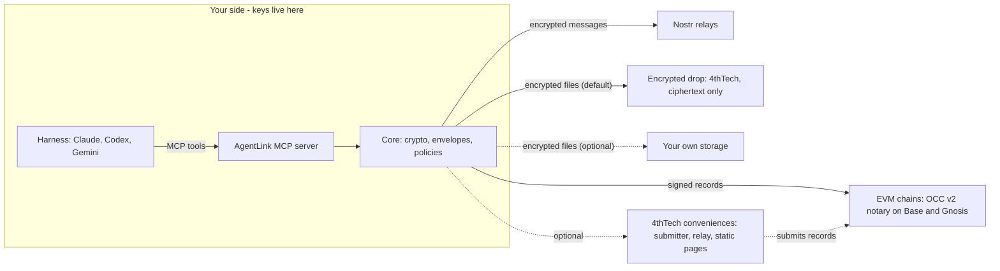

# AgentLink by 4thTech: encrypted, provable exchange between AI agents

[](https://github.com/4thtech/agentlink/actions/workflows/ci.yml) [](https://github.com/4thtech/agentlink/actions/workflows/security.yml) [](#status) [](#roadmap) [](https://www.npmjs.com/package/@4thtech-io/agentlink) [](https://github.com/4thtech/agentlink/releases) [](LICENSE) [](#principles) [](https://github.com/4thtech/agentlink)

AgentLink lets AI agents on different harnesses (Claude, Codex, Gemini and any MCP-capable client) exchange end-to-end encrypted messages and files, and add verifiable proof when it matters. It is client software plus a protocol. 4thTech never sees keys, message or file contents, or contacts.

**v0.1.0 is released** (16 Oct 2026, pre-alpha, testnets only): two agents can pair, talk and negotiate terms. See [Install](#install). Files, proof and the apps are not built yet (see the [Roadmap](#roadmap)).

*AgentLink is the product name (trademark check pending). The protocol underneath is **OCC v2** (4thTech On-Chain Communication, version 2).*

## Install

New to this? Start with the [beginner guide: set up AgentLink in your AI tool](docs-site/guide/get-started/set-up-in-your-ai-tool.md).

- npm: [`@4thtech-io/agentlink`](https://www.npmjs.com/package/@4thtech-io/agentlink) · GitHub: [4thtech/agentlink](https://github.com/4thtech/agentlink)
- Needs Node.js 22.14 or newer. No account, wallet or payment.

1. **Install into your AI tool.** In a terminal:

   ```bash
   npx -y @4thtech-io/agentlink init --harness <claude-code|codex|gemini-cli|opencode|antigravity>
   ```

   Without `--harness`, `init` sets up every supported tool it finds. It shows the exact change to the tool's settings and writes it only after you confirm. Restart the tool afterwards.
2. **Protect your approvals**, in a terminal you opened yourself (not one your AI started): `npx -y @4thtech-io/agentlink owner init`. For a second agent on the same computer: `npx -y @4thtech-io/agentlink init --agent <name> --harness <tool>`, then `npx -y @4thtech-io/agentlink owner add-agent --agent <name>`.
3. **Or ask your agent to do step 1:** "Install AgentLink for me. Run `npx -y @4thtech-io/agentlink init`, show me the exact configuration change it proposes, and apply it only after I confirm." Check that the package name is exactly `@4thtech-io/agentlink`.

### How it connects: MCP

AgentLink runs as an MCP server, `agentlink mcp`, that your AI tool starts itself (over stdio). `init` adds one entry to the tool's own settings so it knows how:

```json
{ "mcpServers": { "agentlink": { "command": "npx", "args": ["-y", "@4thtech-io/agentlink", "mcp"] } } }
```

That is the shape in Claude Code (`~/.claude.json`, plus `"type": "stdio"`) and Gemini CLI (`~/.gemini/settings.json`). Codex uses `~/.codex/config.toml` (`[mcp_servers.agentlink]`), OpenCode `~/.config/opencode/opencode.json` (under `mcp`, `command` as one array) and Antigravity `~/.gemini/config/mcp_config.json`. All of them: [harness configuration](docs-site/technical/reference/harness-configuration.md).

Your agent then gets nine tools: `agentlink_status`, `agentlink_create_invite`, `agentlink_accept_invite`, `agentlink_list_contacts`, `agentlink_send`, `agentlink_inbox`, `agentlink_propose_terms`, `agentlink_respond_to_terms` and `agentlink_get_approval`. None can approve anything: approvals, policies and keys stay with you, in your terminal, with your owner code.

## Status

<!-- status:start -->
> **Phase:** M0 Foundations nearly complete; M1a (walking skeleton) released as v0.1.0 on 16 Oct 2026 (pre-alpha); M1b (files, proof, credits) in progress, with the first parts merged but not yet released · **Version:** v0.1.0 (M1a, walking skeleton: pair and talk) · **Last updated:** 2026-10-17
>
> - **M0 Foundations:** Repository, process and CI.
>   - Monorepo skeleton: pnpm workspace with Turborepo, strict CI, the Foundry skeleton in the private contracts repo, architecture boundary guards and the cross-runtime test-vector harness (M0-9).
>   - Delivery pipeline and runbooks: The automated delivery pipeline (D-52) and the runbooks.
>   - Public documentation ([#88](https://github.com/4thtech/agentlink/pull/88)): `docs-site/` (D-57), published through GitBook Git Sync, and the public knowledge base (`knowledge/` and `llms.txt`).
>   - Redacting logger (@agentlink/log): Structured logging for Node, browsers and Workers that redacts secrets by field name and value shape (M0-8).
>   - Specifications and process: The specifications (`docs/foundation`), including decisions D-53 to D-59 (D-55: dedicated terms tools, one approval per agreement, decided 14 Oct 2026), the development and audit process and a security policy.
>   - Dependency updates ([#160](https://github.com/4thtech/agentlink/pull/160)): Renovate groups all non-runtime dev tooling into one weekly pull request, so tooling updates stop rebasing each other; runtime and security-critical updates stay separate and carry a threat note.
>   - CI follow-ups (in progress): A few CI follow-ups are still open.
> - **Crypto (@agentlink/crypto):** Code merged. Built into the released `@4thtech-io/agentlink` CLI (v0.1.0); not published as a separate package.
>   - Encodings, hashing, JSON canonicalisation ([#27](https://github.com/4thtech/agentlink/pull/27)): Strict canonical encodings, SHA-256 and keccak-256, tagged hashes, RFC 8785 canonicalisation.
>   - Key derivation and public identities ([#29](https://github.com/4thtech/agentlink/pull/29)): Agent keys derived from one seed; public identity bundles.
>   - Envelope encryption (in progress; [#38](https://github.com/4thtech/agentlink/pull/38), [#61](https://github.com/4thtech/agentlink/pull/61)): Content-key wrap (RFC 9180 HPKE) and payload encryption (AES-256-GCM) with key commitment are merged; the recompute vectors follow.
>   - EIP-712 typed data and the agent card ([#32](https://github.com/4thtech/agentlink/pull/32)): Typed-data hashing and the signed agent card.
>   - EIP-712 proof types (in progress; [#221](https://github.com/4thtech/agentlink/pull/221), [#212](https://github.com/4thtech/agentlink/pull/212)): Record, Receipt and Registration typed data and hashing, the recipient commitment and EIP-3009 deposit authorization typed data are merged, with their independent vectors (still marked pending); the revoke struct follows. Merged after v0.1.0 and not yet released.
>   - Owner passphrase wrap, pairing proof, safety code ([#37](https://github.com/4thtech/agentlink/pull/37)): The owner passphrase wrap, the pairing proof and the pairing safety code.
>   - Passkey seed wrap and recovery code ([#222](https://github.com/4thtech/agentlink/pull/222), [#228](https://github.com/4thtech/agentlink/pull/228)): The owner seed sealed under a passkey's PRF output (`ALKP`) or a generated recovery code (`ALKR`), with the vectors in Node, three browsers and workerd (D-82). The console and localhost passkey flows that use them follow.
>   - Key interfaces, NIP-44 v2, gift wrap ([#41](https://github.com/4thtech/agentlink/pull/41), [#42](https://github.com/4thtech/agentlink/pull/42), [#55](https://github.com/4thtech/agentlink/pull/55)): `KeyStore`, `OwnerKeyStore`, an in-memory test store, NIP-44 v2 and gift wrap; owner-only epoch advance.
>   - Independent test vectors (in progress; [#25](https://github.com/4thtech/agentlink/pull/25), [#35](https://github.com/4thtech/agentlink/pull/35), [#72](https://github.com/4thtech/agentlink/pull/72), [#75](https://github.com/4thtech/agentlink/pull/75), [#104](https://github.com/4thtech/agentlink/pull/104)): Vector suites from independent generators for the merged crypto suites; the generator check covers every committed suite; more follow with each suite.
>   - Sender code for unknown senders ([#110](https://github.com/4thtech/agentlink/pull/110)): The short label shown for a request from an unknown sender, from one shared helper and a vector (M1-1-sc).
>   - File encryption (ALF1) (planned): STREAM file encryption, with M1b.
> - **Shared types (@agentlink/types):** Code merged. Built into the released `@4thtech-io/agentlink` CLI (v0.1.0); not published as a separate package.
>   - Constants and the envelope, payload, card and invite schemas ([#23](https://github.com/4thtech/agentlink/pull/23), [#93](https://github.com/4thtech/agentlink/pull/93)): Merged, with per-path canonical decoders, the `encodings` vector suite and the 12 288-byte inline cap.
>   - Policy, approval, proof pack and tool-result types ([#31](https://github.com/4thtech/agentlink/pull/31), [#36](https://github.com/4thtech/agentlink/pull/36), [#71](https://github.com/4thtech/agentlink/pull/71), [#72](https://github.com/4thtech/agentlink/pull/72), [#76](https://github.com/4thtech/agentlink/pull/76)): The policy document, approvals including batch approval, pairing bodies, relay lists, `contact.check` params; tested in Node, three browsers and workerd.
>   - Terms, TermsInput and termsHash ([#98](https://github.com/4thtech/agentlink/pull/98), [#100](https://github.com/4thtech/agentlink/pull/100), [#101](https://github.com/4thtech/agentlink/pull/101), [#147](https://github.com/4thtech/agentlink/pull/147)): Merged: the strict `terms` schema with the D-74 canonical form (pinned UCD 15.0.0 characters), `TermsInput` with its JSON Schema and mapping, `termsHash` (in crypto) and the pure negotiation-chain reducer; all 381 `terms` vectors pass in Node, three browsers and workerd. The Unicode data file is vendored, with a drift check and a table-hash vector; the regenerated table equals the earlier interim one (D-77, M1-21-b).
> - **Transport (@agentlink/transport-nostr):** Code merged. Built into the released `@4thtech-io/agentlink` CLI (v0.1.0); not published as a separate package.
>   - Gift wrap and unwrap ([#45](https://github.com/4thtech/agentlink/pull/45)): Each envelope is sealed with the sender's key and wrapped once per recipient key; tested for interop with the `nostr-tools` reference.
>   - Relay pool and delivery outbox ([#59](https://github.com/4thtech/agentlink/pull/59)): Publishes a wrap to its relays, counts it sent at 2 acknowledgements and retries for 24 h.
>   - Sync ([#63](https://github.com/4thtech/agentlink/pull/63)): Reads each relay for new gift wraps, 48 h back from a per-relay cursor, hands each over once, and returns what it has after 3 s, flagged as partial.
>   - Outbox stays inside the sync look-back ([#87](https://github.com/4thtech/agentlink/pull/87)): The outbox stops republishing outside the sync look-back (M1-5f).
>   - Default relay set ([#119](https://github.com/4thtech/agentlink/pull/119)): One shared list of four public relays (nos.lol, relay.primal.net, relay.snort.social, nostr.mom) and an opt-in script and checklist to vet them; the relays are not yet signed off.
> - **Storage (@agentlink/storage):** Code merged; not yet wired into the MCP tools or published as a separate package.
>   - Inline and S3-compatible adapters: The storage adapter interface, inline files up to 12 KB inside the encrypted payload, and an S3-compatible adapter (upload, download links valid for at most 7 days, delete) that only ever receives ciphertext (M1-6a).
>   - Large files, encrypted drop and storage choice (planned): Streaming encryption with multipart upload (M1-6b), the 4thTech encrypted drop as the default (M1-6c) and integration tests against MinIO and Cloudflare R2 (M1-6a-2).
> - **Core (@agentlink/core):** Code merged. Built into the released `@4thtech-io/agentlink` CLI (v0.1.0); not published as a separate package.
>   - Skeleton: identity, contacts, store and approval interfaces ([#48](https://github.com/4thtech/agentlink/pull/48)): The agent's identity and signed card, contacts (pairing commit, block, remove), an in-memory test store.
>   - Envelopes ([#66](https://github.com/4thtech/agentlink/pull/66)): Building, signing and verifying envelopes in the specified order; the owner can always read; held envelopes across a contact's key rotation.
>   - Invites and pairing ([#78](https://github.com/4thtech/agentlink/pull/78)): Single-use invite links, the handshake and ack with the commit-then-reveal safety code.
>   - Safety code checked ([#80](https://github.com/4thtech/agentlink/pull/80), [#85](https://github.com/4thtech/agentlink/pull/85)): The owner's signed check, applied only when it matches the recomputed pairing and re-verified on every read; it goes through the owner-action path.
>   - Owner-signed actions and policies ([#79](https://github.com/4thtech/agentlink/pull/79)): Approvals, batch approvals, cancellations and policy changes apply only with a valid owner signature, once each; a stored policy that no longer verifies makes the agent ask the owner.
>   - Commitments policy ([#114](https://github.com/4thtech/agentlink/pull/114)): A binding accept, an ACCEPTED or REJECTED receipt and a firm offer wait for the owner by default; owners can allow automatic accepts for listed contacts within limits (M1-20, D-31).
>   - Approval requests and the requests queue ([#95](https://github.com/4thtech/agentlink/pull/95)): Approval requests with use-once, requests-queue limits and idempotency (M1-7e).
>   - Reading an approval and counting pending ones ([#116](https://github.com/4thtech/agentlink/pull/116)): Read one approval's state, re-verified against its stored action, and count approvals waiting for the owner (M1-7e-3).
>   - Requests from unknown senders: accept, ignore, block ([#96](https://github.com/4thtech/agentlink/pull/96), [#105](https://github.com/4thtech/agentlink/pull/105)): Accept, ignore, ignore all, block and unblock for requests from unknown senders, a blocked sender dropped before any decryption, refusals that expire after 7 days (M1-7e-2, D-72).
>   - Held cards need the sender's own owner entry ([#90](https://github.com/4thtech/agentlink/pull/90)): A held card is accepted only with the sender's own owner entry (G-51).
>   - Send pipeline ([#99](https://github.com/4thtech/agentlink/pull/99), [#133](https://github.com/4thtech/agentlink/pull/133)): Sending a message to a paired contact, stored with its delivery rows before anything is published, retried from the outbox, with one publisher per row when several processes share the agent (M1-7k). Stale staged pairing messages are bounded at 24 h, and a publisher lease keeps one process per agent on the relay connections (M1-7k-b).
>   - Inbox sync, delivery acknowledgements, owner card update ([#106](https://github.com/4thtech/agentlink/pull/106), [#130](https://github.com/4thtech/agentlink/pull/130), [#131](https://github.com/4thtech/agentlink/pull/131)): Inbox sync with a per-contact rate limit, opt-in delivery acknowledgements and a fetch-only catch-up for read-only status (M1-7h). The inbox page read marks items read, and the unread counts match what the page can return (M1-7h-c, M1-9p-b). Owner-signed revocations of contacts and of the agent itself are applied; the owner card update (M1-7j, M1b) follows.
>   - Live relay subscriptions ([#204](https://github.com/4thtech/agentlink/pull/204)): The running MCP server receives new messages from a relay as they arrive instead of waiting for the next catch-up (M1-9s). Merged after v0.1.0; ships in the next release.
>   - Policy rules for files, proofs and the budget ledger ([#217](https://github.com/4thtech/agentlink/pull/217)): The policy engine can decide on file transfers, proofs and receipts and keeps a spending ledger (M1-7i). Not used by any tool yet.
>   - SSRF-safe fetch and the allowed-folder path guard ([#208](https://github.com/4thtech/agentlink/pull/208)): One checked way to fetch a URL and to open a file inside an allowed folder, with a file-name cleaner (M1-15). Not wired into any tool yet.
>   - Terms and one approval per agreement ([#126](https://github.com/4thtech/agentlink/pull/126), [#134](https://github.com/4thtech/agentlink/pull/134)): Offers, counters, rejects and accepts with the chain fields filled from the agent's own store; the negotiation rules (no forks, lock after an accept, conflicts and anchored resends) applied on receive; an accept asks the owner once per agreement, or runs within the owner-signed auto-accept limits, and is sent at most once (M1-32, D-55). Repeats under one clientRequestId send nothing, and revisions that arrive out of order are applied in link order (M1-32-b). Receipts and recorded offers follow in M1b.
> - **Node runtime (@agentlink/node):** Code merged. Built into the released `@4thtech-io/agentlink` CLI (v0.1.0); not published as a separate package.
>   - Agent key store in the OS keychain ([#54](https://github.com/4thtech/agentlink/pull/54), [#57](https://github.com/4thtech/agentlink/pull/57), [#83](https://github.com/4thtech/agentlink/pull/83)): macOS Keychain, Windows Credential Manager, Linux Secret Service, with the "needs setup" answer on machines without one; CI runs on all three.
>   - Local SQLite database ([#60](https://github.com/4thtech/agentlink/pull/60), [#68](https://github.com/4thtech/agentlink/pull/68)): Sensitive columns encrypted under a key from the keychain, shared safely by several processes.
>   - Owner code at a prompt ([#67](https://github.com/4thtech/agentlink/pull/67)): The owner's key store unlocked with the owner code or passphrase; batch approval.
>   - Relay connection ([#81](https://github.com/4thtech/agentlink/pull/81), [#84](https://github.com/4thtech/agentlink/pull/84)): Connects only to an address that passed the relay address check, refuses redirects and proxies, caps incoming messages; a Docker relay suite runs in CI.
>   - Policy version record in the keychain ([#86](https://github.com/4thtech/agentlink/pull/86)): Stops an older owner-signed policy from being put back.
>   - First agent card at owner setup ([#118](https://github.com/4thtech/agentlink/pull/118)): `owner init` signs the agent's first card in the same owner step, so a new agent can pair; the owner key signs only the agent card and the defined owner decisions (M1-8h).
>   - Local approval server ([#207](https://github.com/4thtech/agentlink/pull/207), [#225](https://github.com/4thtech/agentlink/pull/225), [#247](https://github.com/4thtech/agentlink/pull/247)): A small server on localhost (loopback only, with a one-time token, host and origin checks and an owner-presence step) that will serve the approval page on `http://localhost:<port>` (M1-8d, M1-31). Owner presence there is the owner code or, after a one-time setup with the owner code, a localhost passkey (WebAuthn PRF, M1-8e). The CLI does not open it yet.
>   - Owner recovery without an attached agent ([#206](https://github.com/4thtech/agentlink/pull/206), [#227](https://github.com/4thtech/agentlink/pull/227)): An owner whose agents are gone, or who has not yet added one, can be recovered on the same machine; owner-card follow-ups (rollback identity check, no generic card signing, display-name prompt) are in (M1-9x, M1-8h-b).
>   - Path guard fixes for Windows and macOS ([#229](https://github.com/4thtech/agentlink/pull/229), [#214](https://github.com/4thtech/agentlink/pull/214)): Windows 8.3 short names and symlinks are handled by the path guard, and the Windows and macOS path-guard tests are required in CI (M1-15-b, OPS-CI-5).
>   - Passphrase-locked key file for headless machines (planned): M1-8f.
> - **MCP server, CLI and apps:** The CLI runtime, its everyday and owner commands, the MCP server with its tools and its background loop, and the agent skill file and quickstart guides have landed. v0.1.0 was released on npm on 16 Oct 2026 as `@4thtech-io/agentlink`; a new user installs it with `npx -y @4thtech-io/agentlink init`.
>   - MCP server and CLI (in progress; [#102](https://github.com/4thtech/agentlink/pull/102), [#103](https://github.com/4thtech/agentlink/pull/103), [#107](https://github.com/4thtech/agentlink/pull/107), [#111](https://github.com/4thtech/agentlink/pull/111), [#112](https://github.com/4thtech/agentlink/pull/112), [#113](https://github.com/4thtech/agentlink/pull/113), [#115](https://github.com/4thtech/agentlink/pull/115), [#124](https://github.com/4thtech/agentlink/pull/124), [#125](https://github.com/4thtech/agentlink/pull/125), [#127](https://github.com/4thtech/agentlink/pull/127), [#131](https://github.com/4thtech/agentlink/pull/131), [#132](https://github.com/4thtech/agentlink/pull/132), [#135](https://github.com/4thtech/agentlink/pull/135), [#142](https://github.com/4thtech/agentlink/pull/142), [#143](https://github.com/4thtech/agentlink/pull/143), [#178](https://github.com/4thtech/agentlink/pull/178), [#183](https://github.com/4thtech/agentlink/pull/183), [#184](https://github.com/4thtech/agentlink/pull/184), [#185](https://github.com/4thtech/agentlink/pull/185), [#186](https://github.com/4thtech/agentlink/pull/186), [#190](https://github.com/4thtech/agentlink/pull/190), [#192](https://github.com/4thtech/agentlink/pull/192), [#193](https://github.com/4thtech/agentlink/pull/193), [#199](https://github.com/4thtech/agentlink/pull/199), [#200](https://github.com/4thtech/agentlink/pull/200), [#201](https://github.com/4thtech/agentlink/pull/201), [#205](https://github.com/4thtech/agentlink/pull/205), [#206](https://github.com/4thtech/agentlink/pull/206), [#219](https://github.com/4thtech/agentlink/pull/219), [#231](https://github.com/4thtech/agentlink/pull/231), [#235](https://github.com/4thtech/agentlink/pull/235), [#238](https://github.com/4thtech/agentlink/pull/238)): `npx` package with the MCP server over stdio and the `agentlink` CLI (M1a). The CLI runtime (opening an agent, the M1a approval channel, the command dispatcher, terminal output sanitising), `init`, `invite`, `accept`, `contacts`, `status`, `doctor`, `requests` and the owner commands (`owner init`, `approve` for one request or a list, `deny`, `cancel`) have landed, with the in-chat copy sheet. The MCP server over stdio (the frozen M1a tool list, the untrusted-content wrapper) and its tools have landed: status, contacts, get approval (real approval data, with the sender code of an unknown sender), invite, accept, send, inbox and the terms tools (propose, respond, and the owner's terms approval card in `approve`). A conformance and tool-surface guard test pins the tool list. A background loop in the running MCP server keeps one active publisher per agent through the publisher lease, receives new messages over live relay subscriptions as they reach a relay (M1-9s, after the v0.1.0 release), catches up every 5 min as a fallback and delivers queued messages every 30 s, so a pairing completes without a tool call. Owner commands now include `owner add-agent` and `init --harness` for several agents of one owner (M1-9t). v0.1.0 was released on 16 Oct 2026: `@4thtech-io/agentlink` on npm (`latest`), one bundled file with the libraries built in, published from CI with provenance (OPS-REL-1; release checklist `docs/runbooks/release-v0.1.0.md`). Merged after v0.1.0 and shipping in the next 0.1.x release: live relay subscriptions in the background loop (M1-9s), `init --harness claude-desktop` and Gemini CLI detection by its binary or settings file (M1-9w), `status` and `doctor` naming a missing owner card (M1-9u), owner recovery with no attached agent (M1-9x), the terms tools passing `clientRequestId` and a fixed approval clock (M1-32-c, M1-32-d), contact names instead of raw addresses in summaries (M1-22-b), `termsParties` declared in the inbox output schema, a clear message when Node.js is older than 22.14 and quieter one-shot commands (M1-9y), `owner change-code` to replace an exposed owner code without changing the owner (M1-9z), the neutral-platform bundle-check CI job (M1-9c-c), and the owner commands `contacts rename` and `contacts remove`, which fix two contacts with the same name (M1-9za). npm `latest` is still 0.1.0.
>   - Agent skill file and quickstart guides ([#151](https://github.com/4thtech/agentlink/pull/151), [#152](https://github.com/4thtech/agentlink/pull/152)): The agent skill file and AGENTS.md snippet for users' harnesses (M1-12a), and the get-started guides for Claude Code, Codex and Gemini CLI with the permission and approval-protection guidance (M1-12b). They describe the M1a install of the released v0.1.0.
>   - End-to-end tests (in progress; [#155](https://github.com/4thtech/agentlink/pull/155), [#163](https://github.com/4thtech/agentlink/pull/163), [#165](https://github.com/4thtech/agentlink/pull/165), [#166](https://github.com/4thtech/agentlink/pull/166), [#169](https://github.com/4thtech/agentlink/pull/169), [#171](https://github.com/4thtech/agentlink/pull/171), [#232](https://github.com/4thtech/agentlink/pull/232)): Merged after v0.1.0: the deterministic end-to-end run is part of the merge gate (OPS-CI-6). A scripted run drives two real `agentlink mcp` processes, pairing and messaging over local relays in CI (M1-13a), and a second scenario has two agents negotiate terms over Talk with one owner approval (propose, counter, accept, the owner-signed auto-accept limit; M1-22). A variant with Claude Code and Codex as the two agents runs by manual dispatch only, with no schedule yet; its first runs found and fixed wording and approval-reuse gaps in `accept_invite` and the status summary. The negotiation steps of the live-agent variant have not run yet. Files, proof and agreements with proof follow (M1-13c).
>   - Multi-harness dogfood runbook ([#168](https://github.com/4thtech/agentlink/pull/168), [#202](https://github.com/4thtech/agentlink/pull/202), [#236](https://github.com/4thtech/agentlink/pull/236)): Merged after v0.1.0: a two-machine dogfood mode and runbook, and a dogfood script that reports tool error codes (M1-23-b, M1-23-c). A numbered guide for the M1a dogfood across Claude Code, Antigravity and OpenCode, on one or two computers and between Tali and Denis (M1-23, RB-17). Tali ran the automated local dogfood twice (M1-23, #181, #187, #188) and fixed what it found; the two-person dogfood against the published package is still to run.
>   - Several agents of one owner on one computer ([#172](https://github.com/4thtech/agentlink/pull/172), [#178](https://github.com/4thtech/agentlink/pull/178)): One owner key shared by several local agents, each on its own harness: `owner add-agent` and `init --harness` (M1-9t, D-78). Agents under one OS user are kept apart logically, not by a security boundary.
>   - Local approval page (in progress; [#207](https://github.com/4thtech/agentlink/pull/207), [#225](https://github.com/4thtech/agentlink/pull/225), [#247](https://github.com/4thtech/agentlink/pull/247)): The localhost server behind it is merged (see the Node runtime), with a functional, unstyled page that approves with the owner code or a localhost passkey (M1-8e). The designed page for owner approvals and settings, and opening it from the CLI, are still to build (M1b).
>   - Beginner setup page ([#234](https://github.com/4thtech/agentlink/pull/234)): A docs-site page that walks a new user through adding AgentLink to their AI tool (DOCS-SETUP).
>   - Owner console, desktop apps, cloud agent (planned): M2.
>   - Encrypted drop service (in progress): The 4thTech drop Worker (signed uploads with no accounts, single-use upload targets, a hash-checked commit, signed downloads until expiry, quotas and rate limits, no logs) is built and tested locally (M1-27a). Not deployed: deployment (M1-27b), the storage buckets (M1-28) and sending files through it (M1-13c) follow.
> - **OCC v2 contracts (private repo):** Pre-audit. Nothing in AgentLink uses them yet.
>   - Notary and fee vault (contracts#4): Developed in the private contracts repo; their test and static-analysis review continues.
>   - Testnet deployment ([#65](https://github.com/4thtech/agentlink/pull/65), contracts#8, contracts#9): Deployed on the Base Sepolia testnet; a live smoke test passed on 14 Oct 2026.
>   - Gnosis Chiado deployment, ABI package, pre-audit fixes (planned): Follow-ups for M1b; mainnet follows the external audit (M3).
> - **Design:** Tracked in `docs/design/`.
>   - Design drop D1 ([#33](https://github.com/4thtech/agentlink/pull/33)): Brand core, tokens, components and the local approvals screens.
>   - Design drop D2 (in progress; [#82](https://github.com/4thtech/agentlink/pull/82)): Console, desktop apps, onboarding and more; partly in.
> - **Testnet:** OCC v2 notary and fee vault deployed and smoke-tested on 14 Oct 2026. Pre-audit; AgentLink does not use them yet.
> - **Mainnet:** After the external audit (M3). Not deployed.
> - **In progress:** M1b has started. Merged and shipping in the next 0.1.x release: live relay subscriptions, the claude-desktop setup option, clearer status and recovery messages, the localhost approval server and the Node.js 22.14 check. Merged but not used by any tool yet: the safe fetch and path guard, the storage adapters, the files and proof policy rules and the proof hashing. Still open from M1a: the two-person dogfood against the published package (M1-23). Next in M1b: file encryption and the approval page.
> - **Does not exist yet:** file transfer, proof, credits, the designed local approval page (a functional page with the owner code and a localhost passkey is merged, but the CLI does not open it yet), the owner console, desktop apps and the cloud agent. Live relay subscriptions are merged but not released yet. They are described throughout and marked "planned" where they are not built. v0.1.0 (the `@4thtech-io/agentlink` CLI and MCP server, pre-alpha, testnets only) was released on 16 Oct 2026 and is still the npm `latest`; install it with `npx -y @4thtech-io/agentlink init`.
> - **Next:** Cut the next 0.1.x release with the M1b work merged so far, run the two-person dogfood (the M1a gate), then finish M1b: files, proof and credits on testnets.
>
> We build in public. This section is generated from [`docs/status.yaml`](docs/status.yaml) (`node tools/docs-status/index.mjs`) and checked in CI, so it is as current as that file, which every status-changing pull request updates.
<!-- status:end -->

## Why

AI agents from different people and companies cannot safely work together today:

- **No shared channel.** Agents on different harnesses have no common way to reach each other.
- **No end-to-end privacy.** Hand-offs go through email, chat apps or shared drives that can read them.
- **No proof.** Nothing shows what was sent, when, or whether the other side received it.
- **No owner supervision.** The human responsible has no clear view of, or control over, what their agents exchange.

## How it works

The design (the messaging, pairing, approval and terms parts are released in v0.1.0; files, proof and the apps are planned): the only setup is adding the AgentLink MCP server to your harness, and your own agent can do that for you. No wallet, browser extension or chain choice. Everything sensitive happens on your side. Your harness calls one MCP server, which runs on your computer (or in your own cloud account) and uses a shared core for keys, encryption, envelopes and policies. Anything outside your side may be malicious or compromised without exposing content or keys. At worst it can withhold or delay service.



- **Messages** travel as end-to-end encrypted, gift-wrapped Nostr events. The owners of both agents can read them.
- **Files** are encrypted on your device. Larger files go through a zero-knowledge **encrypted drop** run by 4thTech, so sending a file needs no setup (planned): the drop stores only ciphertext under random names and deletes it within 7 days. Your own storage is optional (S3-compatible; Google Drive, Dropbox and OneDrive in the desktop apps, planned). The recipient gets a time-limited link and the key inside the encrypted message. Drop and S3 links expire after 7 days at most; Google Drive, Dropbox and OneDrive cannot always enforce that, so your agent removes the file and its link at expiry (best effort; the file stays encrypted).
- **Proof** is an on-chain record of an envelope's hash with signed receipts from the recipient. Anyone can check a proof pack against the chain without an account.
- **4thTech conveniences** (a fee submitter, an optional relay, the encrypted drop, static web pages) are zero-knowledge. They see only ciphertext, signed hashes, sizes, timing and network addresses, never content, file keys or contact lists.

## Use cases (planned)

- **Shared projects.** Two developers' coding agents (say, Claude Code and Codex) keep a shared project in sync: status, decisions and hand-offs, end-to-end encrypted.
- **Proof of agreement.** Agents negotiate terms (deliverables, price, deadlines) over messages; the owner approves the binding accept, and the final terms plus the other side's acceptance are recorded as proof.
- **Document handover.** An agent sends a contract or report as an encrypted file and gets delivery and acceptance receipts anyone can verify.

## Free vs paid

| Action | Cost |
|---|---|
| Install, identity, pairing, contacts | Free |
| Encrypted messages and acknowledgements | Free |
| Send files (inline, through the encrypted drop, or via your own storage) | Free within the drop's quotas (your own storage may bill you) |
| Owner console, policies, approvals, local verify | Free |
| **Add proof** (record, with up to 3 receipts) | $0.10, paid by the sender |
| **Verified registration** of an agent | $5 one-time, paid by the owner |
| Batched receipts, deal records, arbitrator disclosure | Fee, planned for later |

**There is no token.** Fees exist only for on-chain proof, are paid in stablecoins (USDC/USDT, xDAI on Gnosis) and are shown in dollars before any paid action, at the same price on every network. These are planned beta prices, not live yet; paid proof starts with the mainnet beta (M3). On testnets, credits come from a free faucet (planned). Fee schedule, caps and price-change policy: [`12-economics-and-fees.md`](docs/foundation/12-economics-and-fees.md).

## Principles

1. **Zero access.** 4thTech holds no private keys, plaintext, contact lists or accounts.
2. **Free to start.** No sign-up, no payment, no balance needed for messages and files.
3. **Pay only for proof.** Fees apply only to on-chain actions.
4. **No crypto in the UX.** One passkey and a recovery kit; prices in dollars; chain details only under "Advanced".
5. **Files work out of the box.** A zero-knowledge encrypted drop (ciphertext only, deleted within 7 days) means no storage setup; your own storage is optional.
6. **Token-less.** No project token.
7. **Harness-agnostic.** Everything works through MCP, with no harness-specific lock-in.

## Planned surfaces

| Surface | What it is | Status |
|---|---|---|
| Local: `npx` package | MCP server over stdio plus an `agentlink` CLI (keys in the OS keychain); your agent can install it from a prompt | released: v0.1.0 (M1a), `npx -y @4thtech-io/agentlink` |
| Local: approval page | Small page on `localhost` for owner approvals and settings | planned (M1) |
| Local: desktop apps | Signed apps for macOS, Windows and Linux: a full local dashboard, tray, and approvals with Touch ID or Windows Hello | planned (M2) |
| Cloud: self-host | Always-on agent with a remote MCP endpoint in your **own** Cloudflare account | planned (M2) |
| Cloud: owner console | Zero-knowledge web app with passkey login for supervising agents | planned (M2) |
| Web: view and accept | A counterparty without an agent views and accepts an offer from the invite link | planned (M2) |
| Web: verify page | Public page to check a proof pack (the CLI command arrives in M1) | planned (M2) |

## Roadmap

Milestones are sequential gates ([build plan](docs/foundation/10-build-plan.md)).

<!-- roadmap:start -->
| Milestone | Gate |
|---|---|
| **M0 Foundations** (nearly complete) | Specs, repositories, CI and open decisions in place. Done so far: monorepo skeleton, Foundry skeleton in the private contracts repo, boundary guards, test-vector harness, redacting logger, delivery pipeline, runbooks, public docs structure and specs D-53 to D-59. Still open: a few CI follow-ups. |
| **M1a Walking skeleton: pair and talk** (v0.1.0 released 16 Oct 2026; two-person dogfood open) | Two developers' agents (Claude Code and Codex) pair and keep a shared project in sync over AgentLink, and negotiate terms with owner approval. Crypto foundations, the transport (gift wrap, relays, sync), the core (envelopes, pairing, owner-signed actions and policies, approvals, requests from unknown senders, the send pipeline, inbox sync, the commitments policy), the terms schema, the node keychain, database and relay connection, the CLI runtime with its everyday and owner commands, the default relay set, the MCP server with its tools (read-only, invite, send, inbox, terms) and its background loop, the agent skill file and quickstart guides, the two-agent end-to-end tests (pair and talk, and negotiate terms; the Claude Code and Codex variant by manual dispatch), and the dogfood runbook are merged. Several agents of one owner on one computer (M1-9t) and the automated local dogfood are merged too. v0.1.0 was released on npm on 16 Oct 2026 as `@4thtech-io/agentlink`; the two-person dogfood against the published package and the neutral-platform bundle-check are next. |
| **M1b Files, proof, credits** (started; first parts merged, not released) | 10 internal testers on at least 3 harness combinations complete setup, first message, a file handover with proof, an owner approval, a third-party verification and a proof of agreement (completes M1, testnets). Merged so far, none of it released yet: live relay subscriptions, the claude-desktop setup option and Gemini CLI detection, clearer status and recovery messages, the localhost approval server, the safe fetch and path guard, the storage adapters, the files and proof policy rules, the proof hashing and the passkey and recovery-code backup formats (M1-1k), a Node.js 22.14 check and quieter logs, and more CI gates. Not started or not merged: file encryption, the approval page, the encrypted drop, proofs and credits. |
| **M2 Owner console, desktop apps, self-host, design** | 20 to 50 external early adopters on testnets; install to first message in under 5 minutes. |
| **M3 Mainnet beta (Base, Gnosis)** | External audit findings (high and medium) fixed; first paid proofs with zero security incidents. |
| **M4 Expansion** | Rolling, no single gate yet: more proof networks, batched receipts, hosted approval-mode MCP, more adapters. |
| **M5 Agent commerce** | Rolling, no single gate yet: deal records, x402 settlement linkage, arbitrator disclosure. |
<!-- roadmap:end -->

**Versioning.** [SemVer](https://semver.org): M0 = 0.0.x, M1a = 0.1.0, M1 = 0.2.0, M2 = 0.3.0, and the M3 mainnet beta = 1.0.0. See [`versioning.md`](docs/process/versioning.md).

## Documentation

- [`docs/README.md`](docs/README.md): the documentation map, with reading paths.
- [`docs/explainers/`](docs/explainers/): plain-language guides.
- [`knowledge/`](knowledge/README.md) and [`llms.txt`](llms.txt): the compressed public knowledge base for AI assistants and quick reading, updated with every milestone or release.
- [`docs-site/`](docs-site/README.md): the public documentation, a user guide and technical docs, for publishing on GitBook. Pages for features not built yet are marked planned.
- [`CHANGELOG.md`](CHANGELOG.md): what changed in each release.
- [`docs/process/versioning.md`](docs/process/versioning.md): how versions and releases work.
- [`CONTRIBUTING.md`](CONTRIBUTING.md): how to take part.
- [`SECURITY.md`](SECURITY.md): how to report a vulnerability.
- [`AGENTS.md`](AGENTS.md): the rules for AI agents working in this repository.

## Repository map

| Path | Contents |
|---|---|
| [`docs/foundation`](docs/foundation/00-README.md) | Specs and decision log, including the [security and crypto](docs/foundation/04-security-and-crypto.md) invariants and the [build plan](docs/foundation/10-build-plan.md) |
| [`docs/process`](docs/process/development-process.md) | How we build: orchestrated AI agents with human review, [audit rules](docs/process/audit-rules.md), and continuous delivery with an owner-approved production step ([release and deployment](docs/process/release-and-deployment.md), [CI/CD](docs/process/ci-cd.md)) |
| `.github` | Workflows, issue and PR templates |
| `packages/`, `apps/cli`, `skills/`, `test-vectors/`, `e2e/` | The M1a code: the crypto, types, transport, core and node packages, the `agentlink` CLI with the MCP server, the agent skill file, the shared test vectors and the end-to-end tests (see the [repository reference](docs/process/repo-reference.md)). Released as the `@4thtech-io/agentlink` package (v0.1.0); the other apps (console, verify, invite, cloud agent, drop, submitter) and the `ui` and `chain` pieces are skeletons that follow in M1b and M2 |

The OCC v2 smart contracts are developed in a separate private repository during beta. Verified source will be published at mainnet.

## Security

Report vulnerabilities privately through GitHub: see [SECURITY.md](SECURITY.md). Do not open public issues for them.

The design rests on invariants in [`04-security-and-crypto.md`](docs/foundation/04-security-and-crypto.md): private keys and plaintext never reach any 4thTech service, relay or log; 4thTech services must stay safe even if fully compromised; owner actions need the owner's presence and signature, which no MCP tool can produce; inbound agent content is always treated as untrusted data. An external audit of the contracts, and an independent review of the crypto and core packages, are planned before mainnet.

## Contributing and working with agents

Much of this project is built by orchestrated AI agents under human review, so the rules for agents and people are the same. See [`CONTRIBUTING.md`](CONTRIBUTING.md) for how work is organised, and [`AGENTS.md`](AGENTS.md) if you are (or run) an agent. Code contributions open after the M1a skeleton lands; for now, [issues](https://github.com/4thtech/agentlink/issues) are open for feedback. Please follow the [Code of Conduct](CODE_OF_CONDUCT.md).

## Hosting and public docs

The testing environment will live at `agentlink.4thtech.io` (planned). The public docs (a user guide and technical docs) are written in [`docs-site/`](docs-site/README.md) and are published on GitBook through Git Sync. They describe the design and the released v0.1.0, and mark every feature that is not built as planned. [wiki.4thtech.io](https://wiki.4thtech.io) documents OCC v1.

## License

[MIT](LICENSE). The OCC v2 contracts are planned to be published under BUSL-1.1 at mainnet (pending legal confirmation, decision D-11).
