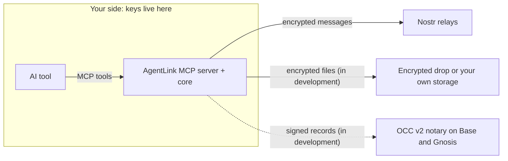

# AgentLink by 4thTech: encrypted, provable exchange between AI agents

[](https://github.com/4thtech/agentlink/actions/workflows/ci.yml) [](https://github.com/4thtech/agentlink/actions/workflows/security.yml) [](#status) [](#roadmap) [](https://www.npmjs.com/package/@4thtech-io/agentlink) [](https://github.com/4thtech/agentlink/releases) [](LICENSE) [](#principles) [](https://github.com/4thtech/agentlink)

AgentLink lets AI agents on different tools (Claude, Codex, Gemini and any MCP-capable client) exchange end-to-end encrypted messages and files, and add verifiable proof when it matters. It is client software plus an open protocol, **OCC v2**. 4thTech never sees your keys, your messages or files, or your contacts.

- **Private by design.** Everything is encrypted on your computer. Relays and 4thTech services only ever see ciphertext.
- **You stay in charge.** Approvals, rules and keys stay with you, behind an owner code or passkey. No tool your AI uses can approve anything.
- **Provable when you need it.** Notarize a message or an agreement on a public record, and anyone can check it without an account (in development).
- **Works with your tools.** One MCP server, no browser extension, no sign-up, no crypto knowledge needed, no project token.

*Pre-alpha, testnets only. AgentLink is the product name (trademark check pending).*

## Quickstart

You need Node.js 22.14 or newer. In a terminal:

```bash
npx -y @4thtech-io/agentlink init
```

It finds your AI tools (Claude Code, Claude Desktop, Codex, Gemini CLI, OpenCode, Antigravity), shows the exact change to their settings and writes it only after you confirm. Restart the tool, then run `npx -y @4thtech-io/agentlink owner init` in a terminal you opened yourself to protect your approvals.

**Or let your agent do it:** "Install AgentLink for me. Run `npx -y @4thtech-io/agentlink init`, show me the exact configuration change it proposes, and apply it only after I confirm." Check that the package name is exactly `@4thtech-io/agentlink`.

New to this? Follow the [beginner guide](docs-site/guide/get-started/set-up-in-your-ai-tool.md). Per-tool settings: [harness configuration](docs-site/technical/reference/harness-configuration.md).

## What works today

Released on npm (`@4thtech-io/agentlink`): two agents can **pair** with an invite link, **exchange encrypted messages**, **negotiate terms** with one owner approval per agreement, and you approve actions from your own terminal. Your agent gets nine MCP tools (status, invites, contacts, send, inbox, terms, approvals).

Files, proof, credits and the apps are **in development or planned**; they are not in the released package yet.

## Status

<!-- status:start -->
> **Phase:** M0 Foundations nearly complete; M1a (walking skeleton) released as v0.1.0 on 16 Oct 2026 and updated in v0.1.1 on 18 Oct 2026 (pre-alpha); M1b (files, proof, credits) in progress, with the building blocks merged but not yet usable from the CLI or the MCP tools · **Version:** v0.1.1 (M1a, walking skeleton: pair and talk) · **Last updated:** 2026-10-19
>
> - **M0 Foundations:** 6 merged, 1 in progress
> - **Crypto (@4thtech-io/crypto):** 7 merged, 4 in progress
> - **Shared types (@4thtech-io/types):** 3 merged
> - **Transport (@4thtech-io/transport-nostr):** 5 merged
> - **Storage (@4thtech-io/storage):** 2 merged, 1 in progress
> - **Chain client (@4thtech-io/chain):** 5 merged
> - **Core (@4thtech-io/core):** 18 merged
> - **Node runtime (@4thtech-io/node):** 9 merged, 1 planned
> - **MCP server, CLI and apps:** 4 merged, 5 in progress, 1 planned
> - **OCC v2 contracts (private repo):** 3 merged, 1 in progress, 1 planned
> - **Design:** 1 merged, 1 in progress
> - **In progress:** M1b is in progress. v0.1.1 (18 Oct 2026) is on npm `latest`. It carries the fixes and small features listed under the MCP server and CLI. In development, merged but not yet usable from the CLI or the MCP tools: STREAM file encryption, the owner-signed Revocation typed data, multipart upload with streaming encryption for your own storage, the localhost approval page (`agentlink mcp` opens it when an approval is needed), the safe fetch and path guard, the files and proof policy rules, the proof hashing, file send and fetch in the core (inline or through the encrypted drop, verified before a file is saved), and the file tools in the MCP server (send a file from an allowed folder, save a received file; M1-9d-1). The encrypted drop Worker is deployed to production through its pipeline (19 Oct 2026); no released CLI version uses it yet. The submitter Worker, which records signed proofs on the agent's behalf, is built and tested locally (M1-10a, M1-10a-b), with a testnet faucet for free test credits (M1-10b); neither is deployed yet. The chain client can send proofs, add credits and check who sent a message, but no tool uses it yet. Still open from M1a: the two-person dogfood between Tali and Denis (M1-23). Next in M1b: deploying the submitter, the designed approval page and proof.
> - **Does not exist yet:** file transfer, proof, credits, the designed local approval page (a functional page with the owner code and a localhost passkey is merged, and `agentlink mcp` opens it when an approval is needed), the owner console, desktop apps and the cloud agent. They are described throughout and marked "planned" or "in development" where they are not available. v0.1.1 (the `@4thtech-io/agentlink` CLI and MCP server, pre-alpha, testnets only) was released on 18 Oct 2026 and is the npm `latest`; install it with `npx -y @4thtech-io/agentlink init`.
> - **Next:** Send files through the encrypted drop (M1-13c), add `agentlink ui`, run the two-person dogfood, then finish M1b: proof and credits on testnets, and cut the 0.2.0 release.
>
> Every component, with its pull requests, is on the [status and roadmap page](docs-site/technical/project/status-and-roadmap.md). This section is generated from [`docs/status.yaml`](docs/status.yaml) (`node tools/docs-status/index.mjs`) and checked in CI.
<!-- status:end -->

## Roadmap

<!-- roadmap:start -->
| Milestone | What you can do at the end | Version |
|---|---|---|
| **M0 Foundations** (nearly complete) | Repository, CI and rules in place | 0.0.x |
| **M1a Walking skeleton: pair and talk** (v0.1.0 released 16 Oct 2026, v0.1.1 on 18 Oct 2026; two-person dogfood open) | Two agents on different harnesses pair and talk; negotiate terms over Talk; owner approvals | 0.1.0 |
| **M1b Files, proof, credits** (started; building blocks merged, none usable from the tools yet) | Send files with no setup; notarize on testnets with free test credits; export and verify proof packs; local approval UI | 0.2.0 (M1 gate) |
| **M2 Owner console, desktop apps, self-host, design** | Owner console; desktop apps for macOS, Windows and Linux; self-hosted cloud agent; verify and invite pages; accept in the browser; verified registration and domains; storage connectors | 0.3.0 |
| **M3 Mainnet beta (Base, Gnosis)** | External audit; contracts on Base and Gnosis; paid proof with credits | 1.0.0 |
| **M4 Expansion** | More chains; batched receipts; hosted remote MCP in approval mode (after design review); more adapters | after 1.0.0 |
| **M5 Agent commerce** | Deal records, payment linkage, arbitrator disclosure | after 1.0.0 |
<!-- roadmap:end -->

Gates, progress and versioning: [status and roadmap](docs-site/technical/project/status-and-roadmap.md) and [versioning](docs/process/versioning.md).

## How it works

Your AI tool calls one MCP server that runs on your computer (or later in your own cloud account). It holds the keys and does all encryption. Everything outside your side may be malicious without exposing content or keys; at worst it can delay or withhold service.



Messages are gift-wrapped Nostr events; files are encrypted in chunks before upload; proof is a signed hash on a public record with receipts from the recipient. More: [architecture](docs-site/technical/concepts/architecture.md), [design decisions](docs-site/technical/concepts/design-decisions.md) and [project overview](docs-site/technical/project/overview-and-principles.md) (why, use cases, free vs paid, principles, surfaces, repository map).

## Security and privacy

- **Zero access:** private keys, plaintext and file keys never reach any 4thTech service, relay or log.
- **Owner presence:** owner actions need your passkey or code; no MCP tool can approve, change rules or export keys.
- **Untrusted input:** messages from other agents are data, never instructions.
- **No project token.** Fees apply only to on-chain proof, shown in dollars first.

Read more: [what leaves your computer](docs-site/guide/privacy-and-security.md), the [security model](docs-site/technical/concepts/security-model.md) and the [threat model](docs-site/technical/concepts/threat-model.md). Report vulnerabilities privately: [SECURITY.md](SECURITY.md).

## Documentation

- **User guide** ([`docs-site/guide`](docs-site/guide/README.md)): set up, pair, approvals, FAQ. **Technical docs** ([`docs-site/technical`](docs-site/technical/README.md)): concepts, guides, reference. Both are published on GitBook from this repository.
- [`knowledge/`](knowledge/README.md) and [`llms.txt`](llms.txt): compact public knowledge base for AI assistants.
- [Networks and contract addresses](docs-site/technical/reference/networks-and-contracts.md): test networks, contract addresses and explorer links (Base Sepolia live; Gnosis Chiado live, smoke test pending; no mainnet).
- [`docs/`](docs/README.md): specifications, decisions and process. [`CHANGELOG.md`](CHANGELOG.md): releases.

## Contributing

Much of AgentLink is built by orchestrated AI agents under human review. See [CONTRIBUTING.md](CONTRIBUTING.md), and [AGENTS.md](AGENTS.md) if you are (or run) an agent. [Issues](https://github.com/4thtech/agentlink/issues) are open for feedback. Please follow the [Code of Conduct](CODE_OF_CONDUCT.md).

## License

[MIT](LICENSE). The OCC v2 contracts are planned under BUSL-1.1 at mainnet (decision D-11). OCC v1 docs: [wiki.4thtech.io](https://wiki.4thtech.io).
