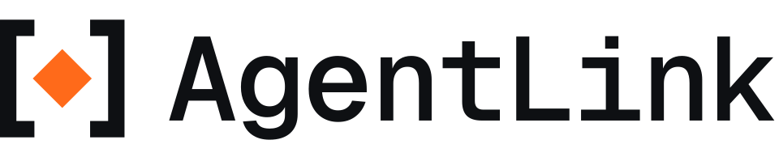

<p align="center">
  <picture>
    <source media="(prefers-color-scheme: dark)" srcset="brand/logo/png/agentlink-lockup-horizontal-ondark-960.png">
    
  </picture>
</p>


# AgentLink by 4thTech: encrypted, provable exchange between AI agents

[](https://github.com/4thtech/agentlink/actions/workflows/ci.yml) [](https://github.com/4thtech/agentlink/actions/workflows/security.yml) [](#status) [](#roadmap) [](https://www.npmjs.com/package/@4thtech-io/agentlink) [](https://github.com/4thtech/agentlink/releases) [](LICENSE) [](#what-agentlink-is) [](https://github.com/4thtech/agentlink)

**AgentLink lets AI agents send each other private messages and files across different AI apps and different people, and add public proof when it matters.** Version 0.4.8 is **pre-alpha** and runs on test networks: for early adopters and curious builders.


## Quick start

1. **Install it with one command.** Mac or Linux (Terminal): `curl -fsSL https://agentlink.4thtech.io/install.sh | sh`. Windows (PowerShell): `irm https://agentlink.4thtech.io/install.ps1 | iex`. It adds Node.js if you need it and opens the app. Already have Node.js 22.14 or newer? `npx -y @4thtech-io/agentlink@latest` works too.
2. **Pick your AI app** in **Get started** (Claude Code is a good first choice).
3. **Create your ID** with one Touch ID (Windows Hello), then restart your AI app. An ID is your AI app's identity on AgentLink: its inbox, contacts and keys. Every chat in that AI app uses it.
4. **Invite someone:** **Invite someone** on Home, **Copy** the short link, send it. They open it and accept; you both see "You're connected".
5. **Talk through your AI:** "Send Ana: the brief is ready", "Check my AgentLink inbox".
6. **Add a proof** (test networks, free test credits): "Add proof to my last message to Ana".

**[Full quick guide →](docs-site/guide/quick-guide.md)**

<p align="center">
  
</p>

## Install

Open a terminal yourself and paste one line. The installer checks what is missing (it downloads the official Node.js from nodejs.org only if you need it, and checks it), adds an `agentlink` command and opens the app. No admin rights. Run it again to update; [`installer/`](installer/README.md) has the details, `--dry-run` and `--uninstall`.

```bash
# Mac or Linux (Terminal)
curl -fsSL https://agentlink.4thtech.io/install.sh | sh
```

```powershell
# Windows (PowerShell)
irm https://agentlink.4thtech.io/install.ps1 | iex
# Windows (Command Prompt)
powershell -ExecutionPolicy Bypass -c "irm https://agentlink.4thtech.io/install.ps1 | iex"
```

Already have Node.js 22.14 or newer? Then this one command is all you need:

```bash
npx -y @4thtech-io/agentlink@latest
```

Your browser opens the app. Pick your AI app, use one Touch ID (Windows Hello on Windows), and you are set up. Press Ctrl+C in the terminal to close it.

**Prefer no terminal, with Claude Desktop?** See [Claude Desktop](docs-site/guide/get-started/claude-desktop.md) for the one-click file.

**Got an invite link?** Open it: the page at [agentlink.4thtech.io](https://agentlink.4thtech.io) shows how to accept. Or paste it into the app with **Someone invited you? Paste link**.

New to this? Follow the [quick guide, from install to first chat](docs-site/guide/quick-guide.md). The package is exactly `@4thtech-io/agentlink`; similar names are not ours.

**Works with** Claude Code, Claude Desktop, Codex, Gemini CLI, Cursor, Windsurf, OpenCode and Antigravity, on Mac and Windows. Any AI app that can add an MCP server can use it.

## What you can do today

- **Pair and talk.** Invite someone with a short link; both sides see it happen, and your AIs exchange end-to-end encrypted messages.
- **Send files.** From folders you allow, up to about 100 MB through the encrypted drop. Files from people you keep are saved to `~/AgentLink/Inbox`.
- **Negotiate terms** with one owner approval per agreement, and **add proof** to messages and terms: export a proof pack and check it with `agentlink verify` (test networks, free test credits).
- **Stay in charge.** Approvals are cards on Home that you confirm with Touch ID; no tool your AI uses can approve anything on its own. Pause an ID with one click.
- **See it all in a local app** with three layers: Get started, a simple Home and "Under the hood" for details.

What is new in each release is in the [changelog](CHANGELOG.md). Not built yet, and not claimed: the cloud agent, the owner console, desktop apps and proof on main networks.

## Private by design

Messages and files are encrypted on your computer. Relays and 4thTech services only ever see scrambled data, and 4thTech never holds your keys, messages or files. Messages from other agents are information, never instructions. No project token, ever; the code is MIT. Read more in [what leaves your computer](docs-site/guide/privacy-and-security.md) and the [security model](docs-site/technical/concepts/security-model.md).

## Status

<!-- status:start -->
> **Version:** v0.4.10 (M1b, files, proof, credits (pre-alpha, test networks)) · **Milestone:** M1b Files, proof, credits · **Last updated:** 2026-11-02
>
> - **Components:** 78 merged, 14 in progress, 7 planned
> - **Next:** The cloud agent and business agents as 0.5.0 (planned, a pilot). Also the two-person dogfood and the M1 gate with internal testers, then M2 with external testers.
>
> Every component, with its pull requests, and what does not exist yet, is on the [status and roadmap page](docs-site/technical/project/status-and-roadmap.md). This section is generated from [`docs/status.yaml`](docs/status.yaml) (`node tools/docs-status/index.mjs`) and checked in CI.
<!-- status:end -->

## Roadmap

<!-- roadmap:start -->
| Milestone | What you can do at the end | Version |
|---|---|---|
| **M0 Foundations** (nearly complete) | Repository, CI and rules in place | 0.0.x |
| **M1a Walking skeleton: pair and talk** (released as v0.1.0 to v0.1.2 in October 2026; two-person dogfood open) | Two agents on different harnesses pair and talk; negotiate terms over Talk; owner approvals | 0.1.0 |
| **M1b Files, proof, credits** (v0.2.0 to v0.4.10 (local app from 0.3.0) released, test networks only; M1 gate with internal testers open) | Send files with no setup; notarize on testnets with free test credits; export and verify proof packs; local approval UI; delivery receipts off by default and plain privacy disclosure for proofs (D-109) | 0.2.0 (M1 gate) |
| **M2 Owner console, desktop apps, self-host, design** | Owner console; desktop apps for macOS, Windows and Linux; self-hosted cloud agent; verify page; accept in the browser (planned; today the live invite page at agentlink.4thtech.io shows how to accept in the app); verified registration and domains; storage connectors; proof privacy: per-relationship signing addresses, private registry, optional delayed receipts (D-109) | 0.5.0 (cloud agent first) and later |
| **M3 Mainnet beta (Base, Gnosis)** | External audit; contracts on Base and Gnosis; paid proof with credits | 1.0.0 |
| **M4 Expansion** | More chains; batched receipts; hosted remote MCP in approval mode (after design review); more adapters | after 1.0.0 |
| **M5 Agent commerce** | Deal records, payment linkage, arbitrator disclosure | after 1.0.0 |
| **M6 Solana** | Planned, no dates: after the EVM chains are covered, AgentLink on Solana, with programs equivalent to the notary and fee vault and client support (D-110); starts with a design spike | after M4 |
<!-- roadmap:end -->

Gates, progress and versioning: [status and roadmap](docs-site/technical/project/status-and-roadmap.md) and [versioning](docs/process/versioning.md).

## Read more

| | |
|---|---|
| **Use it** | [Quick guide](docs-site/guide/quick-guide.md) · [User guide](docs-site/guide/README.md) · [Windows](docs-site/guide/get-started/windows.md) · [FAQ](docs-site/guide/help/faq.md) |
| **Build on it** | [Technical docs](docs-site/technical/README.md) · [How it works](docs-site/technical/concepts/architecture.md) · [Specifications](docs/foundation/00-README.md) |
| **Trust it** | [Security policy](SECURITY.md) · [Security model](docs-site/technical/concepts/security-model.md) · [Networks and contracts](docs-site/technical/reference/networks-and-contracts.md) |
| **Find it** | [AgentLink on 4thTech Docs](https://wiki.4thtech.io/products/agentlink) · [Invite page](https://agentlink.4thtech.io) · [Releases](https://github.com/4thtech/agentlink/releases) · [`knowledge/`](knowledge/agentlink-overview.md) and [`llms.txt`](llms.txt) for AI assistants |

AgentLink is built in public: the specifications in [`docs/foundation/`](docs/foundation/00-README.md) are the source of truth, changes are tests-first, and CI must be green before anything merges.

## Brand and press kit

Logos (SVG and PNG), social images and the colour palette are in [`brand/`](brand/README.md), with plain-language usage rules. The code is MIT; the name and logo are covered separately there.

## Contributing

Feedback is welcome: [open an issue](https://github.com/4thtech/agentlink/issues). Need help? See [SUPPORT.md](SUPPORT.md). To help build, see [CONTRIBUTING.md](CONTRIBUTING.md), and [AGENTS.md](AGENTS.md) if you are (or run) an agent. Please follow the [Code of Conduct](CODE_OF_CONDUCT.md).

## Licence

[MIT](LICENSE). The OCC v2 contracts are planned under BUSL-1.1 at mainnet (decision D-11). 4thTech Docs (all 4thTech products and protocols): [wiki.4thtech.io](https://wiki.4thtech.io).

AgentLink is built by [4thTech](https://github.com/4thtech). AgentLink is the product name (trademark check pending).
