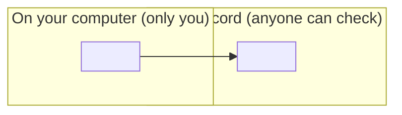

# <The idea, as a plain noun: "Proof">

*Applies to AgentLink <version>.*

<The idea in one short paragraph. What it is, and why it exists. No product jargon; the first product term links to the [glossary](../help/glossary.md).>

## Think of it like this

<One everyday comparison, for example "a sealed, locked box" or "a name tag". Then where the comparison stops.>

## What it means for you

- <What you do, or don't need to do.>
- <What changes, what never changes.>
- <What it costs, if anything, in exact dollars.>


**Good to know:** <one limit we are honest about, for example what is public>.


<!-- Optional. At most 9 boxes, guide words only, no custom colours. -->

For the technically curious

<Two or three sentences on how it works, then links: the technical concept page and the spec section on GitHub.>

## Related

- [<How-to that uses this idea>](…)
