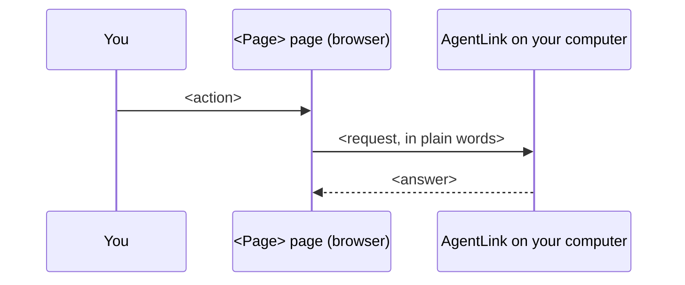

# <Page name, as in the app's navigation> page

*Applies to AgentLink <version>.*
<!-- One status line (MAINTAINING §3). No release history. -->

<What the page is for, in one or two sentences. Then what looking changes (nothing) and what a change needs.> Every change needs your [passkey](../help/glossary.md) or your [owner code](../help/glossary.md).

<!-- screenshot: local-<page>--<state>.png | shows: <the default state, with test data> -->
<!-- When captured, replace the comment with:
<figure>--<state>.png" alt="<What the reader should notice>"><figcaption>
<Short caption>
</figcaption></figure>
-->

## What you see

<!-- Exact UI words from apps/local-ui/src/pages/<page>/strings.ts, in bold. One row per element. -->

| What you see | What it means | What happens behind |
|---|---|---|
| **<Label or message>** | <Plain meaning> | <One plain sentence: what AgentLink does> |
| **<Button>** | <What it is for> | <What it opens or checks first> |

<The empty state: what the page says, and the next action.>

## <Task, as a verb: "Allow a folder">

1. Press **<Button>**.
2. <One action per step. The result in the same step.>
3. Confirm with your passkey, or press **<Use owner code instead>**.
4. The page says **<success message>**.


**Before you continue:** <only when the reader could lose something or expose a secret>.


## <Second task>

1. <…>

## Messages you may see

| Message | What to do |
|---|---|
| **<Exact message>** | <What to do, in one line> |

For the technically curious: how this page is built

<Two or three sentences: who does the work (the local server, not the browser), and what the browser sees.>

<!-- UI ↔ tech bridge. Code and route names in backticks. Link the spec section, the API route's file and the page source on GitHub. -->

| On the page | What happens | Where it is built |
|---|---|---|
| <UI element> | <Plain sentence> | `<METHOD /api/ui/…>` · [`<file>`](https://github.com/4thtech/agentlink/blob/main/<path>) · [<spec §>](https://github.com/4thtech/agentlink/blob/main/docs/foundation/<spec>.md) |
| Page text | Every string on this page | [`strings.ts`](https://github.com/4thtech/agentlink/blob/main/apps/local-ui/src/pages/<page>/strings.ts) |

More: [<Technical page>](https://github.com/4thtech/agentlink/blob/main/docs-site/technical/concepts/<page>.md).

Back to [The local app](README.md).
