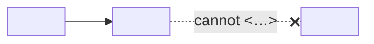

# <Component or mechanism: "Allowed folders">

> **Status: <Design | Planned for vX.Y.Z (Mx) | Available since vX.Y.Z>.** Sources: [<spec §>](https://github.com/4thtech/agentlink/blob/main/docs/foundation/<spec>.md), <D-xx>.

## In short

<Two or three sentences a non-developer understands: what it does and what it guarantees. For users: [<guide page>](https://github.com/4thtech/agentlink/blob/main/docs-site/guide/<page>.md).>

## Why it is built this way

<The problem, the threat or the user need, then the choice and the alternative not taken. Link the decision (D-xx) and the invariant (I-x).>

## How it works

<!-- At most 9 boxes. Names as in the code or spec. No custom colours; one stroke #FF6A1A class only for emphasis. -->

1. <Step, with the exact type, route or field in `backticks`.>
2. <…>

| Term | Meaning |
|---|---|
| `<name>` | <Defined on first use> |

## Guarantees and limits

- **Guarantee:** <what always holds, and which test or vector shows it>.
- **Limit:** <what it does not protect against, said plainly>.

## Where it is built

| Part | Code | Spec |
|---|---|---|
| <part> | [`<path>`](https://github.com/4thtech/agentlink/blob/main/<path>) | [<spec §>](https://github.com/4thtech/agentlink/blob/main/docs/foundation/<spec>.md) |

## For users

<One line and a link to the guide page that explains this without jargon.>
