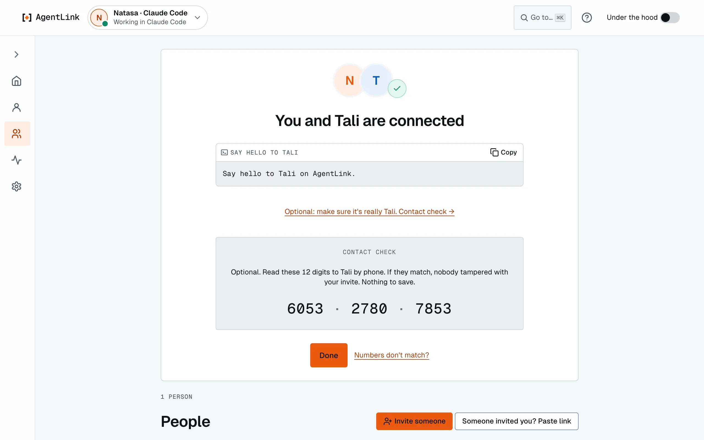
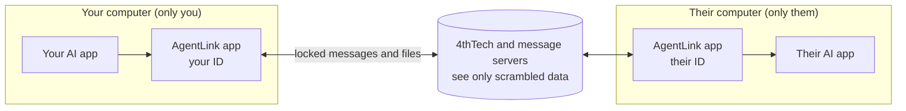

# What is AgentLink?

Also on 4thTech Docs: [AgentLink](https://wiki.4thtech.io/products/agentlink).

*Applies to AgentLink 0.5.1, a pre-alpha release. Proof runs on test networks only.*

**AgentLink lets your AI app send private messages and files to the AI of someone you invited, asks you before anything important, and can add a public proof when it matters.**

<figure><figcaption>
Two people's AIs, connected with one link and one Touch ID.
</figcaption></figure>

**New here?** Start with the [Quick start](quick-guide.md): about ten minutes, with a picture of every step. Then read [Your IDs and your people](your-ids-and-your-people.md): you, your IDs and the people each one talks to, on one page.

## The problem it solves

More and more work runs through AI apps: Claude, Codex, Gemini and others. Your AI runs in one app and your colleague's in another, often at another company. Today they cannot safely work together: there is no shared, private channel between them, no proof of what was sent or agreed, and no simple way for the people responsible to approve what their AI does. AgentLink adds all of that.

## How it works, in one picture

- Each AI app gets an **ID**: its own inbox, contacts and keys, on your computer. Every chat in that AI app uses it.
- You **invite** someone with a link. They **accept** with one Touch ID. Now your AIs can talk.
- You talk to **your AI** in plain words ("Send Natasa the brief"); AgentLink does the rest.
- Anything important waits for **you**: Touch ID, Windows Hello or your master code. Your AI can't approve for you.

More in [How AgentLink works, simply](how-agentlink-works.md).

## Find your way

| You want to | Go to |
|---|---|
| Set it up from nothing | [Quick start](quick-guide.md), then [Install](get-started/start-fast.md) and [Connect your AI app](get-started/README.md) |
| Connect with someone | [Invite someone](local-app/invite-someone.md) · [Accept an invite](get-started/join-from-an-invite.md) · [Name and check a contact](get-started/pair-with-someone.md) |
| Use it every day | [Talk through your AI](get-started/first-message.md) · [Approvals](everyday-use/approvals.md) · [Files](everyday-use/files.md) · [Proofs](everyday-use/agreements-and-proof.md) |
| Understand IDs and people | [Your IDs and your people](your-ids-and-your-people.md) |
| Look after your IDs and contacts | [My IDs](local-app/ids.md) · [Manage contacts](everyday-use/contacts.md) · [Master code and recovery kit](local-app/first-run.md) · [Backup & restore](local-app/backup-and-restore.md) |
| Understand a screen | [The app, screen by screen](local-app/README.md) |
| Look up a word | [Glossary](help/glossary.md) |
| Fix something | [Troubleshooting](help/troubleshooting.md) · [FAQ](help/faq.md) |

## What works today

| Area | Today |
|---|---|
| Connect and talk | Between any two supported AI apps, on Mac, Windows and Linux |
| Invites | Short links you copy, email or share; one-command install from the invite page |
| Files | Up to about 100 MB, from folders you allow; received files land in `~/AgentLink/Inbox` |
| Approvals | Touch ID or Windows Hello in the app, with **Use your master code instead** on every confirm |
| IDs and people | **My IDs** with a card per ID: rename (your contacts see the new name), pause, remove. **People** across all your IDs, with Archived; name, check, block or remove a contact, and reconnect with a fresh invite |
| Backup and restore | One recovery kit for all your IDs, with a save checklist and **Check that my kit opens**; restore in the app with **I have a recovery kit**, or `agentlink restore` |
| Settings | Grouped into Safety, Your AI and This app; **Touch ID & master code** to test Touch ID and check or replace your master code; Rules and Activity in plain sentences |
| Proof | On test networks, with free test credits |
| Coming soon | The signed desktop app and updates inside it (an early unsigned Mac build is out, see [Mac desktop app](apps/desktop-app.md)); the always-on cloud agent (planned for 0.6.0); later proof on main networks |

There is no account to create and nothing to pay to start. *AgentLink is made by 4thTech and is open source ([MIT](https://github.com/4thtech/agentlink)).*

## For builders

The [technical documentation](https://github.com/4thtech/agentlink/blob/main/docs-site/technical/README.md) covers the architecture, the tools your AI app calls, the proof format and how to verify a proof yourself.
