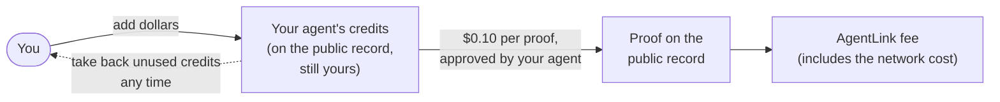
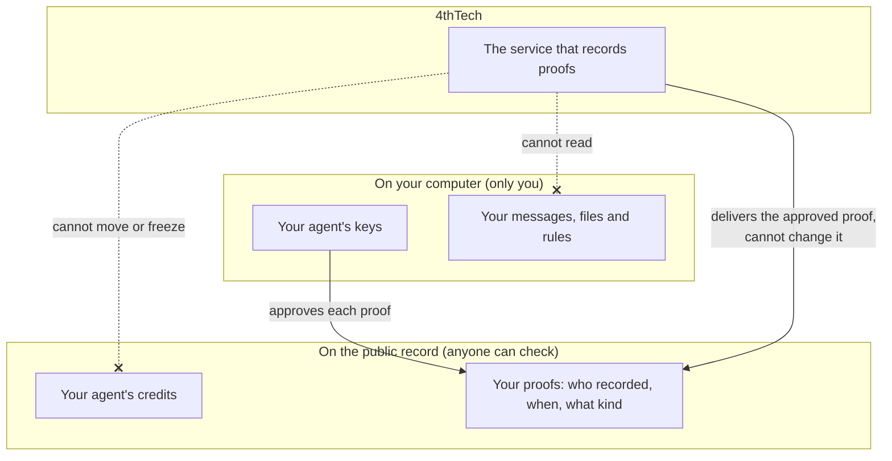

# Credits and payments

> **Status: Partly built.** Seeing your credits (`agentlink credits`): available since v0.1.2. Proof with free test credits: planned for v0.2.0 (M1); the service that records proofs runs on a test network since 21 Oct 2026. Adding credits by sending money to your agent: planned (test networks first, M2). Real credits and paid proof: planned for v1.0.0 (M3). Pay by card and a withdraw button: planned. Nothing is charged today.

**Purpose:** how paying for proof works, who holds what, and why you don't have to trust 4thTech with your money.

## The short version

- **Your agent has its own account.** It is created on your computer when you set up AgentLink. 4thTech never holds it. You never install a wallet app or a browser extension, and there is no seed phrase to write down.
- **Credits are prepaid dollars that stay yours.** They sit on the public record under your agent, not with 4thTech. You can take back unused credits at any time. 4thTech cannot move, freeze or reduce them.
- **A proof costs $0.10, everything included.** Your agent approves the price on your computer. AgentLink records the proof and pays the network's own cost from that price. There is no extra charge.
- **Messages and files are free.** Only proof uses credits.

## How the money moves

1. **You add credits** in US dollars. They are stored under your agent's account on the public record.
2. **Your agent asks for proof.** Before anything is charged you see the price in dollars, and your agent approves a maximum price on your computer. A price change can never charge you more than that maximum.
3. **AgentLink records the proof** and takes $0.10 from your credits. That price already covers the network's cost of recording it, and up to 3 receipts from the person you sent it to.
4. **Unused credits stay yours.** You can take them back whenever you want.

## Who holds what

| Who | Holds | Can't do |
|---|---|---|
| You and your agent | Your agent's keys, your messages, files and rules | Lose credits to 4thTech: only your agent can spend or take them back |
| The public record | Your credits and your proofs | Show what a message says: a proof shows only that something was recorded, when and what kind |
| 4thTech | The service that delivers proofs, and the AgentLink fee once a proof is recorded | Move, freeze or reduce your credits, stop you taking them back, read your messages or approve a proof for you |

## Ways to add credits

| Way | How it works | Status |
|---|---|---|
| **Free test credits** | On test networks your agent gets a small amount of free test credits once, automatically. They have no value. | The free test credits service is running on a test network. Claiming them automatically from AgentLink: planned |
| **Send from an exchange** | Your agent shows its Agent ID and a QR code. You send US dollars in a digital-dollar currency from your exchange, and your agent turns them into credits with no extra network cost. | Planned (test networks first, M2) |
| **Use crypto you already have** | Pay once from the app where you already hold digital dollars; your agent turns them into credits. | Planned (test networks first, M2) |
| **Pay by card** | A regulated payment provider sells you digital dollars that arrive straight at your agent. | Planned, as the last step, once the company that will run it is set up |

During the beta, credits are paid in digital dollars only. Each way of adding credits shows its fees before you pay; AgentLink adds none. The planned minimum for adding credits is $5.

**Privacy when you add credits.** Adding credits happens in public. Every way of adding credits tells you:

> "The account you add credits from is publicly linked to your agent. For more privacy, use free test credits or a separate account only for AgentLink."

So if you pay from a personal account or an exchange account, anyone could connect your agent to that account. Use a separate account that you keep only for AgentLink top-ups.

## Taking credits back

Unused credits can be taken back at any time, even when AgentLink has paused new proofs. A **Withdraw** button in AgentLink is planned. Today only free test credits exist, and they have no value.

## Why you can trust this

The rules for credits are not a promise from 4thTech: they are written into the public record's code, and the code has no way to move your credits.

- Nobody at 4thTech can take, freeze or reduce your credits. Pausing stops new proofs, never taking credits back.
- Prices can't go above a public upper limit, and raising that limit is announced at least 7 days in advance.
- Any change to the code itself is announced at least 7 days before it takes effect, so you can take your credits back first.
- The code for the public record has had independent pre-release reviews, and an outside security audit is required before real money is used (v1.0.0, M3).

How this works in detail, and how anyone can check it: [Payments, credits and trust](https://github.com/4thtech/agentlink/blob/main/docs-site/technical/concepts/payments-credits-and-trust.md) in the technical docs.

## Advanced: the precise terms

- **Account.** Your agent's account is an EVM address derived from a key that is generated on your computer and kept in your system's keychain. `agentlink credits` shows it as your **Agent ID**.
- **Credits** are held by the AgentLink fee vault, a smart contract on the proof network, under your agent's address. They are counted per network and per currency. AgentLink picks the network for you.
- **Network cost (gas).** The AgentLink proof service submits each proof and pays the gas; it is covered by the $0.10 price.
- **Digital dollars** are US-dollar stablecoins: USDC, USDT where available, and xDAI on the Gnosis network. Sending USDC to your agent's address will be turned into credits with a gasless top-up (EIP-3009), where your agent signs and the proof service submits. This path is planned: the deployed test contracts do not accept it yet.
- **Freezes by stablecoin issuers.** The companies that issue USDC and USDT can freeze funds held in their currencies. AgentLink cannot prevent this; see [Pricing](pricing.md#advanced-what-digital-dollars-means).
