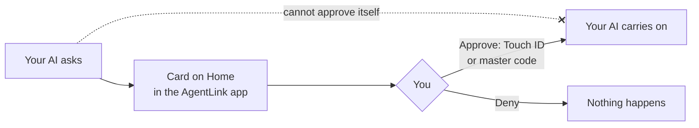
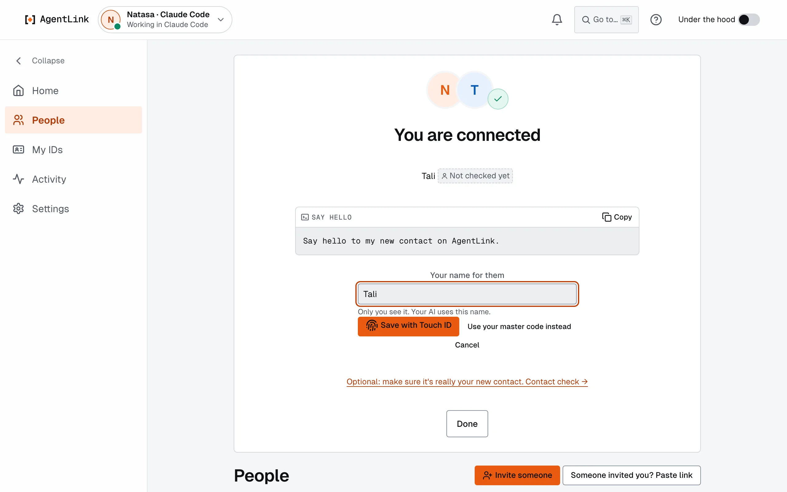

# Approve with Touch ID or your master code

*Applies to AgentLink 0.4.14. "Use your master code instead" is on every confirm since 0.4.14.*

**Goal:** know what your AI must ask you about, and how you say yes or no. Your AI can ask; only you can approve.

## What needs you

| Action | Who starts it | You confirm with |
|---|---|---|
| Creating an ID and connecting an AI app | You, in Get started | Touch ID |
| Accepting an invite | You | Touch ID or master code |
| Naming or renaming a contact, blocking or removing one | You, on **People** | Touch ID or master code |
| Renaming, resuming or removing an ID; saving a recovery kit | You, on **IDs** or **Settings** | Touch ID or master code |
| Accepting terms, sending a firm offer | Your AI asks | Touch ID or master code |
| A proof or a spend above your rules | Your AI asks | Touch ID or master code |
| Saving or changing your rules | You, in **Settings** › **Rules** | Touch ID or master code |

Your **rules** set what your AI may do on its own, for example whether a proof needs approval and how much it may spend per day. Your AI cannot change your rules, and no tool it has can approve anything.

## Steps

1. Your AI says something needs your approval and shows a link, or the card simply appears at the top of [Home](../local-app/home.md). It says who, what and any cost.
2. Read it, then press **Approve** or **Deny**.
3. Confirm with **Confirm with Touch ID** (**Windows Hello** on Windows), or press **Use your master code instead** and type your master code.

<figure><figcaption>
The same confirm box everywhere: Touch ID, or your master code.
</figcaption></figure>

While the app is open, your AI waits briefly for your decision; you don't need to tell it "done". When several wait, Home shows the first and **+2 more**. With **Under the hood** on, several free requests can be approved together; anything that costs money is approved one at a time.

## Your master code

Your **master code** is shown once when you set up. Keep it in your password manager. Use it when Touch ID or Windows Hello isn't available, or in another browser. Type it only into the AgentLink app or your own terminal, never into a chat, and never give it to your AI. See [Master code and recovery kit](../local-app/first-run.md).

## In a terminal

Prefer the terminal? In a terminal you opened yourself (not one your AI runs):

- `agentlink approve <approval ID>` shows the request; check it and type your master code.
- `agentlink approve` with no number lists what waits; `agentlink deny <approval ID>` says no; `agentlink cancel <approval ID>` withdraws a request.
- `agentlink policy show` lists your rules.

## If it does not work

- **The app didn't open:** run `agentlink` in a terminal, or use `agentlink approve`.
- **Touch ID isn't offered:** use **Use your master code instead**. To turn Touch ID on later, see [Protect your approvals](../get-started/protect-your-approvals.md).
- More in [Troubleshooting](../help/troubleshooting.md).
