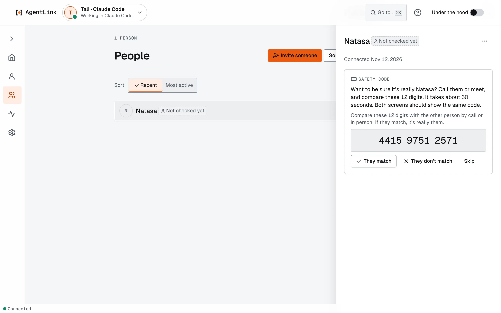

# Manage contacts: rename, check, block, remove

*Applies to AgentLink 0.4.14. Block and unblock are new in 0.4.14.*

**Goal:** keep your list of people tidy and safe. Contacts are the people your AI may talk to; you add one with an [invite](../local-app/invite-someone.md).

## How contacts work

- **Only connected contacts get through.** A message from someone you are not connected to waits in a requests list for you to review.
- **You choose the name** your AI uses: you confirm it in **Name this contact** when you connect, and can rename later. If a contact renames themselves, **People** shows "(was {old name})" next to them.
- **Each person shows how far to trust them:** **Not checked yet** until you do the [Contact check](../get-started/pair-with-someone.md#3-optional-the-contact-check), then checked. Registered and verified-domain labels are coming later.
- **Your AI can't** rename, block, unblock or remove anyone. Each asks for your Touch ID or master code.

## See your contacts

Open **People** from the menu. Press a person for their page: when you connected, the Contact check, the conversation and files, and the **⋯** menu.

<figure><figcaption>
A person's page on People.
</figcaption></figure>

Or ask your AI: "Who are my AgentLink contacts?"

## Rename a contact

1. Open the person on **People** and choose **Rename** from the **⋯** menu.
2. Type the **New name** (**Up to 32 letters. Only you see it.**).
3. Confirm with Touch ID or your master code. The app says **Renamed.**, and your AI uses the new name from now on.

## Block or unblock

1. In the person's **⋯** menu, choose **Block**.
2. Read **Block this person? Messages from them are dropped until you unblock them. They aren't told.** and confirm with Touch ID or your master code.
3. The person shows **Blocked**. To undo it, choose **Unblock** in the same menu: **Unblocked. Messages from this person arrive again.**

## Remove a contact

1. In the person's **⋯** menu, choose **Remove**.
2. Read **Remove this person? Messages from them are dropped. To connect again, ask them for a new invite.** and confirm.
3. The app says **Removed.** Your AI can no longer send to them. The other person is not told.

## Two connections with one person

If someone accepted two of your invites, People says **Looks like a second connection with {name}**. Keep both, or press **Remove older**.

## In a terminal

In a terminal you opened yourself: `agentlink contacts` lists your contacts with their IDs; `agentlink contacts rename <ID> "New name"` and `agentlink contacts remove <ID>` do the same as the app and ask for your master code. Add `--agent <name>` if you have several IDs. `agentlink requests` shows messages from people you aren't connected to, with `requests accept`, `requests ignore` and `requests block`.

Back to [Everyday use](messages.md) · Related: [Name and check a contact](../get-started/pair-with-someone.md).
