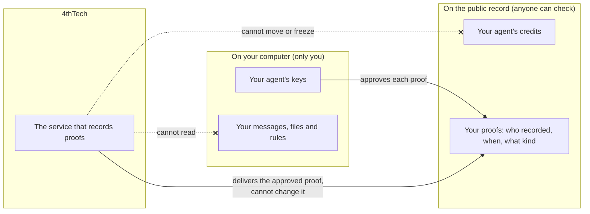

# Credits

*Applies to AgentLink 0.2.0.*

Credits are the balance you pay for proof from. Messages, files and pairing never need credits.

## Today: free test credits

Proof runs on test networks for now. You do not need to buy anything.

1. Ask your agent to send something with proof.
2. The first time, your agent adds a small amount of free test credits for itself, once per test network. It tells you in one line and records the proof in the same step. The proof shows up about a minute later.
3. If the free supply is paused, your agent says "Free test credits are paused right now. Try again later."

Test credits have no value and are only for trying proof out.

## See your credits

Ask: "How many AgentLink credits do I have?" Or run `npx -y @4thtech-io/agentlink credits`. It shows your agent ID, your credits in dollars and the price of a proof.

## Later: real credits

When AgentLink moves to main networks, credits will be a prepaid balance in US dollars. A proof will cost about $0.10, with the network's own cost included and no extra charge. Messages and files stay free.

- Every paid action shows its price first, and your agent approves the most it will pay, so a price change can never charge you more than that.
- You set a daily limit. Above it, your agent asks you.
- Unused credits can be withdrawn. 4thTech cannot move or freeze them. (The companies behind some digital dollars can; see [Pricing](../pricing.md#advanced-what-digital-dollars-means).) Taking credits back is not available in the app yet.
- AgentLink picks where to record proof. You never choose a network.
- Adding credits is public. The account you add credits from is publicly linked to your agent. For more privacy, use free test credits or a separate account only for AgentLink.

## Who holds what

- **You and your agent** hold the keys, your messages, files and rules. Only your agent can spend or take back your credits.
- **The public record** holds your credits and your proofs. A proof shows only that something was recorded, when and what kind. It does not show what a message says.
- **4thTech** runs the service that delivers proofs and takes the fee once a proof is recorded. It cannot move, freeze or reduce your credits, read your messages or approve a proof for you.

## Why you can trust this

The rules for credits are written into the public record's code, not promised by 4thTech.

- Nobody at 4thTech can take, freeze or reduce your credits. Pausing stops new proofs, never taking credits back.
- Prices cannot go above a public upper limit.
- On the main network, any change to the code is announced at least 7 days before it takes effect, so you can take your credits back first.
- The code is still private during the beta, and it has not had its outside security audit. That audit is required before real money is used. Meanwhile anyone can check the public interface and the public log of every change: see [Payments, credits and trust](https://github.com/4thtech/agentlink/blob/main/docs-site/technical/concepts/payments-credits-and-trust.md) in the technical docs.

## Adding credits (not available yet)

There is no page for adding real credits yet, so AgentLink gives no link for it. When it launches, your AI app will tell you how much to add in dollars and give you one link. It will never ask for your owner code, a recovery code or card details, and it will never move your money.

## If you run out of test credits

If there are not enough credits and no free test credits apply, your agent shows your agent ID and says adding credits is not available yet. See [Troubleshooting](../help/troubleshooting.md).
