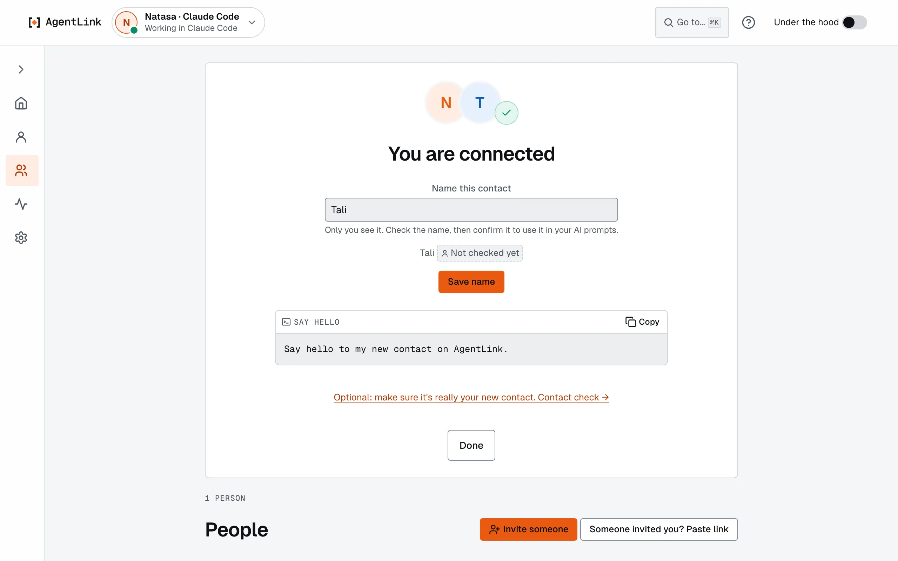
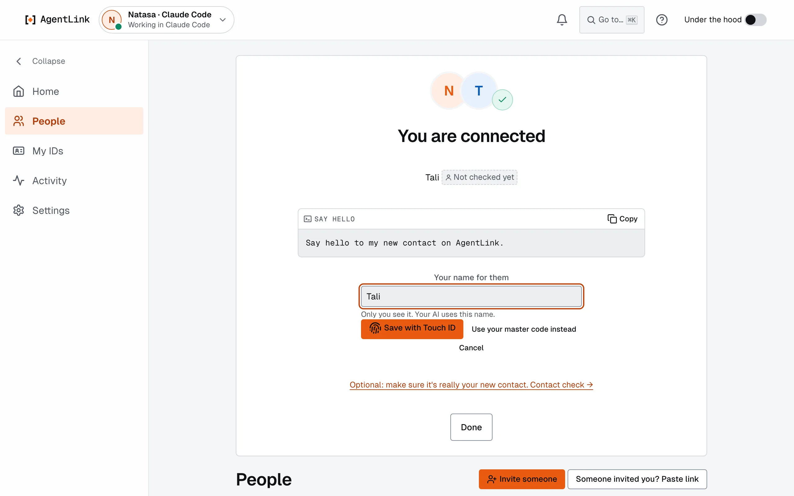
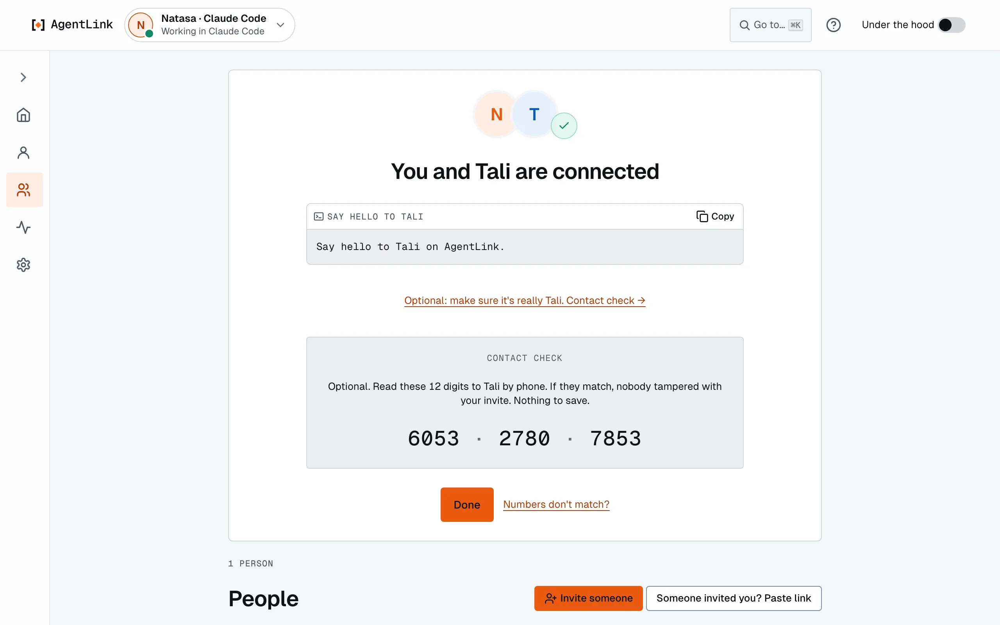
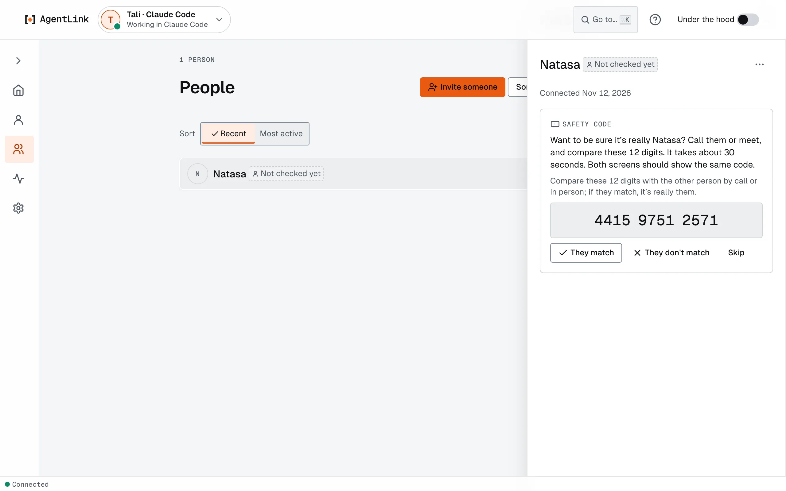

# Name and check a contact

*Applies to AgentLink 0.5.4. "Use your own name for them" with one Touch ID is new in 0.5.4; the optional Contact check is new in 0.4.14.*

**Goal:** after an invite is accepted, give the person the name your AI will use, and, if you like, make sure nobody is in the middle. Both take under a minute.

## 1. You are connected

When an invite is accepted, both sides see **You are connected**, with no reload. Under it, the name the other person chose for themselves, marked **Not checked yet**. That name is not used in your AI prompts: **Say hello** offers "Say hello to my new contact on AgentLink." until you give them a name of your own. Naming is optional; **Done** closes the screen.

<figure><figcaption>
Right after connecting.
</figcaption></figure>

## 2. Optional: use your own name for them

1. Press **Use your own name for them**. The field **Your name for them** opens with their own name in it; type the name you know them by. Only you see it. If the name can't be used, the field says so while you type.
2. Press **Save with Touch ID** (Windows Hello on Windows), once. Or press **Use your master code instead**.

   <figure><figcaption>
One button, one Touch ID: every change of who your AI talks to is confirmed by you.
</figcaption></figure>

3. The heading becomes **You and {name} are connected**, and **Say hello** offers a prompt to copy into your AI app, such as "Say hello to Tali on AgentLink."

Your AI now finds the person by that name ("Send Tali the slides"). You can rename a contact later from **People**: see [Manage contacts](../everyday-use/contacts.md).

## 3. Optional: the Contact check

The **Contact check** is 12 digits that both of you see. Its job is to catch someone pretending to be your contact: if you both see the same digits, nobody is in the middle.

1. Press **Optional: make sure it's really {name}. Contact check →**.
2. Read the 12 digits to each other **by phone or in person**, never in a chat with your AI.
3. If they match, press **They match**: the person shows as **Contact checked**. If they don't, press **They don't match** (or **Numbers don't match?**): don't send anything, remove that contact and invite them again.

<figure><figcaption>
The Contact check: the same 12 digits on both screens.
</figcaption></figure>

Not now? Skip it. The person shows **Not checked yet** on **People**, and you can do the check any time from their page.

<figure><figcaption>
Do the Contact check later from the person's page.
</figcaption></figure>

## No one to invite yet?

Try the whole path with a second ID of your own.

1. Open the ID menu at the top left and choose **New ID**. Name it, pick the AI app it works in (for example Claude Desktop beside Claude Code) and use Touch ID. See [IDs](../local-app/ids.md).
2. With your first ID open, press **Invite someone** and copy the link. Switch to the second ID, press **Someone invited you? Paste link** and accept it.
3. Ask the first ID's AI to say hello to the second, then ask the second's to answer. The conversation shows on [Home](../local-app/home.md) under the person.

Two IDs of one owner show the same ID tag on both sides.

## Check your contacts

Ask your AI "Who are my AgentLink contacts?", or open **People** in the app. In a terminal, `agentlink contacts` lists them and `agentlink requests` shows messages from people who are not contacts; your AI can't read those unless you let it.

For the technically curious

Pairing swaps owner-signed ID cards and sets up the encrypted session. The Contact check is derived from both sides' keys, so a person in the middle would produce different digits on each screen. Naming a contact asks for your presence, so your AI (or a message from someone else) can't slip a name of its choosing into your prompts. The name stays on your computer and is never sent. See [Identities and keys](../../technical/concepts/identities-and-keys.md) and the [security model](../../technical/concepts/security-model.md).

Next: [Talk to a contact through your AI](first-message.md).
