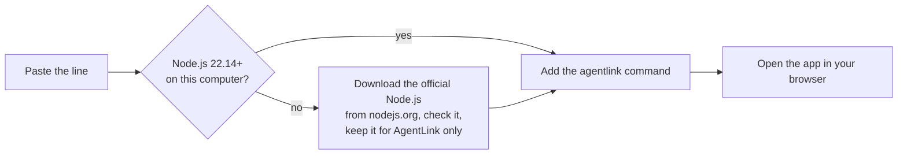

# Install AgentLink

*Applies to AgentLink 0.5.3. Mac, Windows 10 or 11, and Linux.*

**Goal:** AgentLink installed and open, in about two minutes. You need no account and no admin rights.

Pick one way:

- **On a Mac?** Get the Mac app: download, drag to Applications, open. No terminal needed.
- **Windows, Linux, or prefer the terminal?** Paste one command. AgentLink then runs in your browser.

## On a Mac: get the app (recommended)

No terminal needed. Download the file for your Mac:

- **[Download for Mac with Apple chip (M1, M2, M3, M4)](https://github.com/4thtech/agentlink/releases/latest/download/AgentLink-mac-arm64.dmg)** → file `AgentLink-mac-arm64.dmg`
- **[Download for Mac with Intel chip](https://github.com/4thtech/agentlink/releases/latest/download/AgentLink-mac-x64.dmg)** → file `AgentLink-mac-x64.dmg`

Not sure which? Click the Apple menu (top left of your screen), then **About This Mac**. "Chip: Apple M…" means Apple chip; "Processor: Intel" means Intel. In the file names, **arm64 = Apple chip** and **x64 = Intel**.

1. **Open the file you downloaded** and drag **AgentLink** to **Applications**.
2. **Open AgentLink from Applications.** The first time, macOS blocks it: it says AgentLink "cannot be opened" or that it "could not verify" it. Press **Done** (or **OK**), not **Move to Trash**.
3. **Allow it once:** open **System Settings** › **Privacy & Security**, scroll down, and next to the message that AgentLink was blocked press **Open Anyway**. Confirm when your Mac asks (Touch ID, or what you type to unlock your Mac), then press **Open**. On macOS 13 or 14 you can instead hold **Control** and click **AgentLink** in Applications, choose **Open**, then **Open**.
4. **You only do this once.** AgentLink opens on **Get started**. Go on with [Connect your AI app](README.md).

**Why step 3?** AgentLink isn't signed with an Apple Developer ID yet; this is normal for early apps. It does not mean something is wrong with the file. Never turn off your Mac's security settings for it.

Next time, open **AgentLink** from Applications. If macOS says the app is "damaged", and for updates: [Mac app](../apps/desktop-app.md).

## Windows, Linux, or the terminal: one command

1. **Open a terminal yourself.**
   - Mac: Cmd+Space, type **Terminal**, press Return.
   - Windows: Start menu, type **PowerShell**, press Enter.
   - Linux: your usual terminal.
2. **Paste one line and press Return** (Enter on Windows):

   Mac or Linux:

   ```bash
   curl -fsSL https://agentlink.4thtech.io/install.sh | sh
   ```

   Windows PowerShell:

   ```powershell
   irm https://agentlink.4thtech.io/install.ps1 | iex
   ```

   Windows Command Prompt instead:

   ```bat
   powershell -ExecutionPolicy Bypass -c "irm https://agentlink.4thtech.io/install.ps1 | iex"
   ```

3. **Your browser opens AgentLink** on **Get started**. Go on with [Connect your AI app](README.md).

The installer says **AgentLink is installed.**, then opens the app. Keep the terminal open while you use AgentLink; **Ctrl+C** closes it, and it also closes by itself after 30 minutes without use. Next time, open a new terminal and type:

```bash
agentlink
```

## What the installer does



- It changes nothing outside its own folder and your PATH, and needs no admin rights.
- Run the same line again to update.
- To see what it would do first, add `--dry-run` (Mac or Linux: `curl -fsSL https://agentlink.4thtech.io/install.sh | sh -s -- --dry-run`). To remove it, use `--uninstall`; your IDs are kept. Details: [installer](https://github.com/4thtech/agentlink/blob/main/installer/README.md).

## Got an invite link?

Open the link instead. The invite page gives you the same installer with the invite built in: one command installs AgentLink and opens the invite. See [Accept an invite](join-from-an-invite.md).

## Already have Node.js 22.14 or newer?

You can skip the installer:

```bash
npx -y @4thtech-io/agentlink@latest
```

The package name is exactly `@4thtech-io/agentlink`; similar names are not ours. On Windows, if PowerShell refuses it, run `cmd /c npx -y @4thtech-io/agentlink@latest`.

## If something goes wrong

- **Windows says "Windows protected your PC"** or blocks the script: see [Windows](windows.md).
- **The browser didn't open:** the terminal prints a link; open it yourself.
- **Anything else:** run `agentlink doctor`. It says in plain words what is set up and what to do next. More in [Troubleshooting](../help/troubleshooting.md).

Next: [Connect your AI app](README.md).
