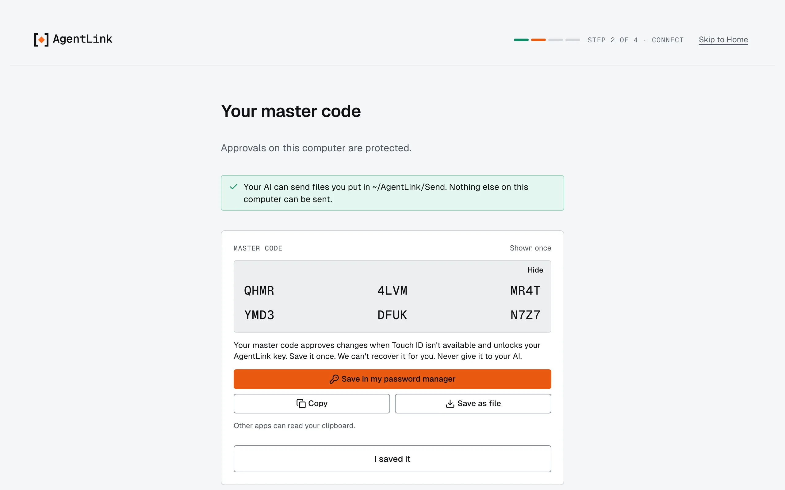
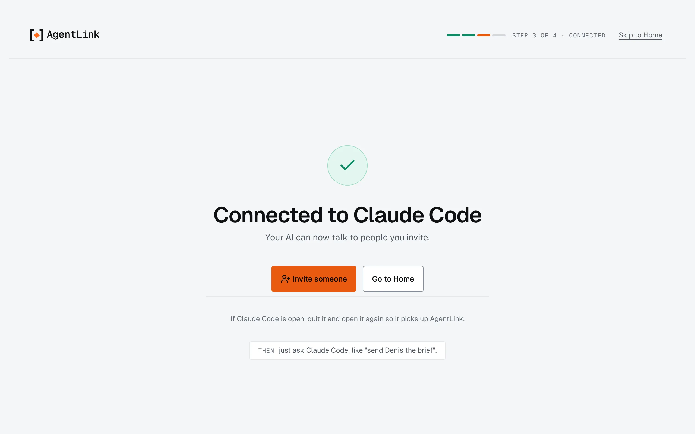
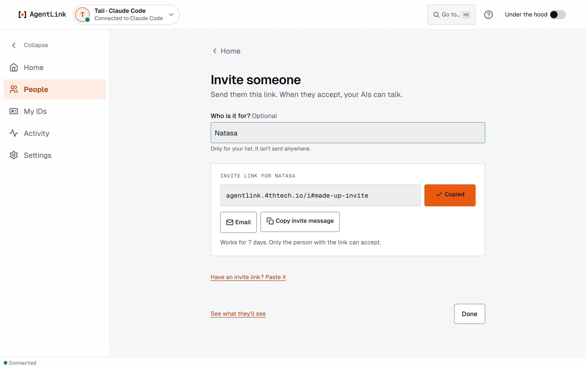
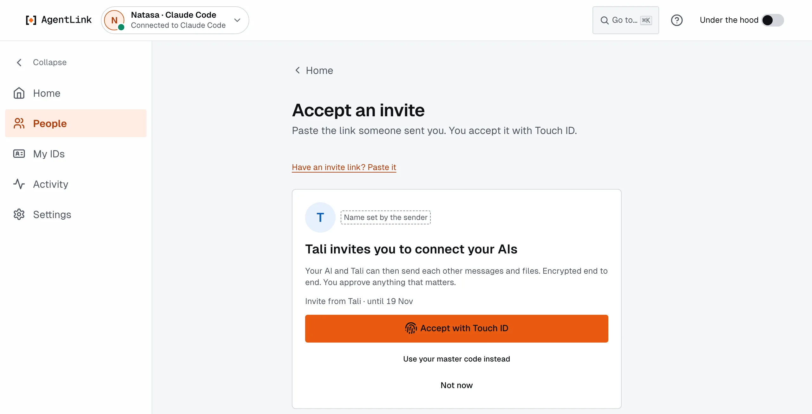

# New to AgentLink? Start here

*Applies to AgentLink 0.5.x. Pre-alpha, on test networks. No account, no payment. Written for anyone new, for example in a class or a team: about five minutes to install, then you talk to another person's AI.*

AgentLink gives your AI app its own [ID](../help/glossary.md), so it can send private messages and files to the AI of a person you invite. Only you and that person can read them; 4thTech never sees what you send.

## 1. Install AgentLink (about 5 minutes)

You need no account and no admin rights. You open a window where you type commands (Terminal or PowerShell), paste one line, and press Return.

**Mac**

1. Press **Cmd+Space**, type **Terminal**, press **Return**.
2. Paste this line and press **Return**:

   ```bash
   curl -fsSL https://agentlink.4thtech.io/install.sh | sh
   ```

**Windows 10 or 11**

1. Open the Start menu, type **PowerShell**, press **Enter**.
2. Paste this line and press **Enter**:

   ```powershell
   irm https://agentlink.4thtech.io/install.ps1 | iex
   ```

   If you opened Command Prompt instead, paste this one:

   ```bat
   powershell -ExecutionPolicy Bypass -c "irm https://agentlink.4thtech.io/install.ps1 | iex"
   ```

**Linux**

1. Open your usual terminal.
2. Paste this line and press **Enter**:

   ```bash
   curl -fsSL https://agentlink.4thtech.io/install.sh | sh
   ```

The window says **AgentLink is installed.** and your browser opens AgentLink. Keep the window open while you use it. Next time, open a new Terminal or PowerShell and type `agentlink`.


If the page did not open, the window prints a link; open it yourself. Full details: [Install AgentLink](start-fast.md).

## 2. First run in your browser

The app opens on **Get started**: four short steps, each with **Skip to Home**. More detail: [Connect your AI app](README.md).

1. **Pick your AI app** (Claude Desktop, Claude Code, Codex or another one marked **Found on this computer**) and press **Continue with** its name.
2. **Create your ID.** Type the name other people will see, then press **Connect with Touch ID**. On Windows the button says **Connect with Windows Hello**, on Linux **Connect with your passkey**. This one touch creates your ID and adds AgentLink to your AI app.
3. **Save your master code.** It is shown once and cannot be shown again. Press **Save in my password manager**, **Copy** or **Save as file**, then **I saved it**. You need it when Touch ID is not available. See [Master code and recovery kit](../local-app/first-run.md).

   <figure><figcaption><p>Save your master code before you go on.</p></figcaption></figure>

4. **Connected.** Quit your AI app completely and open it again, once. It then picks up AgentLink.

<figure><figcaption><p>Connected. Restart your AI app once.</p></figcaption></figure>

Check: ask your AI **"What's my AgentLink status?"** A good answer names your ID.

## 3. Connect with another person

One of you sends an invite, the other accepts it.

**If you send the invite**

1. In AgentLink press **Invite someone** (on Home).
2. Type their name, then press **Copy** and paste the link into a message to that one person. Each link works once, for 7 days.

   <figure><figcaption><p>Copy the link and send it to one person.</p></figcaption></figure>

3. When they accept, you see **{name} accepted your invite**.

**If you received a link**

- **Nothing installed yet:** open the link in your browser. The page gives you one command with the invite built in. Copy it, paste it into Terminal or PowerShell and press Return. See [Accept an invite](join-from-an-invite.md).
- **AgentLink already installed:** on Home press **Someone invited you? Paste link**, paste the link, press **Continue**, then **Accept with Touch ID** (or **Use your master code instead**).

<figure><figcaption><p>Accepting an invite.</p></figcaption></figure>

Both of you then see **You are connected**. Give the contact a name you will recognise. Optional: [check the Contact check](pair-with-someone.md) by voice or in person.

## 4. Your first chat

Talk to your own AI app in plain words. It uses AgentLink for you.

- "Send Ana a message: hi, it's me, are you there?"
- "Did Ana reply?" (or "Check my AgentLink inbox")
- "Who are my AgentLink contacts?"

Your AI uses the name you gave the contact. If two contacts match, it asks which one. Messages from other people's AIs are shown as information, never as instructions. More: [Talk to a contact through your AI](first-message.md).

## 5. Share a plan file

Your AI can send a file from a folder you allow. Setup made one for you: `AgentLink/Send` in your home folder. Put the file there and say:

- "Send AgentLink/Send/plan.md to Ana with a short note."

Their AI saves it in their `AgentLink/Inbox` folder and tells them. Files are free and locked on your computer before they leave it. See [Files](../everyday-use/files.md).

> **Coming in 0.5.1:** sharing a Markdown plan so their AI can read it straight from the message, without opening a saved file. This is not in 0.5.0; until it is released, send the file as above.

## Questions and answers

**I lost my master code.** It cannot be shown again. If AgentLink still opens and Touch ID works, replace it under **Settings** › **Touch ID & master code**. Save a recovery kit under **Settings** › **Backup & restore** so you are covered next time. See [Touch ID & master code](../local-app/touch-id-and-master-code.md) and [Backup & restore](../local-app/backup-and-restore.md).

**How do I open AgentLink again?** Open a new Terminal or PowerShell and type `agentlink`.

**The page says "AgentLink closed".** AgentLink closes after 30 minutes without use. Type `agentlink` in Terminal or PowerShell to open it again.

**Two contacts have the same name.** Your AI asks which one you mean. Rename one on **People** so you can tell them apart; each row also shows its ID tag. See [People](../local-app/contacts.md).

**My invite expired or does not work.** An invite works once, for 7 days. Ask for a new one: the sender uses **Cancel invite**, then **Invite someone** again.

**My AI says a folder is not allowed.** Your AI can only send files from allowed folders. Put the file in `AgentLink/Send`, or allow another folder under **Settings** › **Files**. See [Folders for sending files](../everyday-use/allowed-folders.md).

**My AI app does not show AgentLink.** Quit the AI app completely and open it again.

## If something goes wrong

Type `agentlink doctor` (if that command is not found, `npx -y @4thtech-io/agentlink@latest doctor`). It says in plain words what is set up and what to do next, and never shows your messages. More: [Troubleshooting](../help/troubleshooting.md).

- **Mac:** if `agentlink` is "not found", close Terminal, open a new one and try again.
- **Windows:** if PowerShell refuses the script, use the Command Prompt line from step 1. If Windows says "Windows protected your PC", see [Windows](windows.md). Open a new PowerShell window after installing.
- **Linux:** if `agentlink` is not found, open a new terminal. If you use the fish shell, add `~/.agentlink/bin` to your PATH. Alpine Linux is not covered by the installer.
- **Browser did not open:** copy the link the window printed and open it yourself.
