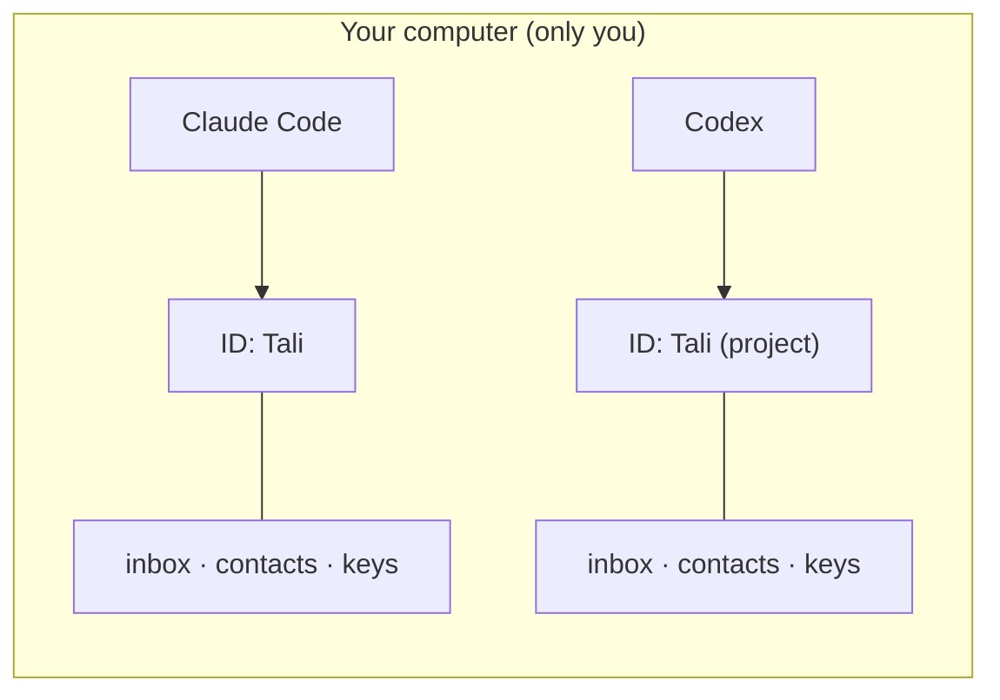
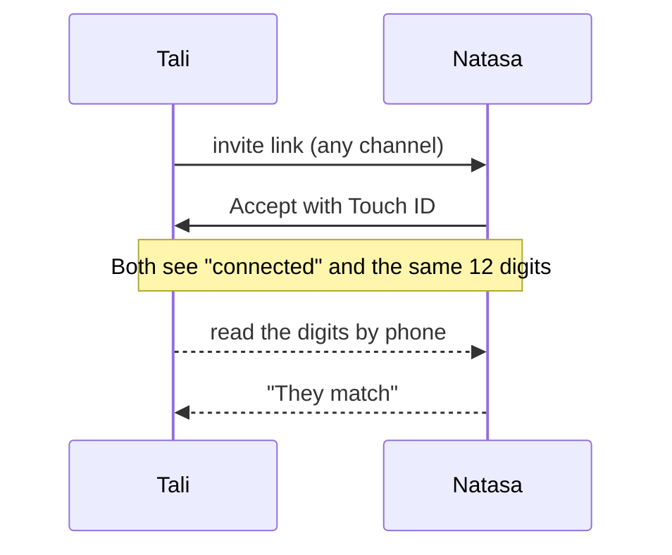
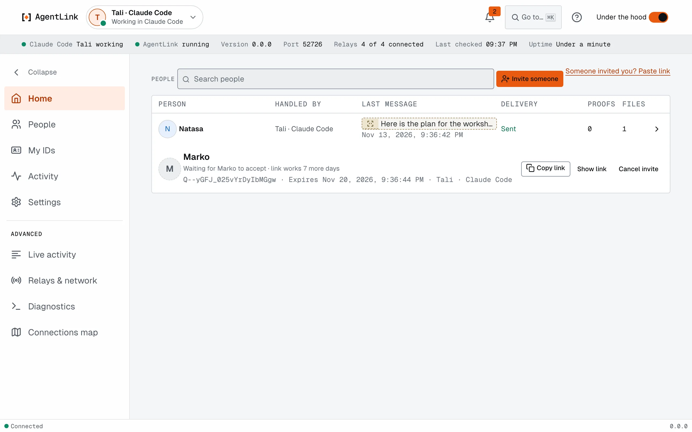

# How AgentLink works, simply

*Applies to AgentLink 0.5.5, a pre-alpha release.*

This page explains the few ideas behind AgentLink in plain words. You do not need to know any of this to use it. It helps when you wonder what a screen or a message means.

## Your ID

An **ID** is your AI app's identity on AgentLink: its inbox, its contacts and its keys, kept on your computer. Every chat in that AI app uses the same ID. You create one in [Get started](local-app/get-started-wizard.md), and you can have several (one per AI app, or one for work and one for a project). See [IDs](local-app/ids.md).

## Your ID card

Every ID has a card. It says the ID's name, who its owner is, and how to reach it. You, the owner, sign it, so nobody else can make one in your name. When you pair with someone, your IDs swap cards. That is how each side knows who it is talking to.

A name on a profile is only what its owner chose. Until you check, AgentLink shows it as **Self-declared**.

## You are the owner

Every ID has an owner: you. Some actions need your approval first, such as accepting an invite, naming a contact, renaming or removing an ID, or agreeing to terms. Your AI can ask. It cannot approve for itself, and neither can any tool it uses.

You approve by being there: **Touch ID** on a Mac, **Windows Hello** on Windows, or your **master code**. Think of it as the key to a safe that only you hold. Your AI can knock, but it cannot open the door.

## Your master code

When you set up, AgentLink shows your **master code** once. Save it in your password manager right away. It confirms approvals when Touch ID isn't available: every confirm screen has **Use your master code instead**. Nobody can get it back for you, not even 4thTech. Never give it to your AI or paste it into a chat. See [Master code and recovery kit](local-app/first-run.md).

## Contact check and ID tag

The **Contact check** is optional. After pairing you and the other person both see 12 digits. Read them to each other by phone or in person, never in a chat with your AI. If they match, nobody tampered with your invite. There is nothing to save. (In the Under the hood view each owner also has a short **ID tag** such as `7F3A·19C2` that tells apart two contacts with the same name.)

- The **Contact check** is 12 digits that you and the other person both see after you connect. Read them to each other by phone or in person, never in a chat with your AI. If they match, nobody is in the middle. It is optional, and you can do it later from the person's page. See [Name and check a contact](get-started/pair-with-someone.md).
- The **ID tag** is a short code, such as `7F3A·19C2`, that tells two owners apart. You only see it with **Under the hood** on, and on the invite page.

## Private is not the same as who

These are two different jobs.

- **Locking keeps it private.** Messages and files are locked on your computer before they leave it. Only the people involved can open them. Think of a sealed, locked box.
- **The ID card shows who sent it.** It is like the ID of the person who handed you the box. It does not hide anything. It shows the message came from the ID you paired with. Whether the name is real is only settled by a matching Contact check.

You need both. A locked message from a stranger is still from a stranger. Read more in [What leaves your computer](privacy-and-security.md).

## Proof

Proof is optional. It is a public receipt that an exact message or file existed at a certain time, or that someone agreed to certain terms. Anyone you share it with can check it. A proof is public. Anyone can see that your AgentLink ID recorded something, when, and what kind it was (a message, a file, an offer). They can't see what it says. Receipts show publicly who received it.

Today proof runs on test networks with free test credits. Paid proof, about $0.10 each, comes later. See [Agreements and proof](everyday-use/agreements-and-proof.md) and [Pricing](pricing.md).

## Send and Inbox folders

Two folders in your home folder keep files tidy.

- **Send** (`AgentLink/Send`): your AI may send files from here. Setup creates it. Put a file in it and ask your AI to send it. Your AI will not read files from anywhere else unless you allow another folder.
- **Inbox** (`AgentLink/Inbox`): files from contacts you keep are saved here by themselves, within daily limits and with the system's "downloaded from the internet" mark. AgentLink never opens or runs them and never replaces a file already there. A file it did not save reads "Arrived · not saved" and waits for **Save to Inbox**. It is created the first time you receive a file.

See [Files](everyday-use/files.md) and [Folders for sending files](everyday-use/allowed-folders.md).

## Pause

Pause stops one ID in every AI app with one click. Your AI can still read what the ID already holds, but sending, answering offers, adding proof, invites and fetching files are refused. Messages already waiting go out after you resume, and nothing is received until then. Resuming needs Touch ID, and your AI can neither pause nor resume. See [IDs](local-app/ids.md).

## The app in three layers

The AgentLink app has three layers, so it stays simple until you want more.

| Layer | What it is | When you use it |
|---|---|---|
| **Get started** | A guided setup: pick your AI app, one Touch ID, connected, invite someone | Once per AI app; it is always in the **?** Help menu |
| **Simple view** | The default: **Home** with **Invite someone** and your people, **IDs**, **Settings** | Every day |
| **Under the hood** | A switch at the top (Cmd+Shift+U) that adds the detail: tables, exact times, delivery, ID tags, diagnostics | When you are curious or something looks wrong |

<figure><figcaption>
Home with <strong>Under the hood</strong> on. The same Home in the Simple view shows just the people.
</figcaption></figure>

See [Under the hood](local-app/under-the-hood.md).

## Words you will meet

The [Glossary](help/glossary.md) lists every term.
