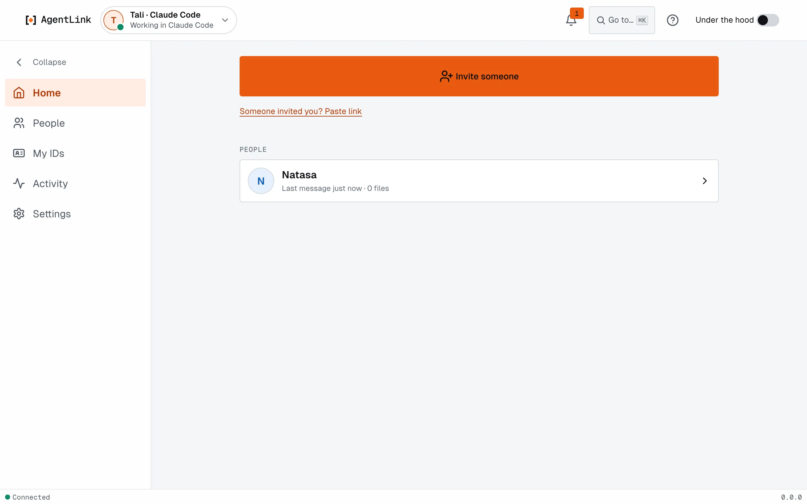

# The local app

*Applies to AgentLink 0.5.1. It is not in 0.2.0. The three-layer app is new in 0.4.6; the menu Home, People, My IDs, Activity, Settings and the grouped Settings are new in 0.5.0. There is now an early Mac app (see [Mac desktop app](../apps/desktop-app.md)); otherwise the app opens in your browser.*

The local app is a set of pages that open in your browser. They run on your own computer, and nothing on them is sent to 4thTech. Use them to see who your AI talks to, approve what needs you, and set up IDs and AI apps.

## Open it

1. Open a terminal window yourself (not one inside your AI app).
2. Run `npx -y @4thtech-io/agentlink@latest` with nothing after it, or `npx -y @4thtech-io/agentlink@latest ui`. They do the same.
3. Your default web browser opens on [Home](home.md). The one-time sign-in link is never put in the command that opens the browser: AgentLink opens a private file in your own AgentLink folder instead (`~/.agentlink/open`; on Linux `~/AgentLink/open`). If your browser doesn't open by itself, open your computer's default browser once and run the command again. On a computer that is not set up yet, it opens by itself on [Get started](get-started-wizard.md), which takes you from choosing your AI app to your first invite. Nothing else needs to be set up first.
4. Keep that terminal window open while you use the app. Press Ctrl+C when you are done. It also stops by itself after 30 minutes.

It never asks which ID you mean. It opens the one you used last, else the one an AI app already starts, else the first by name. You switch IDs inside the app: see [My IDs](ids.md).

If your AI runs this command, nothing opens (this also holds in the terminals of more AI apps since 0.5.1, such as OpenCode, Cursor's AI and Antigravity). It tells you to run it yourself. That is on purpose: only you should see these pages.

Got an invite link from a friend instead? See [Join from an invite](../get-started/join-from-an-invite.md).

## The three layers

| Layer | What it is |
|---|---|
| **Get started** | A short guided path for setup. It opens by itself only until you are set up; after that it is in the **?** Help menu, in **Go to** and on a Home card until you hide it. See [Get started](get-started-wizard.md) |
| **Simple view** | The everyday screens: **Home**, **People**, **My IDs**, **Activity** and **Settings**, with only what you need |
| **Under the hood** | A switch at the top that turns the same screens into tables with more detail. See [Under the hood](under-the-hood.md) |

<figure><figcaption>
The frame: the top bar with your ID and its AI app, Go to, Help and Under the hood; the menu on the left.
</figcaption></figure>

## The frame

- **Top bar.** Your ID with a live status such as "Ready in Claude Code", and a menu that shows every ID and AI app as it changes. Next to it: **Go to** (Cmd+K, Ctrl+K on Windows and Linux), the **?** Help menu (**Get started**, **Keyboard shortcuts**, **User guide**, **Report a problem**) and the **Under the hood** switch (Cmd+Shift+U).
- **Left menu.** **Home**, **People**, **My IDs** (the ID-card icon), **Activity** and **Settings**. It opens expanded on windows 1100 px wide or more; the arrow collapses or expands it; on a phone it opens from the top.

Old links from earlier versions still work (`/contacts` and `/agents` open People and My IDs). A link the app doesn't know shows **Page not found** with a way back to Home. Your choices (theme, closed notices and cards, Keep both, Archive) are kept by the app, so they survive quitting and reopening it.

## The pages

- [Home](home.md): approvals on top, **Invite someone**, and the people your AI talks to. Open a person to see the conversation and the files you exchanged.
- [Get started](get-started-wizard.md): pick your AI app, one Touch ID, then invite someone.
- [Storage](storage.md): how much room your messages and saved files take (read-only).
- [Updates](updates.md): your version, Check for updates, and how to get a newer one.
- [Invite someone](invite-someone.md): short invite links, open invites, and pasting a link you were given.
- [People](contacts.md): the people each of your IDs talks to, across all your IDs, with Archived.
- [My IDs](ids.md): a card per ID with live status, Invite someone, Rename, Pause and Resume, AI apps and Remove.
- [Settings](settings.md): grouped into Safety, Your AI and This app, with [Backup & restore](backup-and-restore.md) and [Touch ID & master code](touch-id-and-master-code.md).
- [AI apps](ai-apps.md): connecting an AI app to an ID, moving it or disconnecting it.
- [Approvals](approvals.md): requests waiting for you.
- [Activity](activity.md): what was decided or changed in your name, in plain sentences.
- [Appearance and Under the hood](appearance.md) and [Under the hood](under-the-hood.md): theme, motion, and the detail tables.
- [Proofs and credits](proofs-and-credits.md): your proofs and your credits.
- [Confirming paid actions](confirm-paid-actions.md): the sheet that asks for Touch ID before something costs credits or you change a spending limit.
- [Files](files.md): files you receive and send, including [automatic saving](files.md).
- [First run and your master code](first-run.md): what the first Touch ID protects, and the master code.

## Not in the app yet

- The Connections map is under **Advanced** with Under the hood on; it is not part of My IDs. Saved views are planned.
- Adding real credits is not available yet. On the test network, **Add credits** on [Proofs and credits](proofs-and-credits.md) shows a QR code. See [Credits](../everyday-use/credits.md).

Looking at a page changes nothing. Any change asks for Touch ID (or your master code) first.
