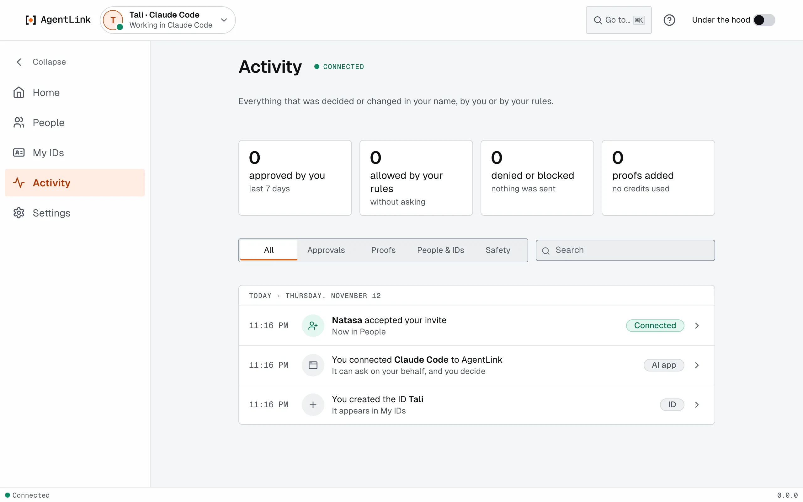

# Activity

*Applies to AgentLink 0.5.0. Plain sentences, the counts, the filters and opened rows are new in 0.5.0. A fresh screenshot of this page follows.*

Activity is everything that was decided or changed in your name, by you or by your rules, newest first. Every row is one plain sentence with the person's name, the file and the cost where known, for example *"You approved sending Q3-plan.pdf to Natasa"* or *"You accepted Ana's invite"*. It does not show what your messages say.

## What it shows

- **Four counts for the last 7 days:** approved by you, allowed by your rules (without asking), denied or blocked (nothing was sent), and proofs added (with the credits used). Choose one to show only those.
- **Filters:** **All**, **Approvals**, **Proofs**, **People & IDs** and **Safety**, and a **Search** box.
- **Rows** for approvals, proofs, people (connected, with whose invite; removed; blocked and unblocked; Contact check), your IDs (created, renamed, paused, resumed, removed), AI apps (connected, disconnected), rule changes and saved recovery kits. Saved kits, blocks and Contact checks are under **Safety**.
- **Open a row** to see what it was, when, and where to go next (for example **Open rules**, **Open My IDs** or **Open backup**).

<<<<<<< HEAD
<figure><figcaption>
Activity, on made-up data.
</figcaption></figure>

Open it from **Activity** in the left menu. With [Under the hood](under-the-hood.md) on, a live activity stream shows what is happening now. Back to [The local app](README.md).
=======
A person the page can't name gets neutral words, never a blank. Nothing on this page changes anything. If it is empty, it says what will show up here.

Open it from **Activity** in the left menu, or from **Activity** on an ID's card. With [Under the hood](under-the-hood.md) on, a live activity stream shows what is happening now. Back to [The local app](README.md).
>>>>>>> origin/main
