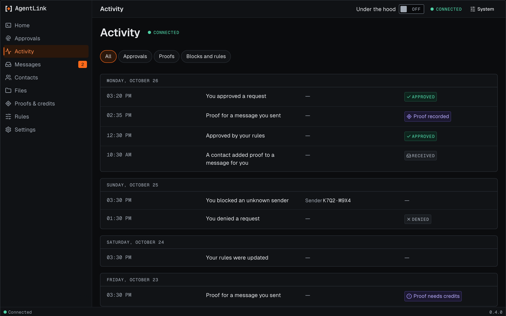

# Activity

*Applies to AgentLink 0.4.2 (released 28 Oct 2026).*

Activity is a list of what happened lately, newest first, in plain words. It does not list your messages or files. It shows:

- requests you approved or denied, and requests your rules approved for you,
- proofs,
- senders and contacts you blocked,
- changes to your rules.

<figure><figcaption>
Activity, with made-up data: approvals, proofs and a blocked sender.
</figcaption></figure>

Press **Show more** for older items. Nothing on this page changes anything. If it is empty, it suggests what to ask your AI.

Open it with `npx -y @4thtech-io/agentlink ui`. Back to [The local app](README.md).
