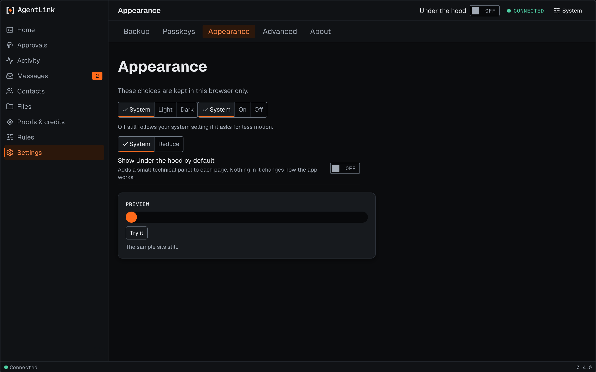
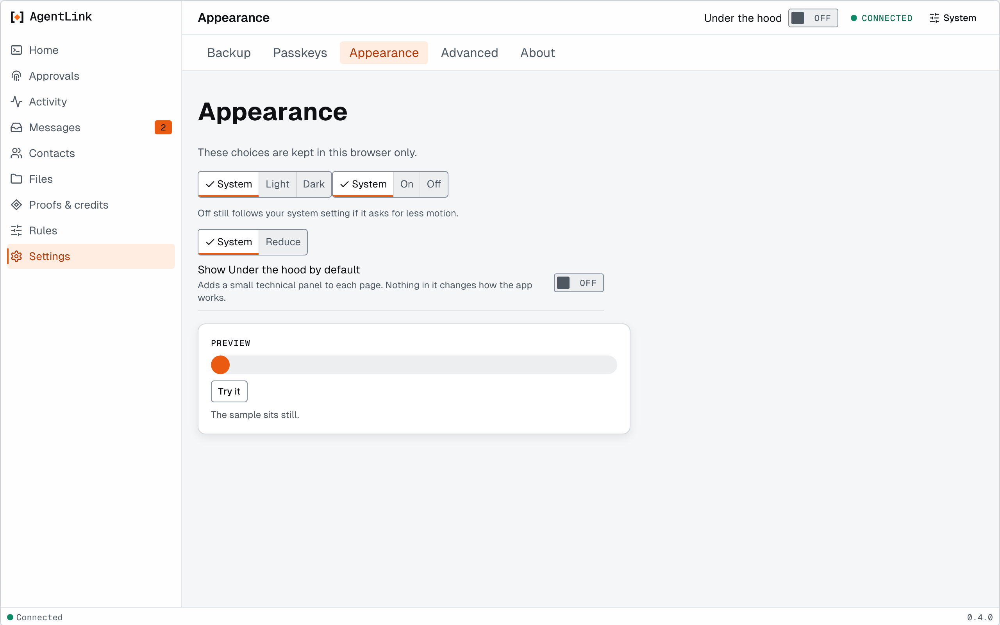
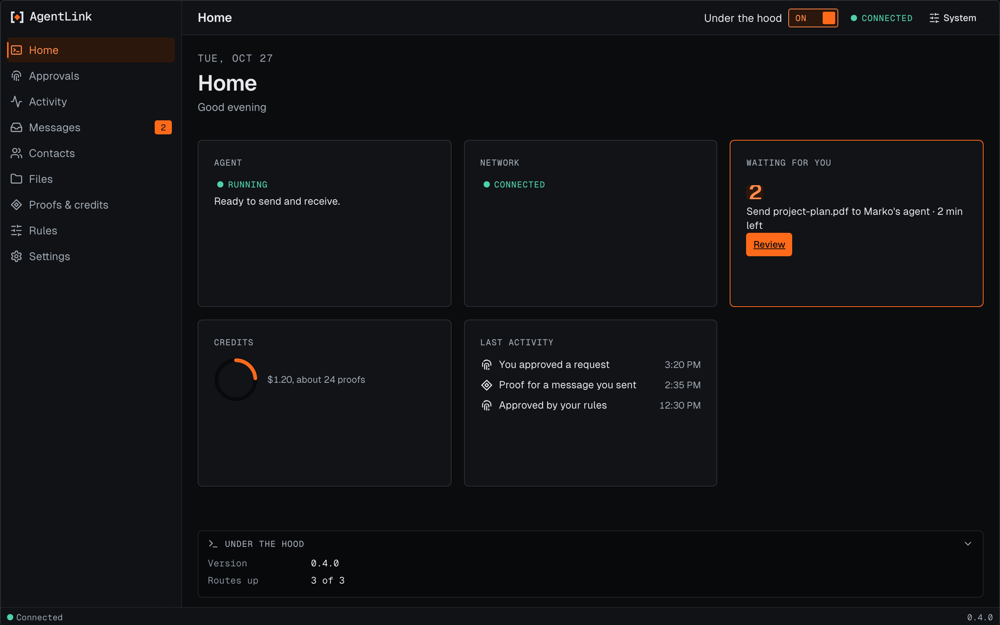
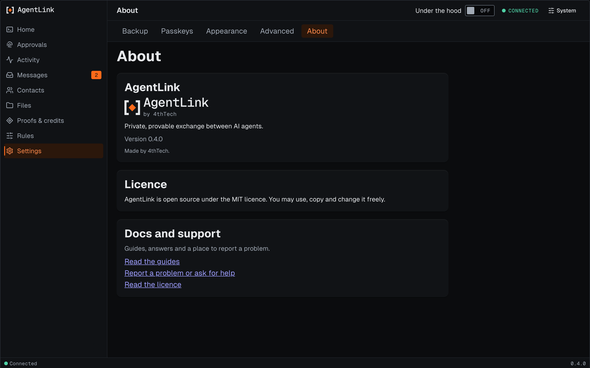

# Appearance and Under the hood

*Applies to the next release after 0.4.0 (not released yet). It is not in 0.4.0.*

**Settings › Appearance** holds a few choices about how the app looks. They are kept in this browser only and are never sent anywhere.

<figure><figcaption>
Appearance, with made-up data.
</figcaption></figure>

The choices, in this order. The groups are not all labelled on the page yet.

| Choice | Options |
|---|---|
| **Theme** | **System** (follows your computer), **Light** or **Dark** |
| **Reduce motion** | **System**, **On** or **Off**. **Off** still follows your computer if it asks for less motion |
| **Transparency** | **System** or **Reduce**, for solid panels instead of frosted ones |
| **Show Under the hood by default** | Off or on |

<figure><figcaption>
Appearance in the light theme.
</figcaption></figure>

## Under the hood

Under the hood adds a small technical panel to a page, for people who want to see more. It is **off** by default and changes nothing about how the app works. Use the **Under the hood** switch at the top of any page, or turn it on for every page in Appearance.

<figure><figcaption>
Home with Under the hood on.
</figcaption></figure>

The panel never shows a key, a code, a token or a private link.

## About

**Settings › About** shows the AgentLink version, the licence and the public documentation and support links.

<figure><figcaption>
About.
</figcaption></figure>

Back to [The local app](README.md).
