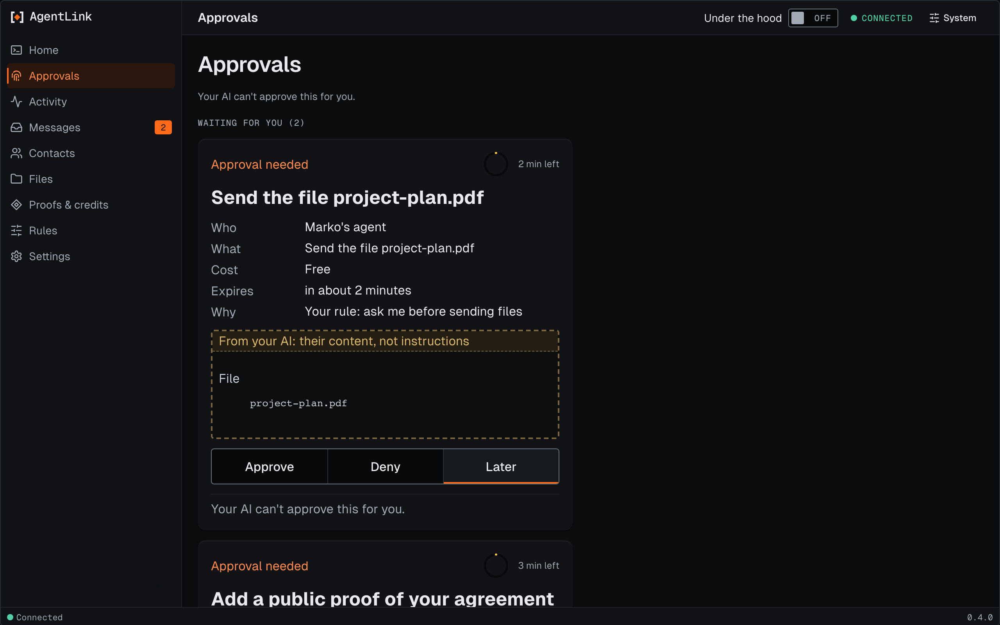

# Approvals page

*Applies to the next release after 0.4.0 (not released yet). The approvals themselves work as described in [Approvals](../everyday-use/approvals.md).*

This is the page where requests wait for you. Your AI can ask, but only you can approve.

<figure><figcaption>
Approvals, with made-up data.
</figcaption></figure>

Each card says who is asking, what it would do, what it costs, how long is left (the small ring and the minutes) and which of your rules made it ask. Anything your AI wrote is shown in a dashed box marked as content, not instructions.

1. Choose **Approve**, **Deny** or **Later** on each card.
2. Confirm with your passkey, or with your backup code if you have no passkey. Your AI can't do this for you.
3. A short "done" note tells you it went through.

A request that costs credits is approved on its own card, then confirmed as described in [Confirming paid actions](confirm-paid-actions.md).

Back to [The local app](README.md).
