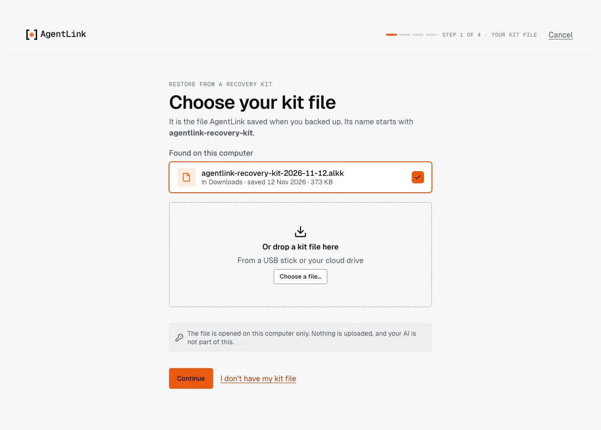
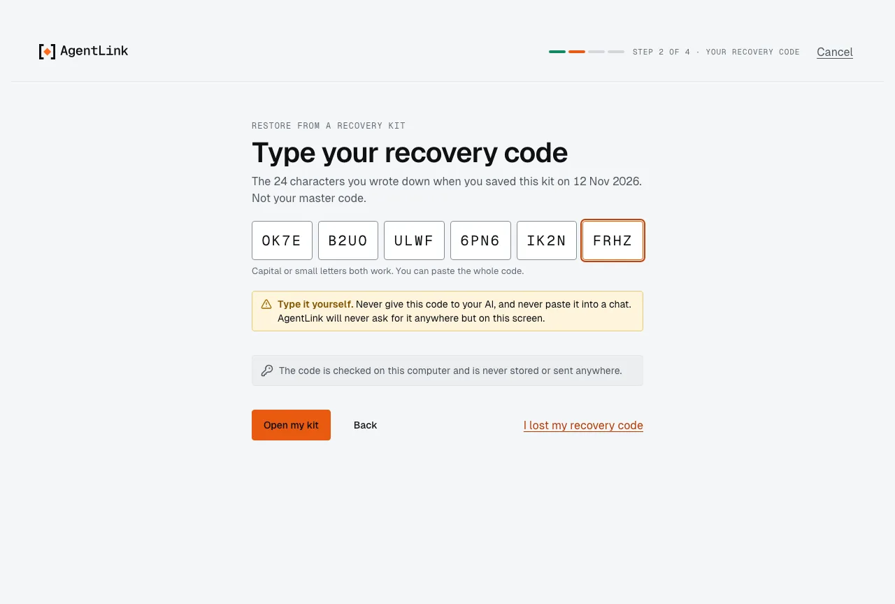
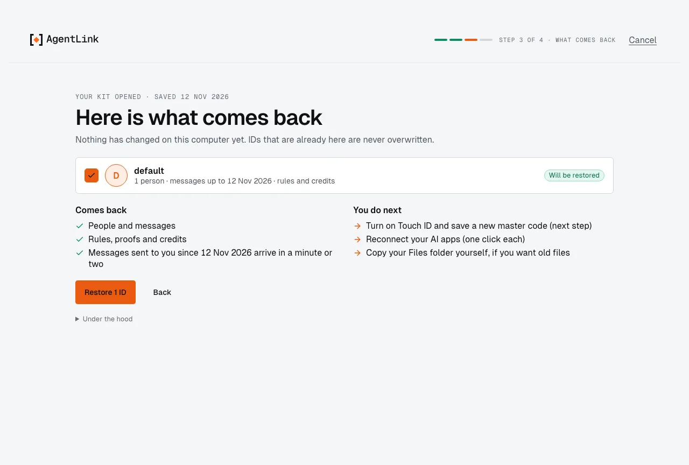
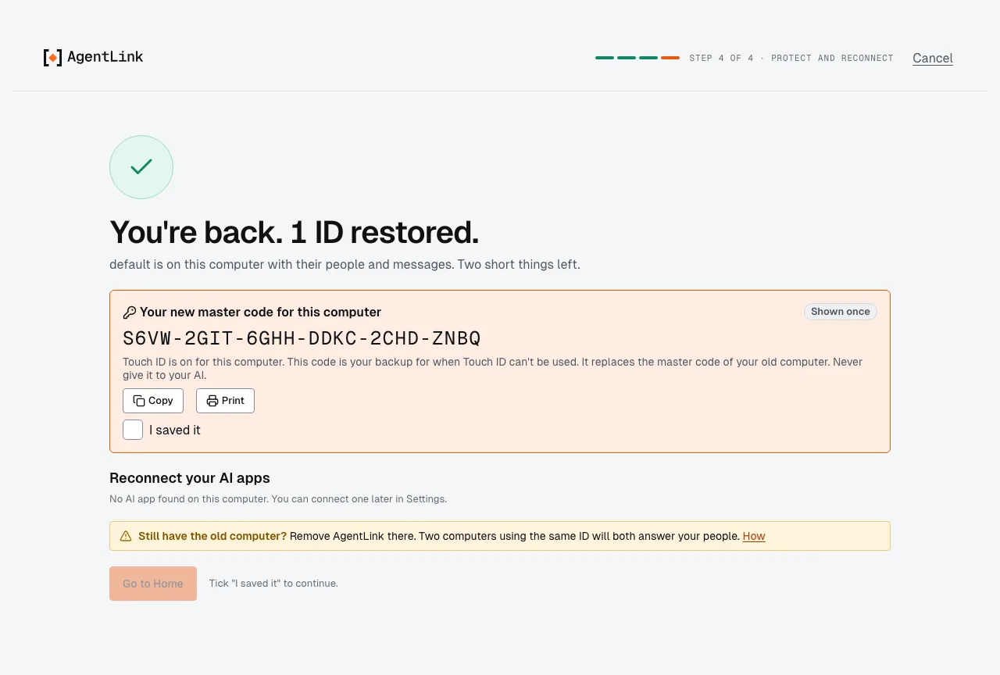

# Backup & restore

*Applies to AgentLink 0.5.3. One recovery kit for all your IDs, the save checklist, Check that my kit opens and restoring in the app are new in 0.5.0. In 0.4.14 a kit was saved per ID and restore was not in the app yet.*

A recovery kit is everything you need to get AgentLink back on any computer: **one locked file with all your IDs**, opened by a **recovery code** of 24 characters that is shown once. Open **Settings** › **Backup & restore** (in the **Safety** group); **Back up** under **More** on an ID's card in [My IDs](ids.md) leads here too.

<figure><figcaption>
Backup &amp; restore, here with a kit that is missing two newer IDs.
</figcaption></figure>

## Where you stand

The card at the top reads the record AgentLink keeps of your last kit:

- **You're backed up:** your last kit covers all your IDs and people, and it was checked.
- **Your kit is out of date:** it names the IDs (and how many people) that joined since. Save a new kit.
- **Your last kit isn't finished:** it was saved, but nobody checked that it opens with its code. If you wrote the code down, check it; if not, save a new kit.
- **No recovery kit yet:** if this computer is lost or reset, your IDs, people and messages can't be brought back.

## Save a kit

1. Press **Save a recovery kit** (or **Save a new kit**) and confirm with Touch ID or your master code. One gesture saves every ID on this computer into one kit.
2. The page shows where the kit was saved and **Your recovery code**, *shown once*.
3. A checklist of three things follows:
   - **Move the kit file off this computer** (**Show in Finder** finds it): a USB stick or your cloud drive is fine.
   - **Write down the recovery code** (**Print** prints it with the three restore steps, without saving anything to disk; **Copy** copies it, and other apps can read your clipboard).
   - **Check that it opens:** type the code and press **Check now**. It says **This kit opens.**
4. **Done** turns on when all three are ticked.

If you leave while a kit is being saved, or while its code and checklist are on screen, the app asks first, because the code can't be shown again.

**IDs not in this kit.** The saved kit names any ID it does not hold, and why: an ID kept with a passphrase file is backed up in the terminal; an ID that couldn't be opened just now is included if you save again in a moment; one kit holds up to 16 IDs.

**Check that my kit opens** (under *Getting back in*) checks a kit at any time, without a second computer: pick the file, type its code, and see what it holds. Nothing is written to this computer.

Keep the kit file and its code apart: anyone with both can read your messages. Never give the code to your AI.

## What comes back, and what you set up again

| Comes back from a kit | Set up again afterwards |
|---|---|
| Your IDs and their names | Touch ID and a new master code (one step) |
| Your people, and whether you checked them | Your AI apps (one click each) |
| Your messages | Files you received: copy your Files folder yourself |
| Your rules, proofs and credits | Your own storage, if you connected one |

## Restore from a kit

If the app is closed right after **Restore 1 ID** and before you saved the new master code, the next start goes back to **Finish restoring**. Choose the same kit again: it finishes with Touch ID and a new master code. Step 3 names your IDs by the name people see (an ID already here shows its name; a new one reads **Your first ID** until it comes back with the kit). A kit is saved in your home folder when Downloads is a link to another folder.

On a new computer, install AgentLink and choose **I have a recovery kit** on the first screen (or in Get started). On a computer that already has AgentLink, open **Backup & restore** and press **Restore…**; it first asks for Touch ID or your master code. A restore takes about two minutes, in four steps:

1. **Your kit file.** AgentLink looks for kits in Downloads, Desktop and your home folder (their names start with *agentlink-recovery-kit*), or you drop one in or **Choose a file…**. The file is opened on this computer only; nothing is uploaded, and your AI is not part of this.
2. **Your recovery code.** Type the 24 characters in six groups of four (capital or small letters both work, and you can paste the whole code). This is the kit's recovery code, not your master code.
3. **What comes back.** A list of the IDs in the kit, each by the name you gave it, with its people and how recent its messages are (a kit saved by an older version shows each ID by its folder until it is restored; an older version given a newer kit says it was made by a newer version). Nothing has changed on this computer yet. IDs that are already here are never overwritten (*Already here*); an ID you removed can't come back. Press **Restore 1 ID** (or **Restore {n} IDs**).
4. **Protect and reconnect.** On a new computer you turn on Touch ID and get a new master code, shown once with **Copy** and **Print**; tick **I saved it**. Then **Reconnect your AI apps** with one click each, and **Go to Home**.

<figure><figcaption>
Step 1: the kit file, found in Downloads.
</figcaption></figure>

<figure><figcaption>
Step 2: the recovery code, typed by you.
</figcaption></figure>

<figure><figcaption>
Step 3: what comes back, before anything changes.
</figcaption></figure>

<figure><figcaption>
Step 4: you're back. Save the new master code and reconnect your AI apps.
</figcaption></figure>

**An ID with the same name.** If this computer already has an ID with the same name, the restored one comes back next to it, still named the same. Afterwards, [My IDs](ids.md) asks you to rename one of the two so people can tell them apart.

**Still have the old computer?** Remove AgentLink there. Two computers using the same ID will both answer your people. **How to move** on Backup & restore walks through moving to a new computer.

**No kit file or no code?** *I don't have my kit file* and *I lost my recovery code* explain your options: each kit has its own code and it can't be reset. If your old computer still works, save a new kit there; otherwise you can start fresh, and your people will need new invites.

**In the terminal.** `agentlink restore` does the same in a terminal you opened yourself, and `agentlink restore --check` only checks that a kit opens. The app offers it when the browser has no Touch ID, Windows Hello or passkey to protect a new computer.

Back to [Settings](settings.md) or [The local app](README.md).
