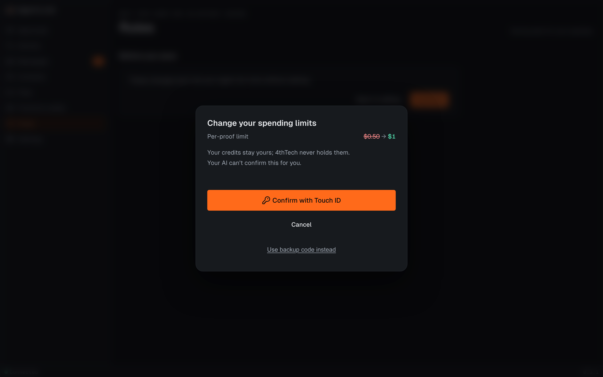

# Confirming paid actions

*Applies to AgentLink 0.4.3 (released 28 Oct 2026). It is not in 0.3.0.*

Some things cost credits or change how much your AI may spend. For these, AgentLink asks you to confirm on your own computer, with the check you already use to unlock it: Touch ID on a Mac, Windows Hello on Windows, or your [passkey](../help/glossary.md). Your AI can't confirm this for you.

<figure><figcaption>
The confirmation sheet for a spending change, with made-up data.
</figcaption></figure>

## When you are asked

| What happens | Do you confirm? |
|---|---|
| A proof costs less than your per-proof limit and fits your 24-hour budget | No. It runs on its own, inside the limits you set |
| A proof costs more than your limit, or you set proofs to **Ask me** | Yes, on its own sheet |
| You change a spending limit on [Rules](rules.md): proofs on or off, the 24-hour budget, the per-proof limit, or a limit for one contact | Yes |
| Verified registration, which costs $5 | Yes, the same way. It is not available yet |

Everything else keeps its usual passkey or backup-code check. AgentLink does not hold your credits or move money for you. The sheet says so: **Your credits stay yours; 4thTech never holds them.**

## Confirm a paid action

1. Open the sheet. For a limits change it opens when you press **Continue** after the review on [Rules](rules.md). For a proof, your AI tells you it is waiting and shows its link.
2. Read the amount and what it is for. A limits change shows each old and new value.
3. Choose **Confirm with Touch ID** (or **Windows Hello**, or **your passkey**). Your computer shows its own prompt. Use your fingerprint, face or PIN there.
4. The sheet shows a check and closes by itself after about a second. With reduced motion turned on, it waits for **Close**.

No passkey, or it won't work? Choose **Use backup code instead** (a small link under the button) and type your backup code.

## If something goes wrong

| Message | What to do |
|---|---|
| **Not confirmed. Nothing was paid.** | You dismissed the prompt. Press the button to try again, or **Cancel** |
| **Couldn't confirm it was you. Try again.** | Try again with your fingerprint, face or PIN |
| **Something changed since you opened this. Check it again.** | Read the new amounts, then confirm again |
| **This request expired.** | Ask your AI to start again. Nothing was paid |
| **Your passkey needs to be set up again for paid actions. Use your backup code this time.** | Use the backup code now, then switch to Touch ID again in [First run](first-run.md) |
| **That backup code didn't match.** | Check the code. After three wrong tries, start again |

For the technically curious: how this works

| On the page | What happens | Where it is built |
|---|---|---|
| The sheet | Shows only the statement your computer's AgentLink built from stored data. Nothing comes from the link or from your AI | `POST /api/ui/pay-confirm/begin` and `/finish` · [04 §2.5.3](https://github.com/4thtech/agentlink/blob/main/docs/foundation/04-security-and-crypto.md) · D-132 |
| Confirm with Touch ID | A passkey check that requires you to be present, tied to this exact statement and used once | [`pay-confirm.ts`](https://github.com/4thtech/agentlink/blob/main/packages/node/src/pay-confirm.ts) |
| Page text | Every word on the sheet | [`pay-confirm.tsx`](https://github.com/4thtech/agentlink/blob/main/packages/ui/src/components/pay-confirm.tsx) |

Back to [The local app](README.md).
