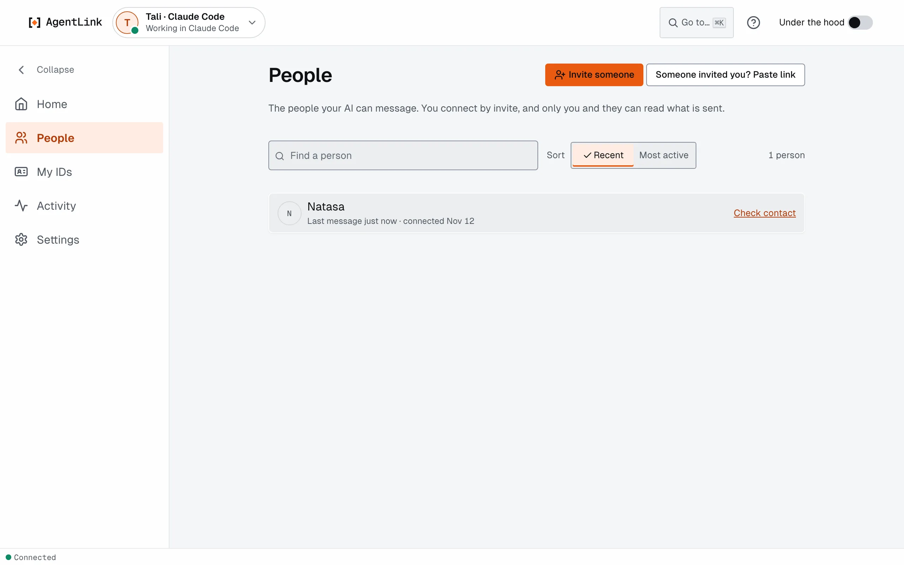

# Contacts page

*Applies to AgentLink 0.4.14. In 0.4.6 the people your AI talks to are on [Home](home.md), with their conversations and files. This People page is still there (open it with Go to, Cmd+K, or its old link) and shows each contact with its label.*

The page lists your contacts by name, each with its label (Self-declared or Contact checked). For how contacts work, see [Contacts](../everyday-use/contacts.md).

<figure><figcaption>
People, with sorting by Recent or Most active.
</figcaption></figure>

<figure><figcaption>
A person's page.
</figcaption></figure>

## Add a contact

Every **Invite someone** in the app (Home, Get started, Go to, this page) opens one Invite screen, with two ways in.

- **Invite someone** shows your short link, ready to **Copy**, **Email** or **Share**, and a preview of what your friend sees. The link is under 80 characters. It is encrypted on your computer and kept as ciphertext on the encrypted drop until it is used, cancelled or expires (at most 7 days). If the drop can't be reached within 10 seconds, you get the long link instead. Older long links still work. Send it only to the person you mean: anyone with the link can connect once. Under the hood shows the long link and a QR code.
- **Have an invite link? Paste it** accepts an invite someone sent you, with Touch ID, without making one of your own. When it works, both computers show **You and** their name **are connected** with the 12 digits to compare.

## Open invites

The page lists the invites you (or your AI) created, who each is for and when it expires, with **Copy link**, **Show link** and **Cancel invite**. The link stays encrypted on this computer until the invite is accepted, cancelled or runs out. An invite made before this was added can't be copied again: cancel it and create a new one.

## Contact check

For a new contact the page shows 12 digits, the Contact check. Read them to the other person by phone or in person, never in a chat with your AI. Then choose:

- **They match:** the contact becomes Contact checked, after you confirm with your passkey or master code.
- **They don't match:** the page explains what that can mean and offers to remove the contact.
- **Skip:** decide later.

## Who is active

Each contact shows a small 24-hour pulse and a word: **Active now** (a filled dot), **Today** (a hollow ring) or **Quiet** (nothing). The state never depends on colour. The **Sort** control can put **Most active** first. AgentLink works this out on your computer from counts and times only, never from message text or file names.

## Rename or remove

You can rename a contact or remove one. Both ask for your passkey or master code. On Home, the same actions, and checking the 12 digits, are in the menu on a person's page. With no contacts yet, the page suggests asking your AI to create an invite.

## A second connection with the same person

<figure><figcaption>
The notice on the newer of two connections, with made-up people.
</figcaption></figure>

If you pair again with someone you already have, the newer contact shows: **Looks like a second connection with** their name **(paired** a date**). Keep both, or remove the older one?**

- **Keep both:** the notice goes away. AgentLink remembers your choice in this browser only.
- **Remove older:** removes the older contact. Removing still asks for your Touch ID or your master code first, like any removal.

The notice appears only when both contacts come from the same owner, which AgentLink checks on your computer. Two different people with the same name never get it.

Back to [The local app](README.md).
