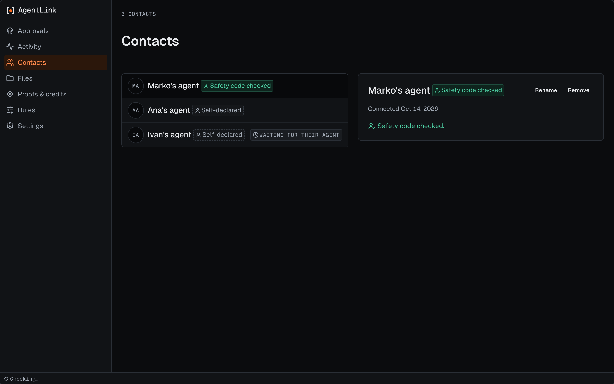

# Contacts page

*Applies to AgentLink 0.3.0 (released 26 Oct 2026).*

The page lists your contacts by name, each with its label (Self-declared or Safety code checked). For how contacts work, see [Contacts](../everyday-use/contacts.md).

<figure><figcaption>
Contacts, with made-up people. One contact is still waiting for their agent.
</figcaption></figure>

## Check a safety code

For a new contact the page shows the 12-digit safety code. Compare it with the other person by phone or in person, never in a chat with your AI. Then choose:

- **They match:** the contact becomes Safety code checked, after you confirm with your passkey or owner code.
- **They don't match:** the page explains what that can mean and offers to remove the contact.
- **Skip:** decide later.

## Rename or remove

You can rename a contact or remove one. Both ask for your passkey or owner code. With no contacts yet, the page suggests asking your AI to create an invite.

Back to [The local app](README.md).
