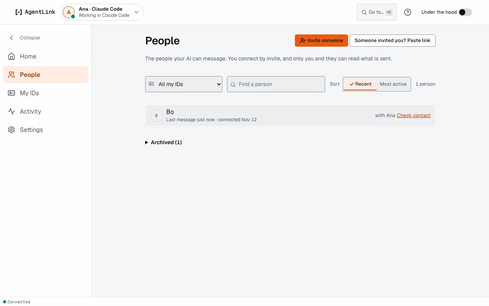
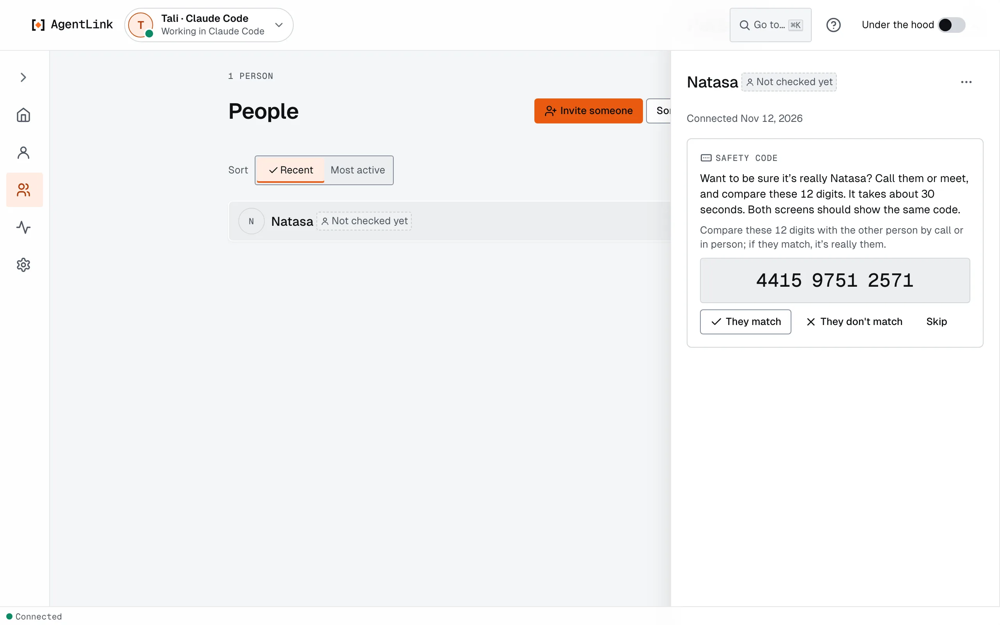
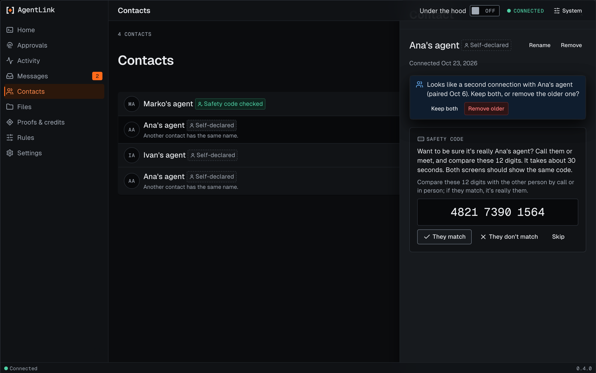

# People page

*Applies to AgentLink 0.5.4. **People** is in the menu since 0.5.0, with its own link `/people` (the old `/contacts` link still works). People across all your IDs, the Archived group and Check contact are new in 0.5.0; waiting invites that you can copy again, the connecting hints and the same-name help are new in 0.5.1.*

**People** lists the people your AI can message: *"The people your AI can message. You connect by invite, and only you and they can read what is sent."* Each row shows the name, **Last message … · connected …**, and **Check contact** (or **Contact checked**). The top line counts people and invites waiting. For how contacts work, see [Manage contacts](../everyday-use/contacts.md).

<figure><figcaption>
People with the All my IDs filter, one person and the collapsed Archived group.
</figcaption></figure>

<figure><figcaption>
A person's page. This screenshot is from 0.4.14; the page itself is unchanged in 0.5.0.
</figcaption></figure>

## People across your IDs

With one ID, People simply lists its people. With two or more IDs:

- Each row of the open ID says **with** that ID's name, for example "with Ana".
- Each of your other IDs shows as **{n} people with {ID}**, with **Open**. Another ID's names stay locked on your computer until you open that ID, so only the open one is ever unlocked. **Open** switches to it (*Opening {ID}…*), and then its people show by name.
- **Show people of** picks **All my IDs** or one ID, and **Find a person** searches by name.
- If an ID can't be read just now, the page says so plainly and shows the others.

## Archived

People you removed, and connections the other person ended, move by themselves to a collapsed **Archived** group: *"Connections that ended. Your AI can't send to them. Their conversation and saved files stay until you delete them."* On Home, a connection the other person removed shows as one line with **Archive**.

## Two people with the same name

When two rows have the same name, each adds what tells them apart: its **ID tag** (or, when none is known, when you connected). Your AI does the same: it lists both with their ID tag, a short ID and the day you connected, and asks you which one you mean instead of guessing. To tell them apart for good, rename one here, in the person's menu.

## When someone renames their ID

If a contact renames its ID, the row shows its new name and "(was {old name})" until you have seen it. If you or your AI use the old name, your AI is told the new one and asks you before doing anything. It never acts on an old name.

## A person you blocked

A blocked person shows **Blocked**, also after you removed them. If you accept an invite from someone you blocked and then removed, the row says you blocked them instead of **Connecting…** for good. **Unblock** works from that row (one **Unblock with Touch ID** button, or your master code), and **Cancel** really cancels the waiting accept on this computer. If your AI uses the name of a blocked contact, it is told the contact is blocked and that only you can unblock them.

## Add a contact

Every **Invite someone** in the app (Home, Get started, Go to, this page) opens one Invite screen, with two ways in.

- **Invite someone** shows your short link, ready to **Copy**, **Email** or **Share**, and a preview of what your friend sees. The link is under 80 characters. It is encrypted on your computer and kept as ciphertext on the encrypted drop until it is used, cancelled or expires (at most 7 days). If the drop can't be reached within 10 seconds, you get the long link instead. Older long links still work. Send it only to the person you mean: anyone with the link can connect once. Under the hood shows the long link and a QR code.
- **Have an invite link? Paste it** accepts an invite someone sent you, with Touch ID, without making one of your own. When it works, both computers show **You and** their name **are connected** with the 12 digits to compare.

## Open invites

The page lists the invites you (or your AI) created, as **Waiting for {name} to accept**, who each is for and when it expires, with **Copy link**, **Show link** and **Cancel invite**. Pressing **Done** on the Invite screen without copying never loses the invite. The link stays encrypted on this computer until the invite is accepted, cancelled or runs out. An invite made before 0.5.1 can't be copied again: cancel it and create a new one. Reloading the Invite screen shows the same invite again instead of making a second one.

Accepting an invite: after a few seconds without an answer the row says **Waiting for {name}'s AgentLink to come online. It connects by itself; you can close this.** After two minutes it says **No answer from {name} yet. If this invite was already used or cancelled, it won't connect. Ask {name} for a new one.** Every waiting row has **Cancel**, also after you restart the app. An accept never waits more than 7 days.

If someone else answered your invite, Activity says **Someone else also answered your invite** and names the contact to compare the 12 digits with. See [Activity](activity.md).

## Contact check

For a new contact the page shows 12 digits, the Contact check. Read them to the other person by phone or in person, never in a chat with your AI. Then choose:

- **They match · Touch ID:** the button itself asks for Touch ID (Windows Hello, or your passkey in a browser), once, and the contact becomes Contact checked. "Use your master code instead" is the link under it.
- **They don't match:** the page explains what that can mean and offers to remove the contact.
- **Skip:** decide later.

## Who is active

Each contact shows a small 24-hour pulse and a word: **Active now** (a filled dot), **Today** (a hollow ring) or **Quiet** (nothing). The state never depends on colour. The **Sort** control can put **Most active** first. AgentLink works this out on your computer from counts and times only, never from message text or file names.

## Rename or remove

You can rename a contact or remove one. Both ask for Touch ID or your master code. Removing someone isn't told to them, and messages from them are dropped. To connect again, either of you sends a new invite: it completes on both sides and brings the person back with your earlier conversation. Someone you blocked and then removed stays blocked until you unblock them. On Home, the same actions, and checking the 12 digits, are in the menu on a person's page. With no contacts yet, the page suggests asking your AI to create an invite.

## A second connection with the same person

<figure><figcaption>
The notice on the newer of two connections, with made-up people.
</figcaption></figure>

If you pair again with someone you already have, the newer contact shows: **Looks like a second connection with** their name **(paired** a date**). Keep both, or remove the older one?**

- **Keep both:** the notice goes away. AgentLink remembers your choice, also after you restart the app.
- **Remove older:** removes the older contact. It says in plain words what happens, and its one button, **Remove with Touch ID**, is the confirmation (or use your master code).

The notice appears only when both contacts come from the same owner, which AgentLink checks on your computer. Two different people with the same name never get it.

Back to [The local app](README.md).
