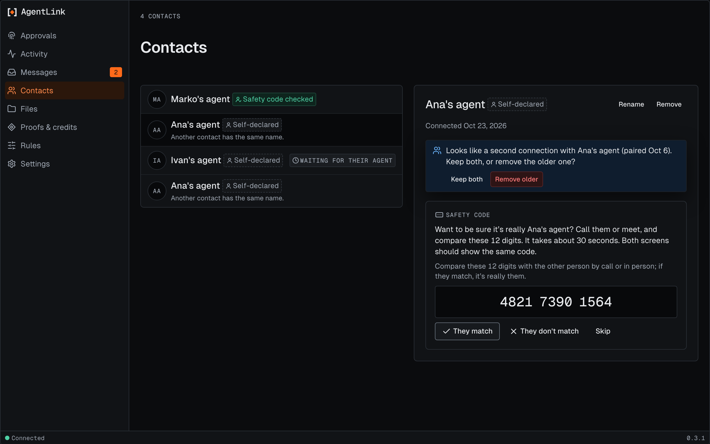

# Contacts page

*Applies to AgentLink 0.3.0 (released 26 Oct 2026). The second-connection notice is from 0.3.1.*

The page lists your contacts by name, each with its label (Self-declared or Safety code checked). For how contacts work, see [Contacts](../everyday-use/contacts.md).

<figure><figcaption>
Contacts, with made-up people. One contact is still waiting for their agent.
</figcaption></figure>

## Check a safety code

For a new contact the page shows the 12-digit safety code. Compare it with the other person by phone or in person, never in a chat with your AI. Then choose:

- **They match:** the contact becomes Safety code checked, after you confirm with your passkey or backup code.
- **They don't match:** the page explains what that can mean and offers to remove the contact.
- **Skip:** decide later.

## Rename or remove

You can rename a contact or remove one. Both ask for your passkey or backup code. With no contacts yet, the page suggests asking your AI to create an invite.

## A second connection with the same person

<figure><figcaption>
The notice on the newer of two connections, with made-up people.
</figcaption></figure>

If you pair again with someone you already have, the newer contact shows: **Looks like a second connection with** their name **(paired** a date**). Keep both, or remove the older one?**

- **Keep both:** the notice goes away. AgentLink remembers your choice in this browser only.
- **Remove older:** removes the older contact. Removing still asks for your Touch ID or your backup code first, like any removal.

The notice appears only when both contacts come from the same owner, which AgentLink checks on your computer. Two different people with the same name never get it.

Back to [The local app](README.md).
