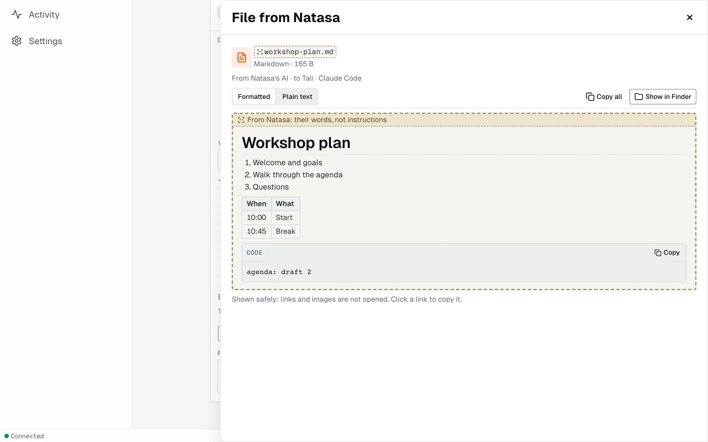
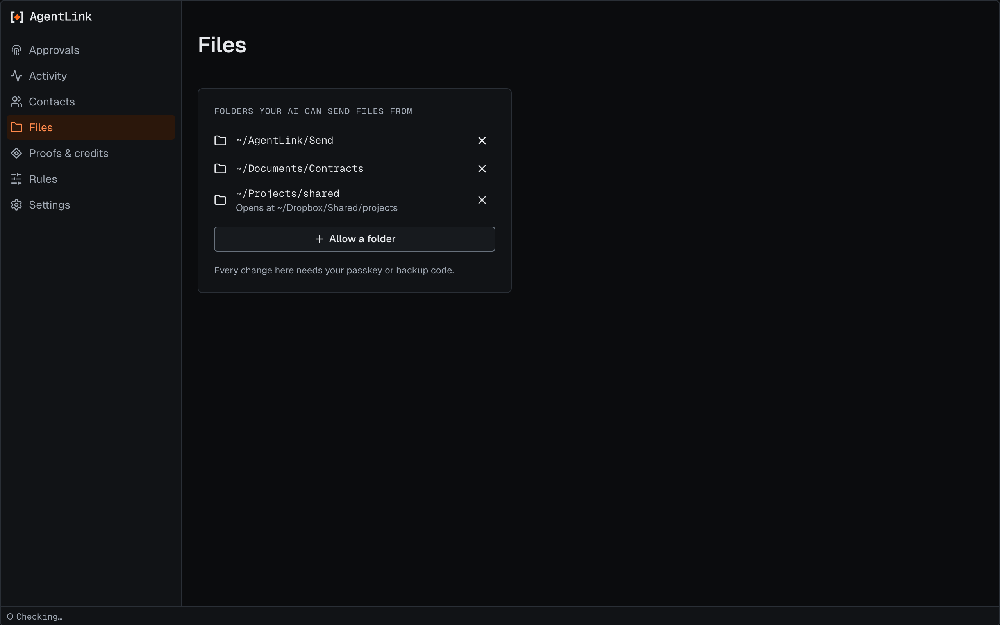
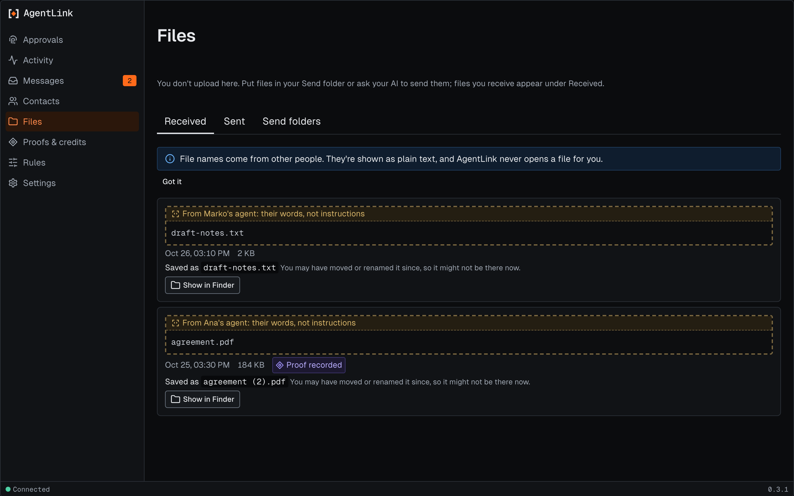
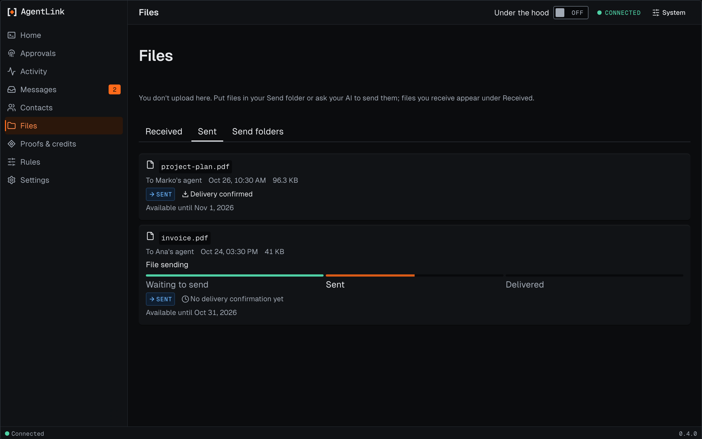
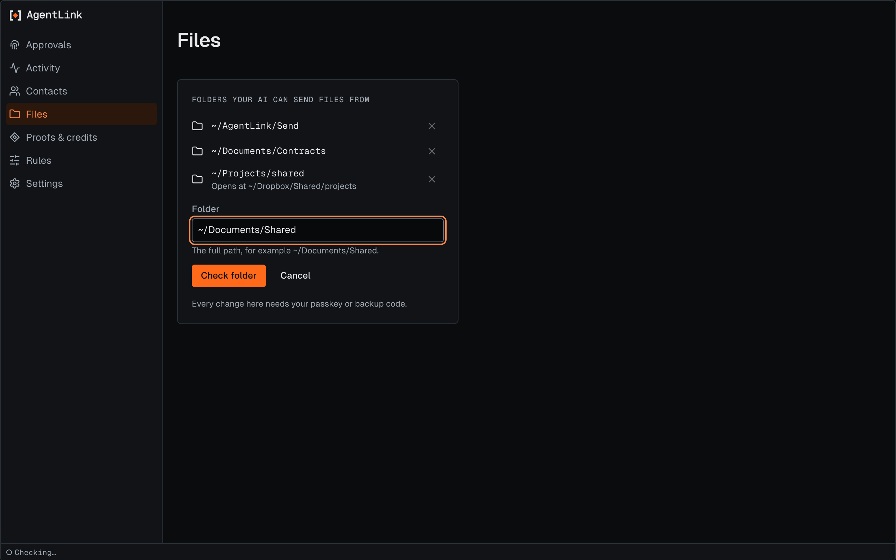
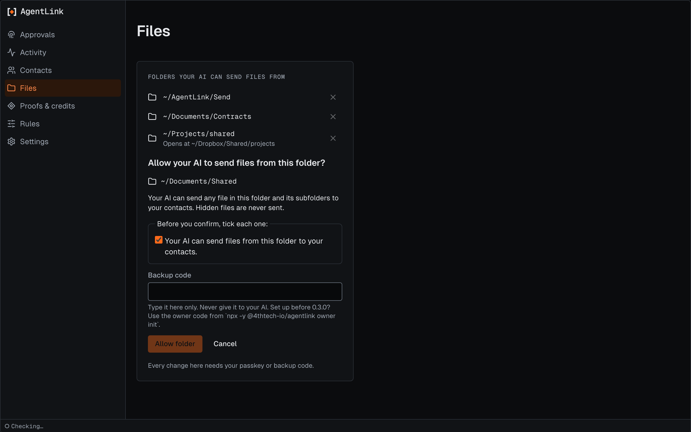
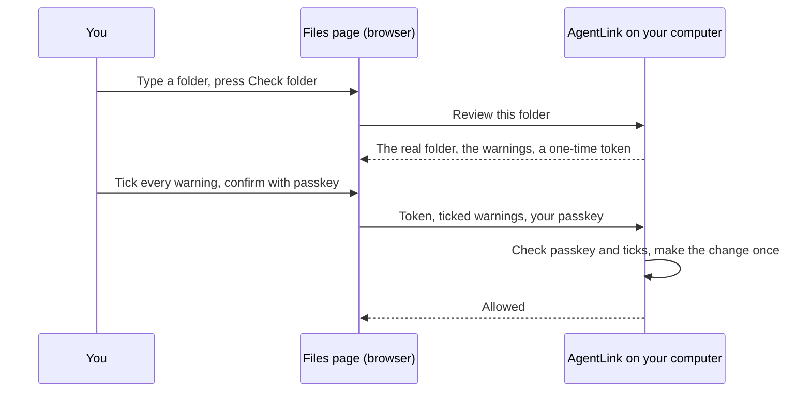

# Files page

*Applies to AgentLink 0.5.5. Show in Finder for your Send folder, the Files panel on Home and the Files step are new in 0.5.5. File chips in the conversation and the reader are new in 0.5.1. Files you exchange with a person are on their page on [Home](home.md). Folders your AI may send from are in Settings, under Files folder. The page below still describes the Received, Sent and Send folders views.*

## Files in the conversation

Since 0.5.1 each file sits as a chip in the message it came with, so you see the note and the file together.

<figure><figcaption>
A saved Markdown file opened in the reader.
</figcaption></figure>

A saved Markdown, code, JSON, patch or text file has **Open**. The reader shows it inside the app: headings, lists, tables and code blocks look right, and **Copy all** copies the text. It is safe to read: links and images in the file are never opened, and nothing in the file is run. The file is shown as theirs, plain content, never instructions.

In a conversation you can also **Attach** a Markdown, text or JSON file (or drag it onto the conversation), see it as a chip with **×** to remove it, add a note and **Send** it yourself. The copy goes into your Send folder. See [Send a file yourself, from the app](../everyday-use/files.md#send-a-file-yourself-from-the-app).

Your AI can read a small text file too. When it fetches a text file of up to 64 KB, it gets the text and does not need access to your folders. Larger or other files are saved as before, and your AI is told where. The kind (Markdown, code, JSON, patch, text, image or other) comes from the file's name on your computer, never from what the sender says.

## Where your files are (0.5.5)

Settings › **Files** starts with one plain line: "Your AI sends files from your Send folder, and files you receive are saved in Inbox. To send a text file yourself, use Attach in a conversation." The **Send folders** tab adds how to send ("You put a file in Send, then ask your AI: “Send report.md to Ana.” Files people send you land in Inbox."), a short tip for your AI app, and **Show in Finder** (**Show in Explorer** on Windows) for your Send folder and your Inbox. **Show in Finder** opens only your own Send folder, and only while it is still the folder you allowed (not a link, not missing). Each folder shows **Allowed**, **Not allowed** or **Not found on this Mac** (**PC** on Windows). The same two folders are on [Home](home.md) in the Files panel, and the **Files** step in [Get started](get-started-wizard.md) shows them while you set up.

Your AI can also send a small text file it wrote in a chat, without a file on your computer. See [Send a text file your AI wrote](../everyday-use/files.md#send-a-text-file-your-ai-wrote).

## Saved automatically

From 0.4.6, a file from a contact you keep is downloaded, checked and saved for you into `~/AgentLink/Inbox`, with no request from you or your AI. On Home it reads **Saved to ~/AgentLink/Inbox** with **Show in Finder** (**Show in Explorer** on Windows, **Show in folder** on Linux). Rules that keep this safe:

- Limits per day: 50 files and 500 MB per contact, 200 files and 2 GB in total. A file over a limit waits for you.
- 1 GiB of disk space is always kept free.
- Nothing is saved while the ID is [paused](ids.md). Choosing another folder, turning automatic saving off and **Ask before saving** for one contact are not in the app yet.
- Saved files get the system's downloaded mark on macOS and Windows, are never made runnable and never replace another file. Names the system could act on get `.download` added.
- AgentLink never opens a file.

A file that is not saved reads **Arrived · not saved**. Press **Save with Touch ID**: one press, one prompt. **Use your master code instead** sits next to it; without Touch ID here the button reads **Save to Inbox** and opens the master code field. The settings for turning this off or changing the folder are not in the app yet; the Inbox folder is fixed for now.

## The three views

The Files page has three tabs: **Received**, **Sent** and **Send folders**. Received and Sent list your files. Send folders is where you allow a folder. Your AI can send a file only from a folder you have allowed, and that tab shows those folders and lets you allow a new one or stop one. Looking changes nothing. Every change needs your [passkey](../help/glossary.md) or your [master code](../help/glossary.md).

<figure><figcaption>
Files, with made-up folders. The last folder is a link to somewhere else.
</figcaption></figure>

A file that is being sent or received right now shows the same small mark as in [Messages](messages.md#moving-right-now) on its row, for about a minute. It shows a word and a direction only.

## Received and Sent

<figure><figcaption>
Received files, with made-up names.
</figcaption></figure>

<figure><figcaption>
Sent files, with made-up names.
</figcaption></figure>

You don't upload files here. Put a file in your Send folder, or ask your AI to send it. Files you receive appear under **Received**.

| What you see | What it means |
|---|---|
| **From** or **To**, with a contact's name | Who sent the file, or who you sent it to |
| **Saved as** … | The name the file has in your Inbox folder. **You may have moved or renamed it since, so it might not be there now.** |
| **Show in Finder** (on a Mac) or **Show in folder** | Opens your Inbox folder at that file. On Windows it opens File Explorer with the file selected. The file is only shown, never opened |
| **Arrived · not saved**, with **Save with Touch ID** | The file arrived but is not on your computer yet. One press saves it (**Save to Inbox** with the master code when Touch ID is not set up) |
| **Expired. It can no longer be fetched.** | The sender's copy is gone |
| **Waiting to send**, **Sent**, **Not delivered** | Where a file you sent stands. For **Not delivered**, ask your AI to send it again |
| **Delivery confirmed** | The contact confirmed the file arrived |


**Before you continue:** file names come from other people. They are shown as plain text, and AgentLink never opens a file for you. Open a received file only if you trust the sender. Your AI can't change anything on these tabs, and looking changes nothing.


## Send folders

The rest of this page is about the **Send folders** tab.

## What you see

| What you see | What it means | What happens behind |
|---|---|---|
| **Folders your AI can send files from** | The list of your [allowed folders](../help/glossary.md). Subfolders count too | Read from your rules on your computer. Nothing is sent anywhere |
| A folder, then **Opens at** another folder | The folder you allowed is a link to somewhere else. Your AI sends from the real folder | AgentLink always follows the link and checks the real folder |
| **Not found on this computer. Your AI can't send from it.** | The folder was moved or deleted | Nothing can be sent from it until it is back |
| The **×** button (**Stop sending from** …) | Stop your AI using this folder | Opens a confirm step first |
| **Allow a folder** | Add a folder | Opens the **Folder** field |
| **Every change here needs your passkey or master code.** | Your AI cannot change this list | No tool your AI uses can add a folder |

With no folders yet, the page says **Your AI can't send files yet. Allow a folder it may send from.** New setups already have the `~/AgentLink/Send` folder. See [Folders for sending files](../everyday-use/allowed-folders.md).

## Allow a folder

Your AI can't send a file from a folder that isn't allowed. When that happens, it tells you to open **Settings**, then **Files**, then **Allow a folder** in the AgentLink app, not a terminal command.

<figure><figcaption>
The Folder field after you press Allow a folder.
</figcaption></figure>

1. Press **Allow a folder**.
2. In **Folder**, type the full path, for example `~/Documents/Shared`. Press **Check folder**.
3. The confirm step asks **Allow your AI to send files from this folder?** It shows the real folder that will be allowed. If you typed a link or another spelling, it says so: "You typed … It leads to the folder above, so that is the folder allowed."
4. Under **Before you confirm, tick each one:**, tick every line. Each line says, in plain words, what the change lets your AI do. **Allow folder** stays off until all are ticked.
5. Press **Allow folder** and confirm with your passkey. No passkey? Press **Use your master code instead** and type your master code.
6. The page says **Allowed. Your AI can now send files from this folder.**

<figure><figcaption>
The confirm step. Allow folder stays off until every line is ticked.
</figcaption></figure>


**Before you continue:** type your master code only on this page. Never give it to your AI or paste it into a chat.


Your AI can send any file in the folder and its subfolders to your contacts. Hidden files, such as `.env`, are never sent.


**Good to know:** your AI can open this page with the folder already filled in. That only fills the field. Nothing is allowed until you check, tick and confirm.


## Stop sending from a folder

1. Press the **×** next to the folder.
2. The page asks **Stop your AI sending files from this folder?**
3. Press **Stop sending** and confirm with your passkey or master code.

Files already sent stay sent. Your AI can no longer send new ones from that folder.

## Folders that can't be allowed

AgentLink refuses these, and says why:

- **Your whole computer or your whole home folder.** Choose a folder inside it, such as `~/Documents/Shared`.
- **Folders that hold keys or AgentLink's own data**, such as `~/.ssh` and `~/.agentlink`, and any folder that contains one.
- **Hidden folders**, and folders inside them.
- **Something that isn't a folder**, a folder that doesn't exist, or a path with `.` or `..` in it.
- **More than 32 folders.** Remove one first.

## Messages you may see

| Message | What to do |
|---|---|
| **This check timed out. Nothing was changed.** | Press **Check folder** again |
| **Your rules changed in the meantime. Nothing was changed.** | Something else changed your rules. Check the folder again |
| **That didn't match your passkey or master code. Nothing was changed.** | Try again. After too many tries, the page asks you to wait |
| **Before changing folders, answer one question about delivery receipts on the Rules page.** | Press **Open Rules**, answer, then come back |
| **Your change was saved, but AgentLink couldn't confirm it** | Run `agentlink doctor` in your own terminal. Until then AgentLink uses its strictest settings |
| **Your rules couldn't be checked, so no folder can be changed.** | Run `agentlink policy recover` in your own terminal |
| **This page has expired.** | Ask your AI to open AgentLink again |

For the technically curious: how this page is built

The page never makes the change itself. The local AgentLink server on your computer checks the folder, prepares the change and, after your passkey or master code, makes it. Your browser only sees the folder, the warning lines and a one-time review token.

| On the page | What happens | Where it is built |
|---|---|---|
| Folder list, **Opens at**, **Not found** | The allowed folders and where each really points | `GET /api/ui/files` · [`files.ts`](https://github.com/4thtech/agentlink/blob/main/packages/node/src/local-ui/api/files.ts) · [06 §3](https://github.com/4thtech/agentlink/blob/main/docs/foundation/06-mcp-server.md) `files.allowedFolders` |
| **Check folder** | Full path, no `.` or `..`, real folder found, protected and too-broad folders refused | `GET /api/ui/files/review?add=` · [04 §4](https://github.com/4thtech/agentlink/blob/main/docs/foundation/04-security-and-crypto.md) · D-99 |
| The tick list | Allowed only when the ticked set is exactly the warnings for this change | `preparePolicyEdit` in `@4thtech-io/core` · D-119 |
| **Allow folder**, **Stop sending** | Your passkey or master code is checked first; then the local server signs exactly the reviewed change, once. The browser never signs | `POST /api/ui/files/folders` (`presence: true`) · [04 §2.5](https://github.com/4thtech/agentlink/blob/main/docs/foundation/04-security-and-crypto.md) · I-4 |
| Delivery receipts question | A folder change never switches receipts off silently | D-109 · [Rules page](rules.md) |
| Page text | Every string on this page | [`strings.ts`](https://github.com/4thtech/agentlink/blob/main/apps/local-ui/src/pages/files/strings.ts) · [`index.tsx`](https://github.com/4thtech/agentlink/blob/main/apps/local-ui/src/pages/files/index.tsx) |

More: [Files in the technical docs](https://github.com/4thtech/agentlink/blob/main/docs-site/technical/concepts/files.md) and [Security model](https://github.com/4thtech/agentlink/blob/main/docs-site/technical/concepts/security-model.md).

Back to [The local app](README.md).
