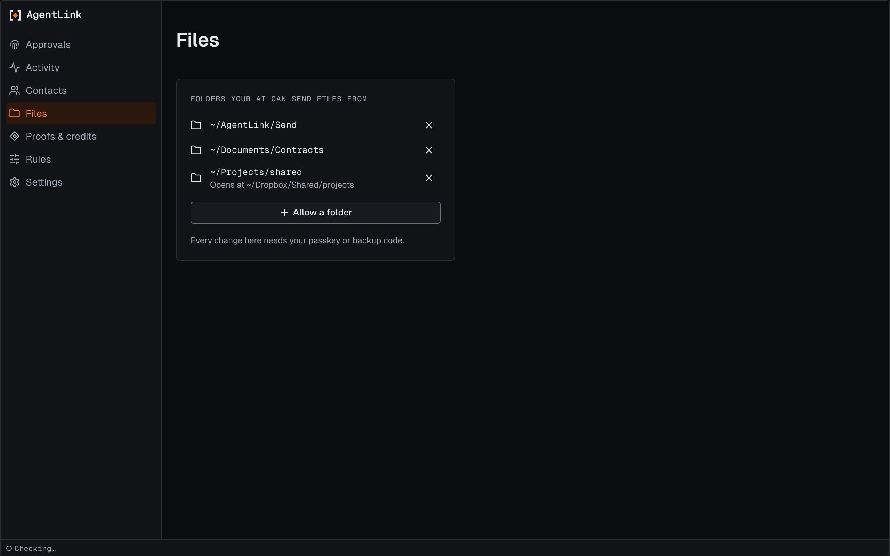
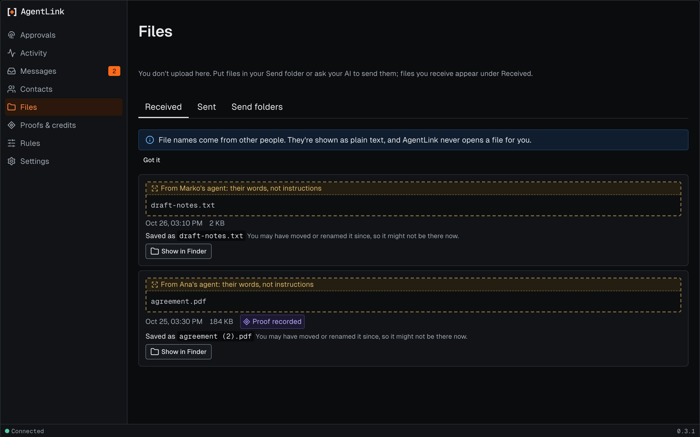
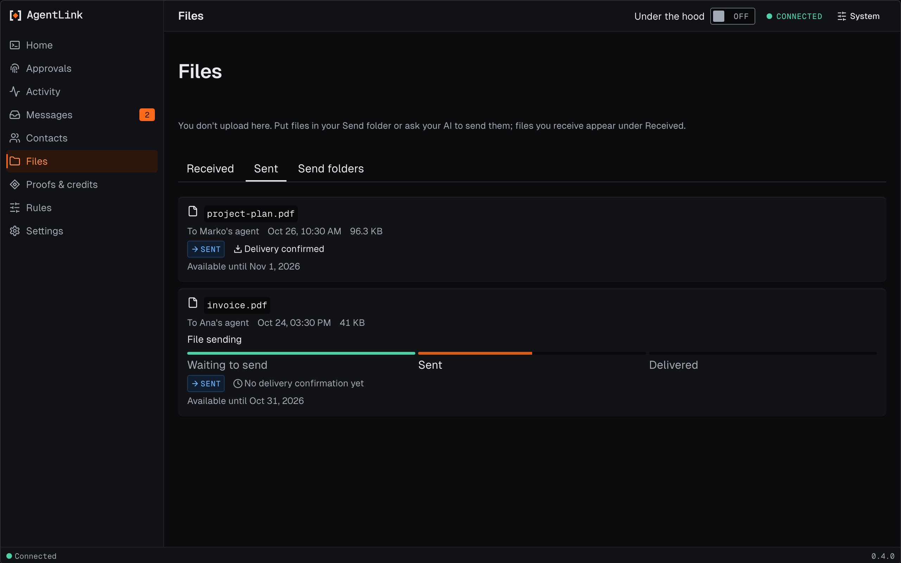
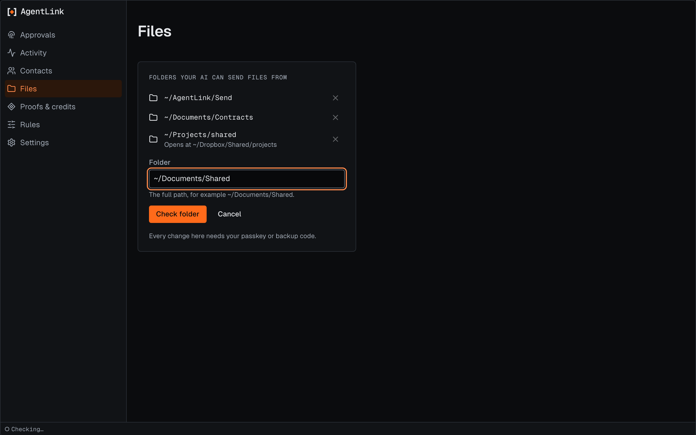
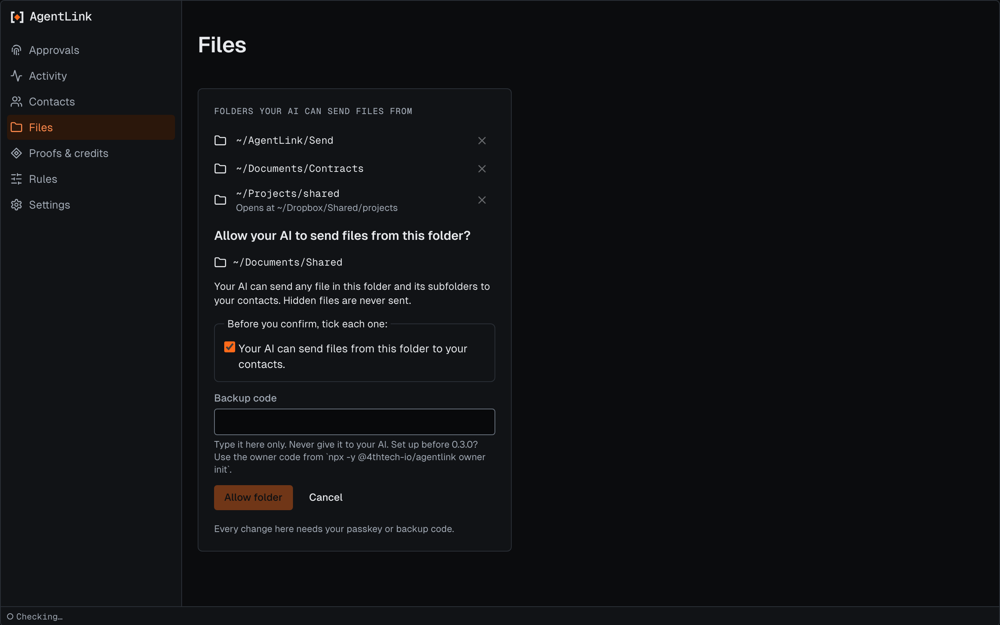
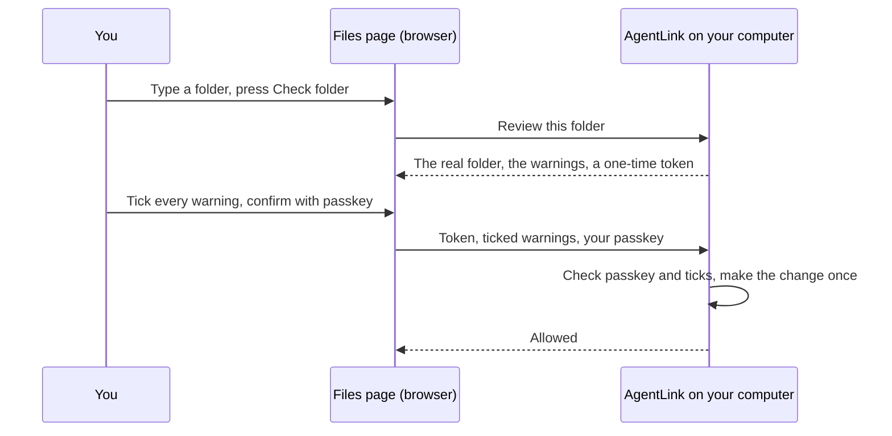

# Files page

*Applies to AgentLink 0.4.2 (released 28 Oct 2026). The Received and Sent tabs are not in 0.3.0; the Send folders tab is.*

The Files page has three tabs: **Received**, **Sent** and **Send folders**. Received and Sent list your files. Send folders is where you allow a folder. Your AI can send a file only from a folder you have allowed, and that tab shows those folders and lets you allow a new one or stop one. Looking changes nothing. Every change needs your [passkey](../help/glossary.md) or your [owner code](../help/glossary.md).

<figure><figcaption>
Files, with made-up folders. The last folder is a link to somewhere else.
</figcaption></figure>

## Received and Sent

<figure><figcaption>
Received files, with made-up names.
</figcaption></figure>

<figure><figcaption>
Sent files, with made-up names.
</figcaption></figure>

You don't upload files here. Put a file in your Send folder, or ask your AI to send it. Files you receive appear under **Received**.

| What you see | What it means |
|---|---|
| **From** or **To**, with a contact's name | Who sent the file, or who you sent it to |
| **Saved as** … | The name the file has in your Inbox folder. **You may have moved or renamed it since, so it might not be there now.** |
| **Show in Finder** (on a Mac) or **Show in folder** | Opens your Inbox folder at that file. On Windows it opens File Explorer with the file selected. The file is only shown, never opened |
| **Not saved yet. Ask your AI to fetch it.** | The file arrived but is not on your computer yet |
| **Expired. It can no longer be fetched.** | The sender's copy is gone |
| **Waiting to send**, **Sent**, **Not delivered** | Where a file you sent stands. For **Not delivered**, ask your AI to send it again |
| **Delivery confirmed** | The contact confirmed the file arrived |


**Before you continue:** file names come from other people. They are shown as plain text, and AgentLink never opens a file for you. Open a received file only if you trust the sender. Your AI can't change anything on these tabs, and looking changes nothing.


## Send folders

The rest of this page is about the **Send folders** tab.

## What you see

| What you see | What it means | What happens behind |
|---|---|---|
| **Folders your AI can send files from** | The list of your [allowed folders](../help/glossary.md). Subfolders count too | Read from your rules on your computer. Nothing is sent anywhere |
| A folder, then **Opens at** another folder | The folder you allowed is a link to somewhere else. Your AI sends from the real folder | AgentLink always follows the link and checks the real folder |
| **Not found on this computer. Your AI can't send from it.** | The folder was moved or deleted | Nothing can be sent from it until it is back |
| The **×** button (**Stop sending from** …) | Stop your AI using this folder | Opens a confirm step first |
| **Allow a folder** | Add a folder | Opens the **Folder** field |
| **Every change here needs your passkey or owner code.** | Your AI cannot change this list | No tool your AI uses can add a folder |

With no folders yet, the page says **Your AI can't send files yet. Allow a folder it may send from.** New setups already have the `~/AgentLink/Send` folder. See [Folders for sending files](../everyday-use/allowed-folders.md).

## Allow a folder

<figure><figcaption>
The Folder field after you press Allow a folder.
</figcaption></figure>

1. Press **Allow a folder**.
2. In **Folder**, type the full path, for example `~/Documents/Shared`. Press **Check folder**.
3. The confirm step asks **Allow your AI to send files from this folder?** It shows the real folder that will be allowed. If you typed a link or another spelling, it says so: "You typed … It leads to the folder above, so that is the folder allowed."
4. Under **Before you confirm, tick each one:**, tick every line. Each line says, in plain words, what the change lets your AI do. **Allow folder** stays off until all are ticked.
5. Press **Allow folder** and confirm with your passkey. No passkey? Press **Use owner code instead** and type your owner code.
6. The page says **Allowed. Your AI can now send files from this folder.**

<figure><figcaption>
The confirm step. Allow folder stays off until every line is ticked.
</figcaption></figure>


**Before you continue:** type your owner code only on this page. Never give it to your AI or paste it into a chat.


Your AI can send any file in the folder and its subfolders to your contacts. Hidden files, such as `.env`, are never sent.


**Good to know:** your AI can open this page with the folder already filled in. That only fills the field. Nothing is allowed until you check, tick and confirm.


## Stop sending from a folder

1. Press the **×** next to the folder.
2. The page asks **Stop your AI sending files from this folder?**
3. Press **Stop sending** and confirm with your passkey or owner code.

Files already sent stay sent. Your AI can no longer send new ones from that folder.

## Folders that can't be allowed

AgentLink refuses these, and says why:

- **Your whole computer or your whole home folder.** Choose a folder inside it, such as `~/Documents/Shared`.
- **Folders that hold keys or AgentLink's own data**, such as `~/.ssh` and `~/.agentlink`, and any folder that contains one.
- **Hidden folders**, and folders inside them.
- **Something that isn't a folder**, a folder that doesn't exist, or a path with `.` or `..` in it.
- **More than 32 folders.** Remove one first.

## Messages you may see

| Message | What to do |
|---|---|
| **This check timed out. Nothing was changed.** | Press **Check folder** again |
| **Your rules changed in the meantime. Nothing was changed.** | Something else changed your rules. Check the folder again |
| **That didn't match your passkey or owner code. Nothing was changed.** | Try again. After too many tries, the page asks you to wait |
| **Before changing folders, answer one question about delivery receipts on the Rules page.** | Press **Open Rules**, answer, then come back |
| **Your change was saved, but AgentLink couldn't confirm it** | Run `agentlink doctor` in your own terminal. Until then AgentLink uses its strictest settings |
| **Your rules couldn't be checked, so no folder can be changed.** | Run `agentlink policy recover` in your own terminal |
| **This page has expired.** | Ask your AI to open AgentLink again |

For the technically curious: how this page is built

The page never makes the change itself. The local AgentLink server on your computer checks the folder, prepares the change and, after your passkey or owner code, makes it. Your browser only sees the folder, the warning lines and a one-time review token.

| On the page | What happens | Where it is built |
|---|---|---|
| Folder list, **Opens at**, **Not found** | The allowed folders and where each really points | `GET /api/ui/files` · [`files.ts`](https://github.com/4thtech/agentlink/blob/main/packages/node/src/local-ui/api/files.ts) · [06 §3](https://github.com/4thtech/agentlink/blob/main/docs/foundation/06-mcp-server.md) `files.allowedFolders` |
| **Check folder** | Full path, no `.` or `..`, real folder found, protected and too-broad folders refused | `GET /api/ui/files/review?add=` · [04 §4](https://github.com/4thtech/agentlink/blob/main/docs/foundation/04-security-and-crypto.md) · D-99 |
| The tick list | Allowed only when the ticked set is exactly the warnings for this change | `preparePolicyEdit` in `@4thtech-io/core` · D-119 |
| **Allow folder**, **Stop sending** | Your passkey or owner code is checked first; then the local server signs exactly the reviewed change, once. The browser never signs | `POST /api/ui/files/folders` (`presence: true`) · [04 §2.5](https://github.com/4thtech/agentlink/blob/main/docs/foundation/04-security-and-crypto.md) · I-4 |
| Delivery receipts question | A folder change never switches receipts off silently | D-109 · [Rules page](rules.md) |
| Page text | Every string on this page | [`strings.ts`](https://github.com/4thtech/agentlink/blob/main/apps/local-ui/src/pages/files/strings.ts) · [`index.tsx`](https://github.com/4thtech/agentlink/blob/main/apps/local-ui/src/pages/files/index.tsx) |

More: [Files in the technical docs](https://github.com/4thtech/agentlink/blob/main/docs-site/technical/concepts/files.md) and [Security model](https://github.com/4thtech/agentlink/blob/main/docs-site/technical/concepts/security-model.md).

Back to [The local app](README.md).
