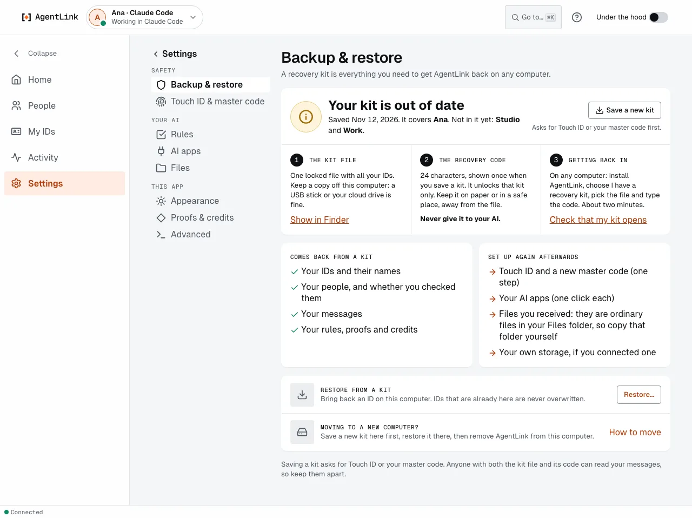

# Your master code and recovery kit

*Applies to AgentLink 0.5.3. Saving a recovery kit in the app is new in 0.4.14; one kit for all your IDs, the save checklist and restoring in the app are new in 0.5.0. The words "backup code" and "owner code" became **master code** in 0.4.14; it is the same code.*

Two things keep you in charge of your IDs when your fingerprint reader or your computer is not there: your **master code** and your **recovery kit**.

| | Master code | Recovery kit |
|---|---|---|
| What it is | A code that confirms approvals instead of Touch ID | One locked file with all your IDs, your people and your messages |
| When you get it | Once, during [Get started](get-started-wizard.md) | When you press **Save recovery kit** |
| Where to keep it | Your password manager | Somewhere safe, apart from its recovery code |
| Use it for | **Use your master code instead**, on any confirm | Getting your IDs back on a new computer or this one: **I have a recovery kit** |
| Never | Give it to your AI or paste it into a chat | Share it with anyone |

## Your master code

The master code is shown once, right after the Touch ID that creates your first ID.

<figure><figcaption>
Shown once. Save it before you press I saved it.
</figcaption></figure>

If you reload the page before you press **I saved it**, you see the same code again, not a new one. The app keeps it in its memory for this window only, for at most 10 minutes, and never writes it to disk. If the app was closed before you saved it, it says **Your master code wasn't saved** and offers a new one with Touch ID (or your passkey), instead of asking for a code you never saw. Leaving the screen with **Skip to Home** or **Cancel** asks first, because the code is shown once.

1. Press **Save in my password manager**, **Copy** (it says **Copied**) or **Save as file**. **Hide** covers it if someone is looking.
2. Press **I saved it**.

Every place that asks for Touch ID also offers **Use your master code instead**. Fields accept a pasted code even with line breaks, spaces or long dashes. Nobody can get your master code back for you, not even 4thTech. To test it or replace it, open **Settings** › [**Touch ID & master code**](touch-id-and-master-code.md).

## Your recovery kit

A recovery kit holds your IDs, their contacts and their messages, locked under a new **recovery code** that is shown once. It is everything you need to get AgentLink back on any computer; keep the file and the code safe, and apart.

1. Open **Settings** › **Backup & restore** (an ID's **Back up** leads there too).
2. Press **Save a recovery kit** and confirm with Touch ID or your master code. One kit covers all your IDs.
3. The kit is saved to your Downloads folder (or your home folder when there is none). A checklist follows: move the file off this computer (**Show in Finder**), write down the recovery code shown once (**Print** or **Copy**), and check that it opens (**Check now**). **Done** turns on when all three are ticked.

<figure><figcaption>
Settings › Backup &amp; restore.
</figcaption></figure>

Until you check that the kit opens, Backup & restore says **Your last kit isn't finished**. The full page, and how to restore, is in [Backup & restore](backup-and-restore.md).

Nothing is sent anywhere. To restore, choose **I have a recovery kit** when you set up AgentLink on the new computer, or **Restore…** in **Settings** › **Backup & restore**.

## If you set up before 0.3.0

If you set up AgentLink in the terminal before the app existed, your approvals use a code. The app offers **Switch to Touch ID** (**Switch to Windows Hello** or **Switch to a passkey** elsewhere): press it, type your master code once (the code `owner init` printed), touch the sensor, and the page says **Touch ID is on**. Your master code keeps working when the sensor isn't available.

## If your browser has no passkey

The page tells you which browser works, or lets you continue with the master code only. Nothing breaks. See [Protect your approvals](../get-started/protect-your-approvals.md).

Back to [The local app](README.md).
