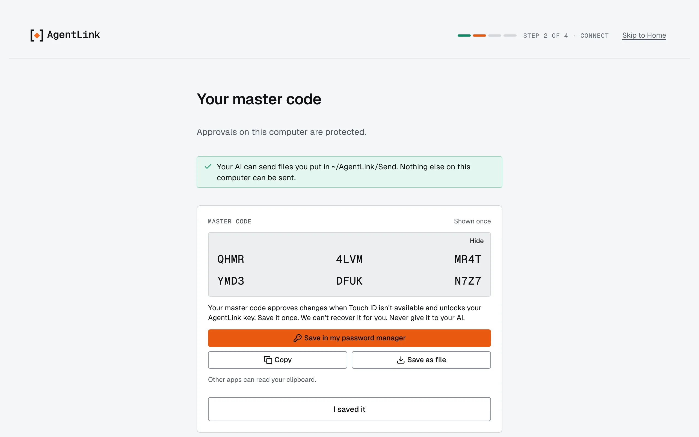
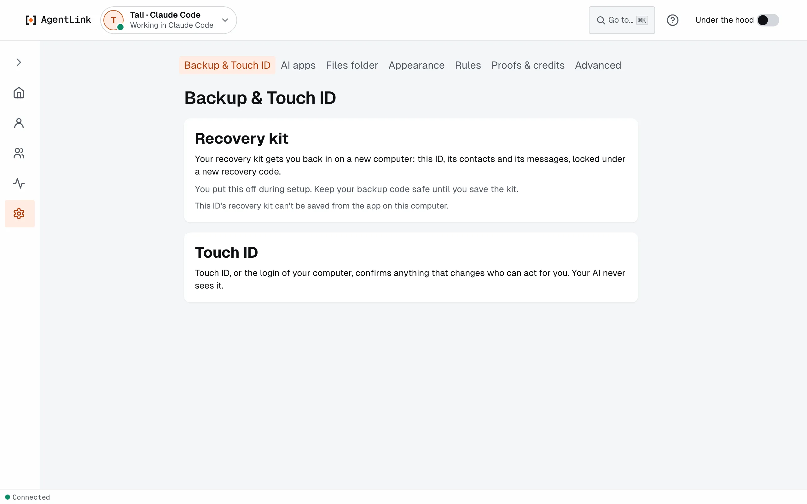
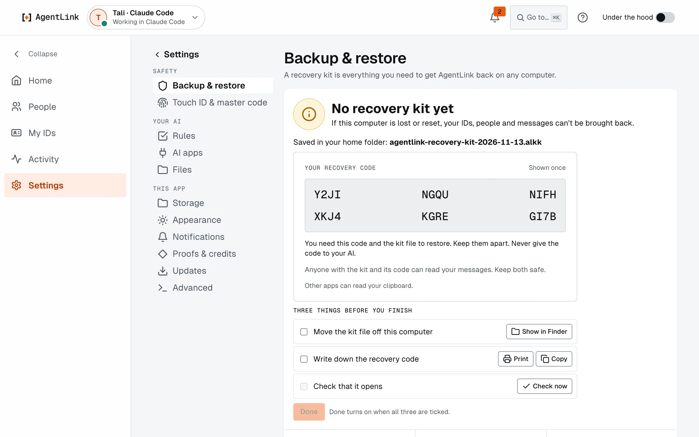

# Your master code and recovery kit

*Applies to AgentLink 0.4.14. Saving a recovery kit in the app is new in 0.4.14. The words "backup code" and "owner code" became **master code** in 0.4.14; it is the same code.*

Two things keep you in charge of your IDs when your fingerprint reader or your computer is not there: your **master code** and your **recovery kit**.

| | Master code | Recovery kit |
|---|---|---|
| What it is | A code that confirms approvals instead of Touch ID | An encrypted file with one ID, its contacts and messages |
| When you get it | Once, during [Get started](get-started-wizard.md) | When you press **Save recovery kit** |
| Where to keep it | Your password manager | Somewhere safe, apart from its recovery code |
| Use it for | **Use your master code instead**, on any confirm | Getting an ID back on a new computer (restore is coming) |
| Never | Give it to your AI or paste it into a chat | Share it with anyone |

## Your master code

The master code is shown once, right after the Touch ID that creates your first ID.

<figure><figcaption>
Shown once. Save it before you press I saved it.
</figcaption></figure>

1. Press **Save in my password manager**, **Copy** (it says **Copied**) or **Save as file**. **Hide** covers it if someone is looking.
2. Press **I saved it**.

Every place that asks for Touch ID also offers **Use your master code instead**. Fields accept a pasted code even with line breaks, spaces or long dashes. Nobody can get your master code back for you, not even 4thTech.

## Your recovery kit

A recovery kit holds an ID, its contacts and its messages, locked under a new **recovery code** that is shown once. Restoring from it arrives in the next update; keep the file and the code safe, and apart.

1. Open **Settings** › **Backup & Touch ID**, or press **Back up** on an ID's card on [IDs](ids.md).
2. Press **Save recovery kit** and confirm with Touch ID or your master code.
3. The kit is saved to your Downloads folder (or your home folder when there is none). Write down the recovery code shown once, and keep it apart from the kit.

<figure><figcaption>
Settings › Backup &amp; Touch ID.
</figcaption></figure>

<figure><figcaption>
The kit is saved and its recovery code is shown once.
</figcaption></figure>

Nothing is sent anywhere. To back up another ID, open that ID first. Restoring from a kit is not available yet; it arrives in the next update.

## If you set up before 0.3.0

If you set up AgentLink in the terminal before the app existed, your approvals use a code. The app offers **Switch to Touch ID** (**Switch to Windows Hello** or **Switch to a passkey** elsewhere): press it, type your master code once (the code `owner init` printed), touch the sensor, and the page says **Touch ID is on**. Your master code keeps working when the sensor isn't available.

## If your browser has no passkey

The page tells you which browser works, or lets you continue with the master code only. Nothing breaks. See [Protect your approvals](../get-started/protect-your-approvals.md).

Back to [The local app](README.md).
