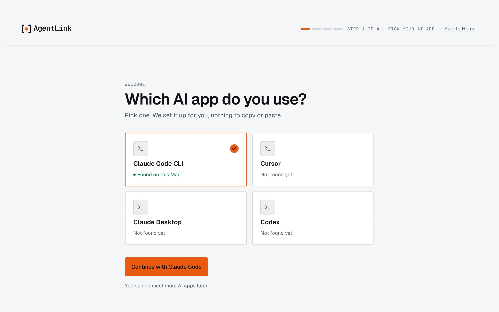

# Get started

*Applies to AgentLink 0.5.4. Before your first ID exists there is no **Skip to Home**; the other changes are described below.*

Get started is a short guided path: pick your AI app, confirm it is you with one Touch ID, see that you are connected, then invite someone if you like. Step by step with every screen: [Connect your AI app](../get-started/README.md).

<figure><figcaption>
Step 1 of 4.
</figcaption></figure>

## When it opens

It opens by itself only until you are set up, which means you have an ID with an AI app connected. After that the app opens on [Home](home.md). Get started is always available from:

- the **?** Help menu,
- **Go to** (Cmd+K),
- a card on Home, **Get started · n of 3 done**, until you hide it.

Each step shows where you are, for example **Step 2 of 4**. **Skip to Home** leaves once your first ID exists; before that it is not offered, and a Home without an ID offers **Create your first ID** in the app. Leaving the once-shown master code (**Skip to Home**, or **Cancel** after a restore) asks first. **Enter** confirms your name on the first screen. The Get started card follows what really happened: a person who accepted shows as done, on any ID, and stays done. Get started no longer opens on every launch once you have an ID.

## The steps

1. **Pick your AI app.** AgentLink looks in the usual places on your computer for the AI apps it can connect to. Pick yours, or choose **I'll choose later**. Nothing is written yet.
2. **Confirm it is you.** Type the name people see, then press **Connect with Touch ID** (**Connect with Windows Hello** on Windows, **Connect with your passkey** on Linux). That one touch does three things together: it creates your ID, protects your approvals, and adds AgentLink to the AI app you picked. When it is done, it says "{label} is ready in {app}. Restart {app} to finish." AgentLink never restarts the app for you. Untick **Connect to {app}** (or choose **Not now**) to connect later from [AI apps](ai-apps.md). If the app's settings can't be written, your AI is still ready and the app offers **Connect**. If you cannot use Touch ID, a link offers your master code instead.
3. **Connected to {app}.** The page confirms the connection.
4. **Invite someone.** Make your invite link right there, or skip it. See [Invite someone](invite-someone.md).

## Adding another ID

From the ID menu or **IDs**, adding an ID uses the same steps in this order: its **name**, which **AI app** it works in, then one Touch ID. When it is done you can open the new ID. See [IDs](ids.md).

## Connecting another AI app

Connecting an AI app to an ID later uses the same steps. You can also do it from [AI apps](ai-apps.md).

Back to [The local app](README.md).
