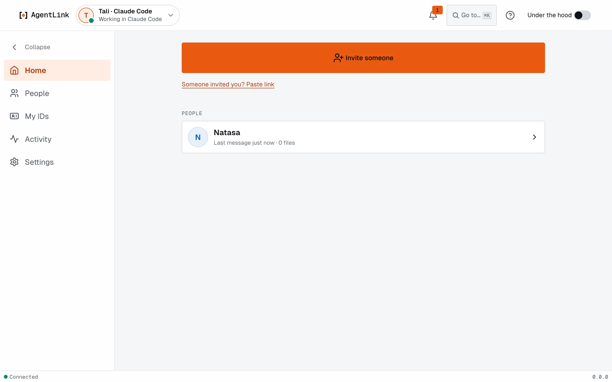
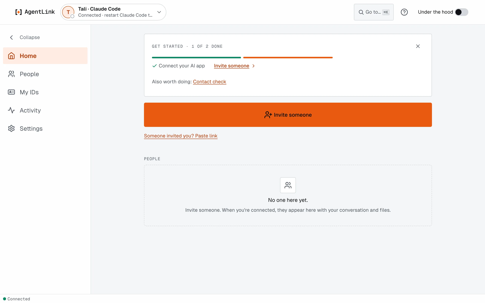
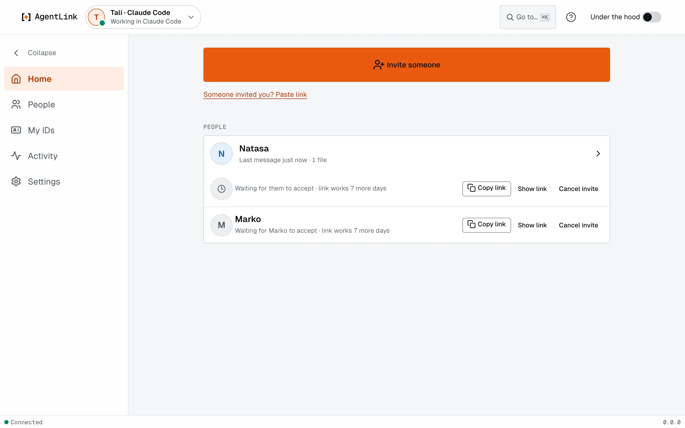

# Home

*Applies to AgentLink 0.5.4. Waiting invites, file chips with a reader in the conversation and the network status line are new in 0.5.1. In 0.4.4 and 0.4.5, Home was five tiles and a seven-step Start here.*

Home is the first screen. It shows what needs you, then the people your AI talks to.

<figure><figcaption>
Home in the Simple view.
</figcaption></figure>

Right after setup, before you have contacts, Home also shows the **Get started** card:

<figure><figcaption>
Home before your first contact.
</figcaption></figure>

## What you see

1. **Approvals on top.** Anything waiting for you is a short card: what your AI wants in one line, **Approve with Touch ID**, **Deny with Touch ID** and **Review**, which opens the whole request in place. One press confirms (or use your master code). When several wait, the card says "+2 more". Your AI can ask, but only you can approve. See [Approvals](approvals.md).
2. **Invite someone.** Opens the [Invite screen](invite-someone.md).
3. **Invites waiting.** An invite you made, or your AI made, that nobody has accepted yet shows as **Waiting for {name} to accept**, with **Copy link**, **Show link** and **Cancel invite**. See below.
4. **People.** The people your AI talks to, each with their last activity. A connection the other person removed shows as one line with **Archive**, which moves it to **Archived** on [People](contacts.md).
5. **Get started.** Until setup is done, a card says **Get started · n of 3 done**. You can hide it. See [Get started](get-started-wizard.md).

## Waiting invites

<figure><figcaption>
An invite that nobody has accepted yet.
</figcaption></figure>

An invite is never lost. If you press **Done** without copying the link, it keeps waiting here and on [People](contacts.md), also the ones your AI made. The link stays encrypted on this computer until the invite is accepted, cancelled or runs out (at most 7 days). Invites made before 0.5.1 can't be copied again: cancel them and make a new one.

When you accept someone else's invite and they are not online, the row says **Connecting…**, then after a few seconds **Waiting for {name}'s AgentLink to come online. It connects by itself; you can close this.** After two minutes it says **No answer from {name} yet. If this invite was already used or cancelled, it won't connect. Ask {name} for a new one.** Every waiting row has **Cancel**.

If you have two IDs and look at **All IDs**, Home names each other ID that has people, with an **Open** button.

## Open a person

- **The conversation, both ways.** Messages sent or received in the same second keep their order. Each message you sent says **Sent**, **Waiting to send** or **Not delivered**. Every message has **Copy**. Earlier messages load when you ask. To reply, ask your AI.
- **Files you exchanged.** Each file sits as a chip in the message it came with. A file that arrived and was saved shows "Saved to ~/AgentLink/Inbox" and **Show in Finder** (**Show in Explorer** on Windows, **Show in folder** on Linux). A file that arrived but was not saved reads **Arrived · not saved** with **Save with Touch ID** (one press; **Save to Inbox** opens the master code when Touch ID is not set up here). A saved Markdown, code, JSON, patch or text file also has **Open**, which shows it in a reader inside the app. See [Files](files.md).
- **Terms.** Terms you proposed, accepted, declined or answered show in the conversation too, right where they happened.
- **A menu** to rename the person, do the Contact check or remove them.

What other people wrote, including file names, is shown as plain text in a box marked as theirs. It is content, never instructions.

## When the message network can't be reached

If this computer can't reach the message network (a school or office network can block it), the status bar says **Can't reach the message network. Messages wait and send when it's back.** It never says **Connected** then. Your messages show **Waiting to send** and go out by themselves once the network is back. Nothing is lost. If the network is down for more than 5 seconds, a notice says so on every page, and **Back online.** appears once when it is back; a short blip says nothing. Waiting messages go out at once when the network returns.

## Under the hood

With [Under the hood](under-the-hood.md) on, Home becomes a table with search and an ID filter. Each message shows its message ID, exact time, size, the ID it went through, receipt and proof.

Home follows your [Appearance](appearance.md) choices. It also works on a narrow screen.

Back to [The local app](README.md).
