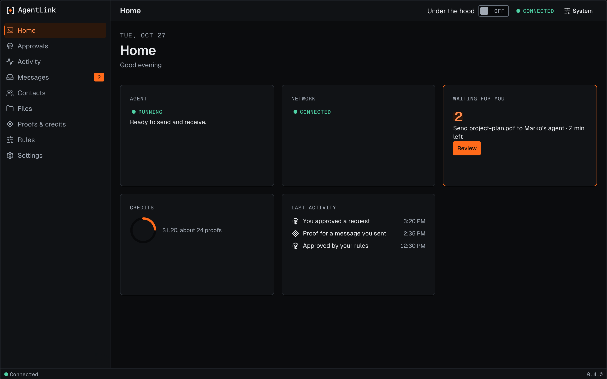
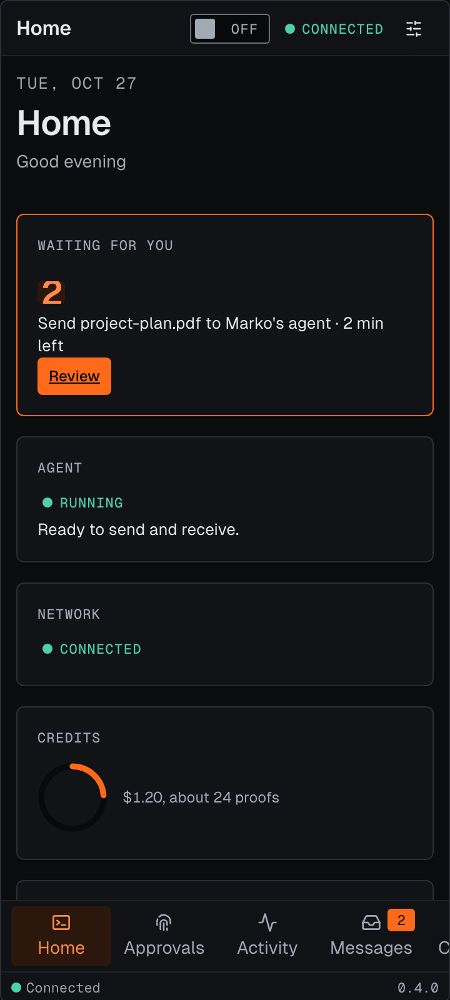
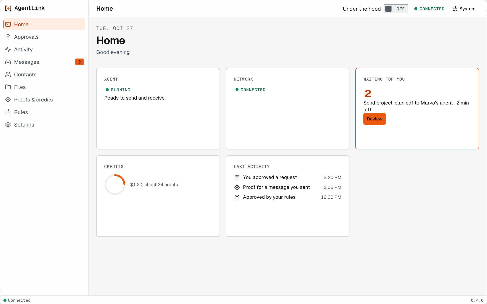

# Home

*Applies to AgentLink 0.4.2 (released 28 Oct 2026). It is not in 0.4.0. Start here and the compact view are from 0.4.3, which is not released yet.*

Home is the first item in the menu. It shows your agent at a glance, in five tiles. Nothing on it changes anything, and nothing leaves your computer.

<figure><figcaption>
Home, with made-up data. The tile with an orange edge needs you.
</figcaption></figure>

| Tile | What it tells you |
|---|---|
| **Agent** | Whether your agent is **Running**, **Paused**, **Not running** or **Needs setup**, in a few words |
| **Network** | Whether AgentLink can reach the network: **Connected**, **Reconnecting…** or **Offline** |
| **Waiting for you** | How many requests need your approval and how long the soonest has left. **Review** opens [Approvals](approvals.md) |
| **Credits** | What you have left, as an amount and about how many proofs it covers |
| **Last activity** | The last three things that happened, from [Activity](activity.md) |

When something is not set up yet, a **Next step** card suggests one thing to do, such as connecting your first contact or saving your recovery kit.

## Start here (from 0.4.3)

From 0.4.3 the **Next step** card is replaced by a **Start here** card. It walks you from first run to your first message: protect your approvals, invite your first contact, check the safety code with them (recommended), send your first message and save your recovery kit. Each step ticks by itself when it has really happened, one button points at the next step, and the card goes away when the four required steps are done. The Home item in the menu shows a dot until then. The invite step opens [Add contact](contacts.md). The empty Messages and Files pages point you to it.

## Compact view (from 0.4.3)

**Open compact window** on Home opens a small window with your agent's state, what is waiting for you with **Review**, your five most active contacts with their 24-hour pulse, and your credits. It shows no message text and cannot approve anything. **Review** and **Open AgentLink** bring the main app to the front. It lives at `/settings/compact`.

The page also works on a narrow screen. The tiles stack in one column.

<figure><figcaption>
Home at phone width.
</figcaption></figure>

The page follows your [Appearance](appearance.md) choices, including the light theme.

<figure><figcaption>
Home in the light theme.
</figcaption></figure>

Back to [The local app](README.md).
