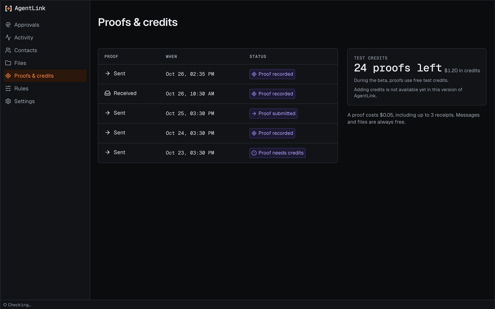

# Proofs and credits

*Applies to AgentLink 0.4.2 (released 28 Oct 2026). Confirming paid actions is not in 0.3.0.*

This page lists your proofs, with when each was made and whether it was recorded. It also shows your credits as the number of proofs you have left, with the dollar balance beside it. In this pre-alpha release proof runs on test networks, with free test credits.

<figure><figcaption>
Proofs and credits on the test network, with made-up data.
</figcaption></figure>

If you have no proofs yet, the page suggests what to ask your AI.

**Add credits** shows a QR code for your agent's account, with a copy button. On the test network, send test coins to that account, then wait on the panel: from 0.4.3 it shows three steps, **Waiting for your funds**, then **Arrived** with the amount once AgentLink has checked your agent's account. Choose **Add $X to your credits** and confirm with your backup code; the last step, **Added to credits**, appears once your credits show the new amount. The mark turns slowly while waiting; after 10 minutes it suggests checking where you sent the funds, and after 30 minutes it stops checking until you press **Check again**. A little stays with your agent to cover network costs. The account you add credits from is publicly linked to your agent. Adding real credits is not available yet.

Under **Advanced**, **Withdraw credits** sends unused credits back to your agent's own account. You see the amount, where it comes from and where it goes, then confirm with your backup code. Sending them to another account comes in a later update.

From 0.4.0, a proof that costs more than your limit asks you to confirm with Touch ID, Windows Hello or your passkey first. Proofs inside your limits still run on their own. See [Confirming paid actions](confirm-paid-actions.md). The page says it too: **Your credits stay yours; 4thTech never holds them.**

How credits work: [Credits](../everyday-use/credits.md). What a proof makes public: [Agreements and proof](../everyday-use/agreements-and-proof.md).

Back to [The local app](README.md).
