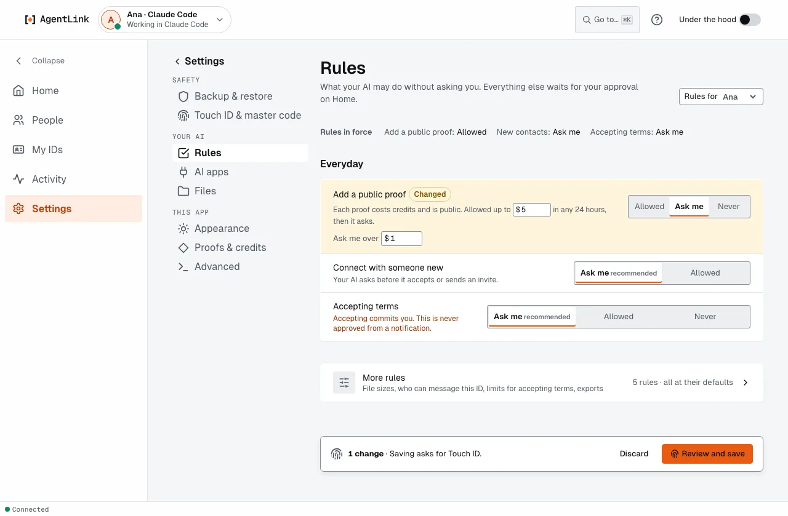

# Rules page

*Applies to AgentLink 0.5.0. Open it from **Settings** › **Rules** (in the **Your AI** group) or from **Rules** on an ID's card in [My IDs](ids.md). The one-row-per-rule layout, the **Changed** tag and the **Rules for** picker are new in 0.5.0.*

Rules decide what your AI may do without asking you: *"What your AI may do without asking you. Everything else waits for your approval on Home."* **Rules in force** at the top sums up what your AI follows right now. With two or more IDs, **Rules for** picks the ID; each ID has its own rules.

<figure><figcaption>
One change waiting: the row is marked Changed, and the bar says what saving asks for.
</figcaption></figure>

Each rule is one row with its choices (**Allowed**, **Ask me**, **Never**; the safe choice is marked *recommended*):

- **Everyday:** **Add a public proof** (with its budget in any 24 hours), **Connect with someone new** and **Accepting terms**.
- **Connect with someone new** covers accepting an invite. Making an invite never asks: an invite you or your AI send connects when the other person accepts it.
- **More rules:** file sizes, who can message this ID, limits for accepting terms and exports. Its row says how many rules there are and how many you changed.

## Change a rule

1. Change what you want. Each changed row shows **Changed**, and a bar at the bottom counts your changes. It names how saving is confirmed (**Touch ID** on a Mac, **Windows Hello** on Windows, *your passkey* elsewhere, or your master code) and says when a change lets your AI do more without asking.
2. Press **Review and save**. Before saving, the page lists in plain words everything the change lets your AI do without asking. Tick each one.
3. Confirm once with Touch ID or your master code. **Discard** drops your changes.

A change to what your AI may spend (proofs on or off, the 24-hour budget, the per-proof limit, or a limit for one contact) ends with **Continue** and a confirmation sheet instead. It shows each old and new value. See [Confirming paid actions](confirm-paid-actions.md).

If you turn selling on, an extra warning appears while you do. Your AI cannot change your rules.

Back to [The local app](README.md).
