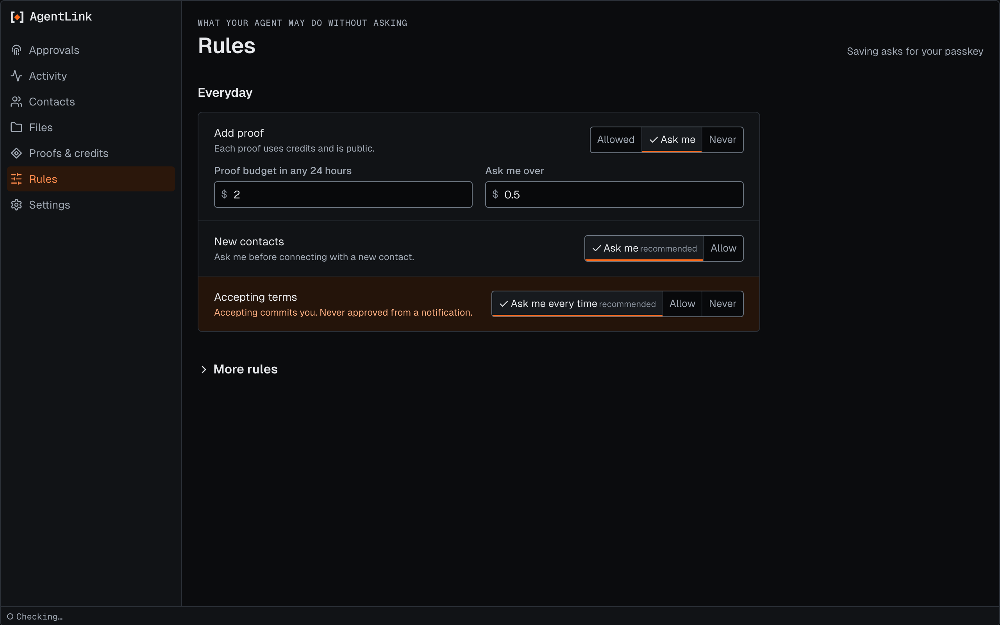

# Rules page

*Applies to AgentLink 0.4.6. Open it from Settings (Rules) or, with Under the hood on, from the Advanced group.*

Rules decide what your agent may do without asking you. The page shows them in two groups:

- **Everyday:** adding proof and its budget, new contacts, accepting terms.
- **More rules:** unknown senders, files, exports and the limits for accepting terms on its own.

<figure><figcaption>
Rules, showing the safe defaults.
</figcaption></figure>

## Change a rule

1. Change what you want. Your changes wait in an unsaved-changes bar.
2. Before saving, the page lists in plain words everything the change lets your agent do without asking. Tick each one.
3. Approve once with your passkey or backup code.

From 0.4.0, a change to what your agent may spend (proofs on or off, the 24-hour budget, the per-proof limit, or a limit for one contact) ends with **Continue** and a confirmation sheet instead. It shows each old and new value, and you confirm with Touch ID, Windows Hello or your passkey. See [Confirming paid actions](confirm-paid-actions.md). Other changes keep the passkey or backup-code check.

If you turn selling on, an extra warning appears while you do. Your agent cannot change your rules.

Back to [The local app](README.md).
