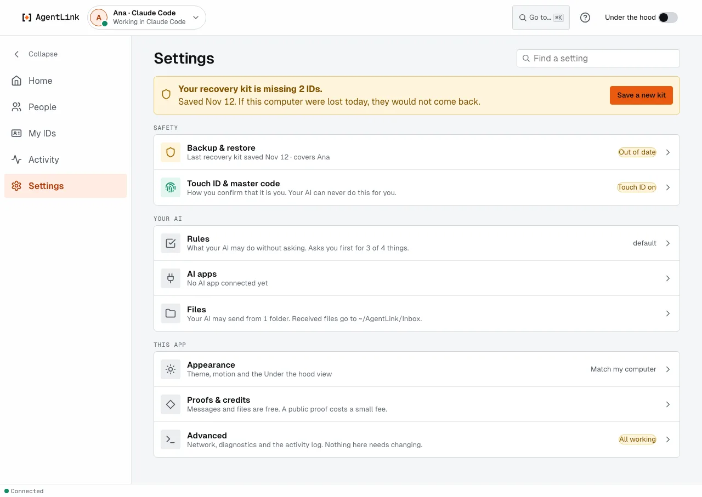

# Settings

*Applies to AgentLink 0.5.1. The three groups, the states on each row, Find a setting and the list of pages beside each Settings page are new in 0.5.0.*

**Settings** is in the left menu. Its rows are in three groups, and each row says in one line where it stands.

<figure><figcaption>
Settings: one notice at the top for what needs you first, then three groups.
</figcaption></figure>

| Group | Pages |
|---|---|
| **Safety** | [Backup & restore](backup-and-restore.md) (*Up to date*, *Out of date*, *Not backed up* or *Not finished*) and [Touch ID & master code](touch-id-and-master-code.md) (*Touch ID on* or *Master code only*; Windows Hello on Windows, *your passkey* elsewhere) |
| **Your AI** | [Rules](rules.md) (how many things your AI asks you about first), [AI apps](ai-apps.md) (which are connected) **Files** (the [folders your AI may send from](../everyday-use/allowed-folders.md) and where received files go) and [Storage](storage.md) (how much room your messages and saved files take, and Free up space) |
| **This app** | [Appearance](appearance.md) (theme, motion and Under the hood), [Notifications](notifications.md) (what AgentLink may alert you about; new in 0.5.3), [Proofs & credits](proofs-and-credits.md), [Updates](updates.md) (your version, and a newer one when it is out) and **Advanced** (network, diagnostics and the activity log; *All working* when nothing needs you) |

- **One notice at the top** says what needs you first, for example *"You have no recovery kit."* or *"Your recovery kit is missing 2 IDs."*, with the button that fixes it.
- **Find a setting** filters the rows as you type.
- **Each page** opens with the list of the other Settings pages beside it, so you can move between them. On a narrow window the list is hidden and **Settings** at the top goes back.
- **The version** of the AgentLink you are running is the last line, for example *AgentLink 0.5.0*. Give it when you report a problem.

Looking at Settings changes nothing. Any change asks for Touch ID (or your master code) first.

Back to [The local app](README.md).
