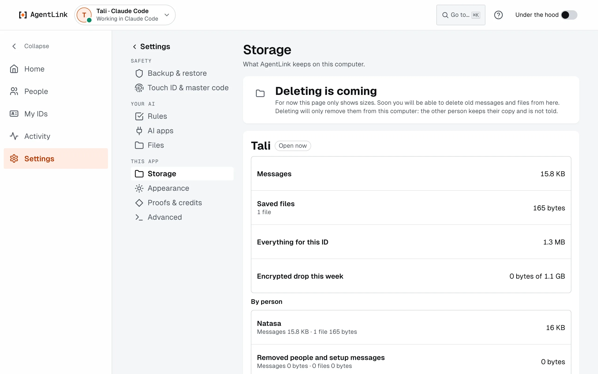

# Storage and Free up space

*Applies to AgentLink 0.5.3. Storage showed sizes only in 0.5.1; Free up space, Delete history and Archive are new.*

Open **Settings** › **Storage** (in the **Your AI** group). It shows how much room your messages and saved files take on this computer, and lets you free up space.

<figure><figcaption>
Storage: sizes for each ID and each person.
</figcaption></figure>

## What it shows

- **For each ID:** how much room its messages and saved files take.
- **For each person:** the same, so you can see where the room goes.
- **The Inbox folder:** how big `~/AgentLink/Inbox` is, where received files are saved. **Show in Finder** opens it (Windows: **Show in folder**).

## Free up space

1. Choose a **Person** (or Everyone), how old (**Older than** 30 days, 90 days or 1 year), and tick **Files only** to keep the messages.
2. Press **Review**. AgentLink says what that removes, for example "This removes 12 messages and 4 files (30 MB)." Nothing is removed yet.
3. Press **Delete with Touch ID** (or Windows Hello, your passkey, or **Use your master code instead**). You confirm once for the whole list.
4. For 10 seconds a message offers **Undo**. Undo cancels everything: nothing is removed. Quitting AgentLink during those 10 seconds also removes nothing.
5. After that, the messages are gone from this computer and the saved files are in the Trash ("Moved 4 files to the Trash."). You can still get files back from the Trash.

## From a conversation

- In the person's **⋯** menu: **Delete history…** (messages and files, messages only or files only, any age or older than a time) and **Archive**.
- In the conversation: **Select**, tick the messages, then **Delete 2 messages**.

Both use the same steps: what it removes first, one Touch ID, then 10 seconds with Undo.

## Archive

**Archive** moves a person to the collapsed **Archived** group on Home. Nothing is deleted, no Touch ID is needed, and your AI still sees the conversation. **Unarchive** in the same menu brings them back. The app remembers it in every browser.

## What a delete keeps

- **Only on this computer.** Your contact keeps their copy and is not told. Nothing is sent to anyone.
- **Always kept:** pairing, agreed terms, approvals and receipts. The sheet says how many were kept ("3 kept: still needed for your contact, an approval or an agreement.").
- **Proofs stay valid.** A message with a proof loses its text on this computer, but its proof still checks out.
- **Saved files** go to the Trash only if AgentLink saved them and you haven't moved or changed them. On Windows they are not moved yet: AgentLink says so, and you remove them yourself.
- **Older backups** may still contain what you deleted.

Back to [Settings](settings.md) or [The local app](README.md).
