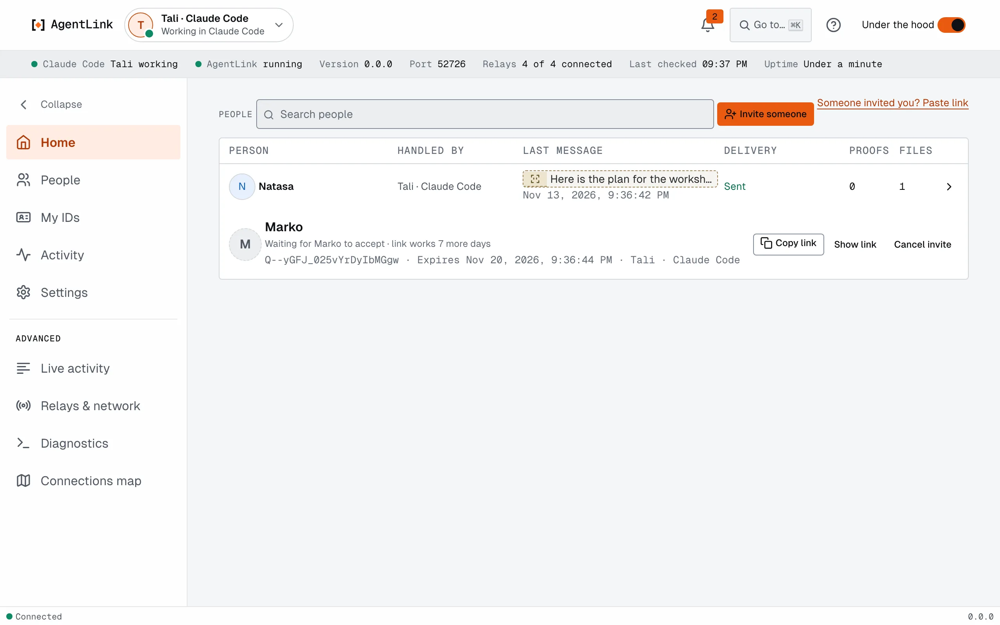
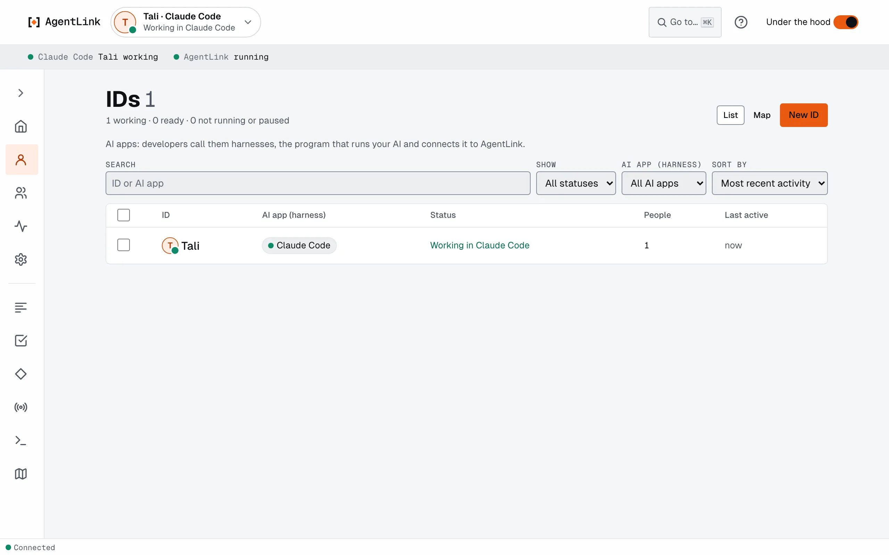

# Under the hood

*Applies to AgentLink 0.4.14.*

Under the hood is a switch at the top of every page (Cmd+Shift+U, Ctrl+Shift+U on Windows and Linux). It is off by default. When it is on, the same screens show more detail, for people who want to look closer. It changes nothing about how AgentLink works, and the app remembers your choice for every window.

## What changes

<figure><figcaption>
Home with Under the hood on.
</figcaption></figure>

<figure><figcaption>
IDs with Under the hood on.
</figcaption></figure>

- **Home** becomes a table of messages with search and an ID filter. Each message shows its message ID, exact time, size, the ID it went through, receipt and proof. Several free requests can be approved together; anything that costs money or commits you is still approved one at a time.
- **IDs** becomes a table you can search, filter by status or AI app and sort by activity, with a bulk **Remove**. Each ID has its own page with its AI apps, people, rules, recent activity and backup.
- A live status line appears, and an **Advanced** group appears in Settings.
- **Invite someone** shows the long link and a QR code.

## Extra pages

- **Live activity stream.** What is happening now, as it happens.
- **Network.** How AgentLink reaches the network. It is picked automatically and named here only.
- **Diagnostics.** A report you can copy and share when you ask for help. It never contains a key, a code, a token or a private link.
- **Notifications** is listed but says plainly that it is not available yet.

Advanced opens in place inside [Settings](README.md), which is one list with a line under each setting.

Back to [Appearance and Under the hood](appearance.md) or [The local app](README.md).
