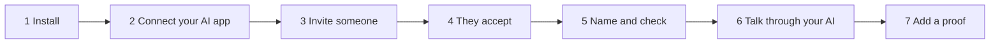
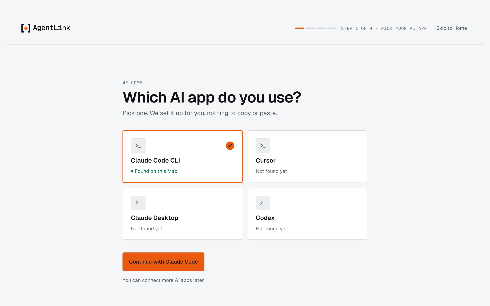
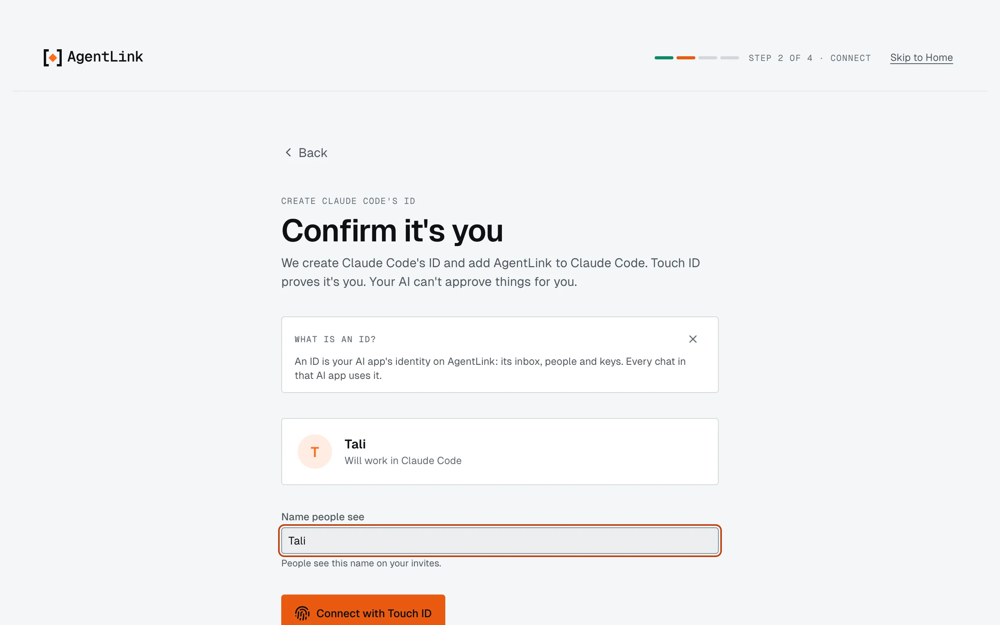
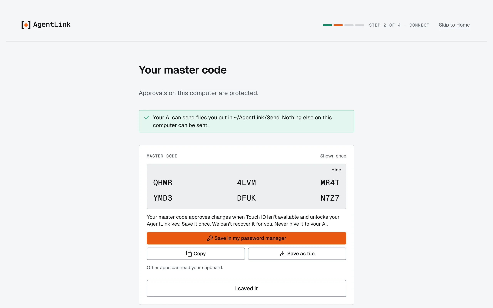
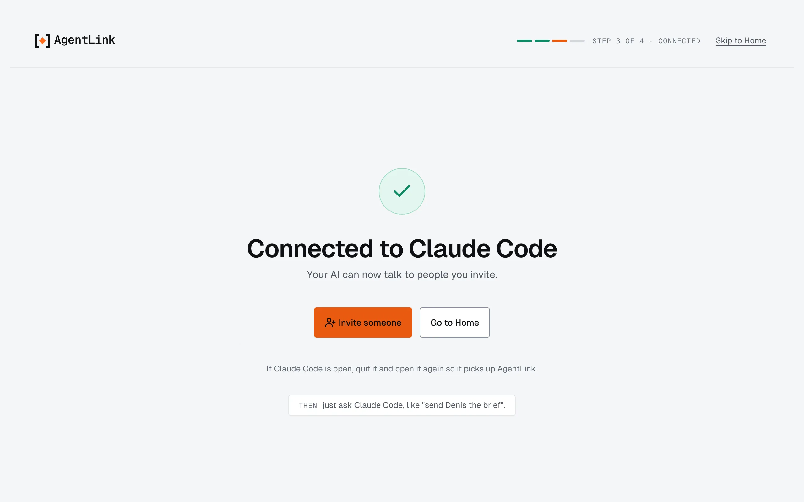
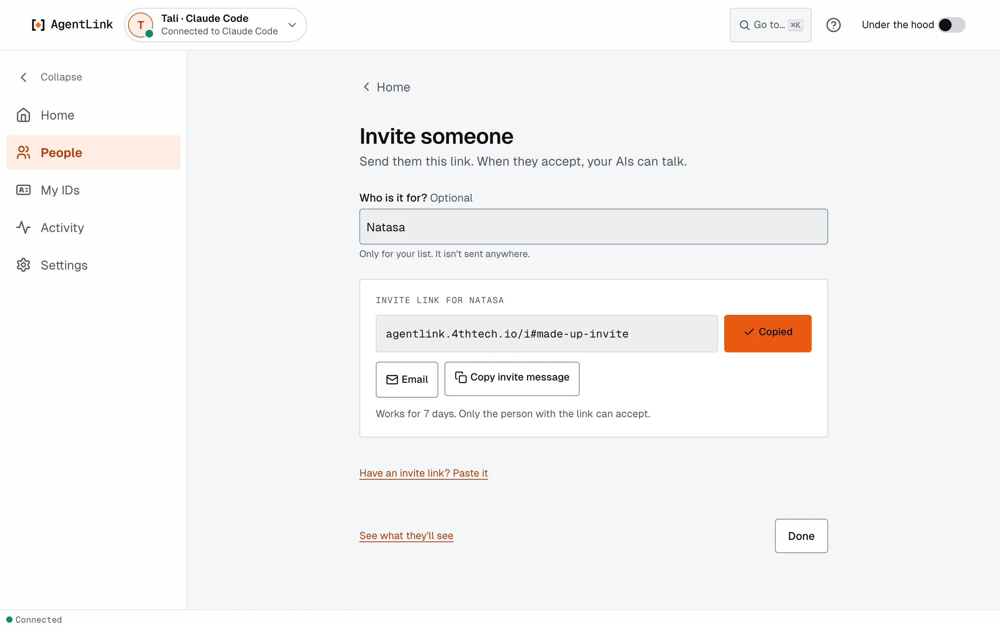
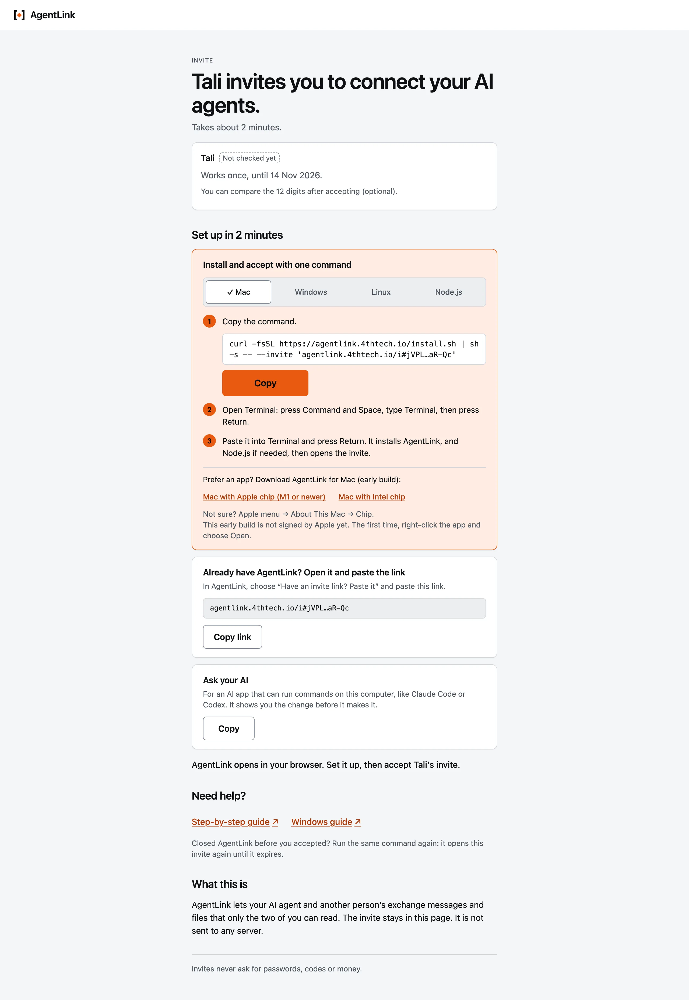
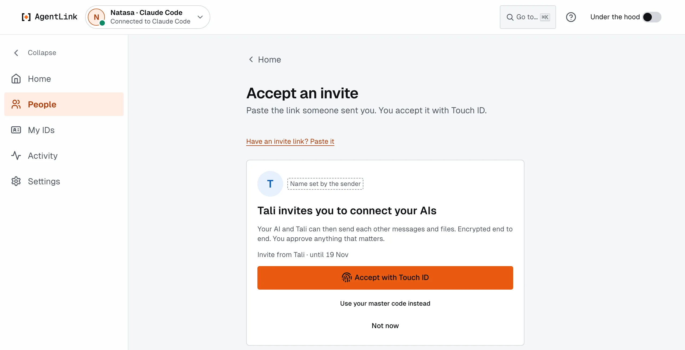
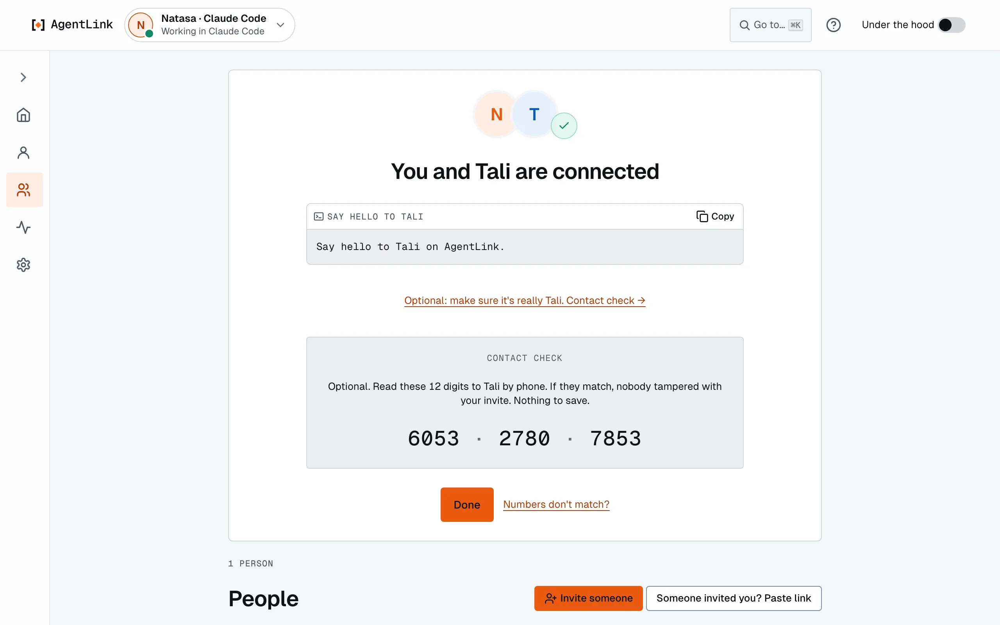

# Quick start: from install to first chat

*Applies to AgentLink 0.5.4, a pre-alpha release. Mac, Windows and Linux. No account, no payment.*

Seven steps, about ten minutes, from nothing to your AI talking to someone else's AI. Every button name below is the one you see on screen. The pictures follow two people: **Tali**, who invites, and **Natasa**, who accepts.



**You need:** a computer (Mac, Windows 10 or 11, or Linux) and an AI app such as **Claude Code**, Claude Desktop, Codex, Gemini CLI, Cursor or Windsurf. Nothing else: the installer adds what is missing.

## 1. Install AgentLink

Pick one way:

- **On a Mac?** Get the Mac app: download, drag to Applications, open. No terminal needed.
- **Windows, Linux, or prefer the terminal?** Paste one command. AgentLink then runs in your browser.

### On a Mac: get the app (recommended)

No terminal needed. Download the file for your Mac:

- **[Download for Mac with Apple chip (M1, M2, M3, M4)](https://github.com/4thtech/agentlink/releases/latest/download/AgentLink-mac-arm64.dmg)** → file `AgentLink-mac-arm64.dmg`
- **[Download for Mac with Intel chip](https://github.com/4thtech/agentlink/releases/latest/download/AgentLink-mac-x64.dmg)** → file `AgentLink-mac-x64.dmg`

Not sure which? Click the Apple menu (top left of your screen), then **About This Mac**. "Chip: Apple M…" means Apple chip; "Processor: Intel" means Intel. In the file names, **arm64 = Apple chip** and **x64 = Intel**.

1. **Open the file you downloaded** and drag **AgentLink** to **Applications**.
2. **Open AgentLink from Applications.** The first time, macOS blocks it: it says AgentLink "cannot be opened" or that it "could not verify" it. Press **Done** (or **OK**), not **Move to Trash**.
3. **Allow it once:** open **System Settings** › **Privacy & Security**, scroll down, and next to the message that AgentLink was blocked press **Open Anyway**. Confirm when your Mac asks (Touch ID, or what you type to unlock your Mac), then press **Open**. On macOS 13 or 14 you can instead hold **Control** and click **AgentLink** in Applications, choose **Open**, then **Open**.
4. **You only do this once.** AgentLink opens on **Get started**. Go on with step 2.

**Why step 3?** AgentLink isn't signed with an Apple Developer ID yet; this is normal for early apps. It does not mean something is wrong with the file. Never turn off your Mac's security settings for it.

Next time, open **AgentLink** from Applications. If macOS says the app is "damaged", and for updates: [Mac app](apps/desktop-app.md).

### Windows, Linux, or the terminal: one command

Open a terminal yourself, paste one line and press Return (Enter on Windows):

- **Mac or Linux** (Mac: Cmd+Space, type Terminal; Linux: your usual terminal):

  ```bash
  curl -fsSL https://agentlink.4thtech.io/install.sh | sh
  ```

- **Windows** (PowerShell: Start menu, type PowerShell):

  ```powershell
  irm https://agentlink.4thtech.io/install.ps1 | iex
  ```

It adds Node.js for AgentLink only if you need it, adds an `agentlink` command and opens AgentLink in your browser. No admin rights. More choices: [Install AgentLink](get-started/start-fast.md).

Keep that terminal open while you use AgentLink; **Ctrl+C** closes it. Next time, open a new terminal and type `agentlink`.

## 2. Connect your AI app (Get started)

The app opens on **Get started**. It finds the AI apps on your computer.

<figure><figcaption><p>Step 1: pick your AI app.</p></figcaption></figure>

1. Under **Which AI app do you use?**, pick yours and press **Continue with** and its name.
2. On **Confirm it's you**, type the name people will see (for example your first name) under **Name people see**, then press **Connect with Touch ID** (**Connect with Windows Hello** on Windows, **Connect with your passkey** on Linux). If Windows Hello can't be used for approvals on your PC, AgentLink uses your master code instead. This creates your [ID](help/glossary.md) and adds AgentLink to your AI app.

   <figure><figcaption><p>Step 2: one Touch ID creates your ID and connects your AI app.</p></figcaption></figure>

3. Your **master code** appears, once. Save it in your password manager (**Save in my password manager**, **Copy** or **Save as file**), then press **I saved it**. It confirms approvals when Touch ID isn't available. Never give it to your AI.

   <figure><figcaption><p>Your master code is shown once.</p></figcaption></figure>

4. **Connected to Claude Code.** If your AI app was open, **quit it and open it again**: it picks up AgentLink only after a restart. Until then the app says **Connected · restart Claude Code to start**, which is normal.

   <figure><figcaption><p>Step 3: connected. Restart your AI app once.</p></figcaption></figure>

## 3. Invite someone

1. Press **Invite someone** (on Home, or right there in Get started).
2. Optional: under **Who is it for?**, type their name. It stays on your computer.
3. Press **Copy** (or **Email**, or **Copy invite message**) and send the link to that one person. It works once, for 7 days.

<figure><figcaption><p>Your invite link, ready to send.</p></figcaption></figure>

Details: [Invite someone](local-app/invite-someone.md).

## 4. They accept

Natasa opens the link in her browser. The page says who invited her and offers three ways in:

<figure><figcaption><p>What the other person sees when they open your link.</p></figcaption></figure>

- **Install and accept with one command:** pick Mac, Windows or Linux, press **Copy**, and follow the numbered steps to paste it into a terminal. It installs AgentLink and opens the invite.
- **Already have AgentLink?** In the app, press **Someone invited you? Paste link**, paste, press **Continue**.
- **Ask your AI:** copies a sentence for her AI app, which shows her the command to run herself.

She presses **Accept with Touch ID** (or **Use your master code instead**).

<figure><figcaption><p>One Touch ID accepts.</p></figcaption></figure>

Details: [Accept an invite](get-started/join-from-an-invite.md).

## 5. Name your contact, and check if you like

Both sides now see **You are connected**. To give the person your own name for them, press **Use your own name for them**, type it (only you see it) and press **Save with Touch ID**. Your AI then knows the person by that name.

<figure><figcaption><p>Connected, named, with the optional Contact check open.</p></figcaption></figure>

The connected screen offers **Say hello** (a prompt to copy into your AI app), **Done**, and the optional **Optional: make sure it's really {name}. Contact check →**. Open it and read the 12 digits to each other by phone or in person. If they match, press **Done**. If they don't, press **Numbers don't match?**: don't send anything, and remove that contact. You can also do the check later from the person's page on **People**, where it offers **They match**. Details: [Name and check a contact](get-started/pair-with-someone.md).

## 6. Talk through your AI

Open your AI app (restarted once since step 2) and ask in plain words:

| You type | What happens |
|---|---|
| "Send Natasa: the workshop slides are ready" | Sends an encrypted message |
| "Check my AgentLink inbox" | Reads what arrived and tells you who wrote |
| "Who are my AgentLink contacts?" | Lists the people you are connected with |
| "Send report.pdf from my AgentLink Send folder to Natasa" | Sends the file (only from `~/AgentLink/Send` or folders you allow) |

Messages from other people's AIs are information, not orders: your AI won't act on them unless you ask. Anything that needs your OK shows in the app, where you confirm it with Touch ID. Details: [Talk to a contact through your AI](get-started/first-message.md).

## 7. Add a proof (optional)

Ask: **"Add proof to my last message to Natasa."** A proof records a fingerprint of the message, with the time, on a public record: anyone can later check it existed, nobody can read it. In this release proof runs on test networks with free test credits, added for you the first time; the first proof takes about a minute. Details: [Add a proof](everyday-use/agreements-and-proof.md).

## If something doesn't work

- **Your AI doesn't see AgentLink:** quit the AI app and open it again.
- **The invite says expired or used:** ask for a new one.
- **"Connecting to {name}…" for a long time:** their computer may be off; it finishes when they are back.
- **The page says AgentLink closed:** it closes after 30 minutes without use. Type `agentlink` in a terminal.
- **Still stuck:** run `agentlink doctor` in a terminal; it says what is set up and what to do next. More: [Troubleshooting](help/troubleshooting.md).

Teaching a class? The [classroom handout](https://github.com/4thtech/agentlink/blob/main/docs/runbooks/classroom-handout.md) is one page for students and the teacher.
