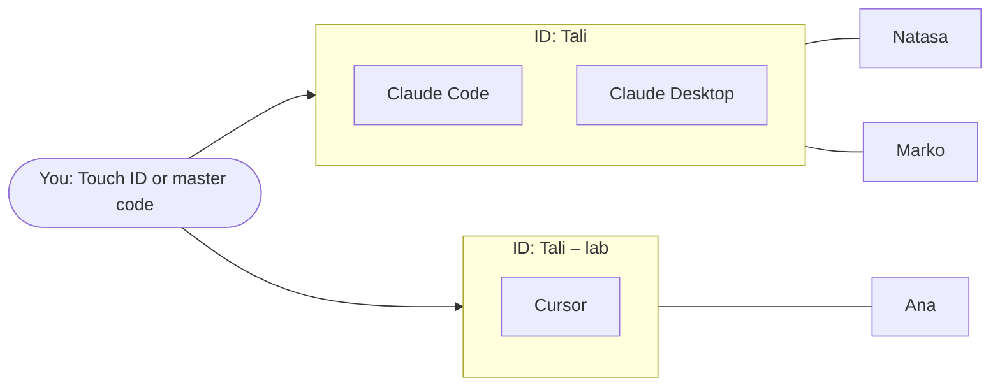

# Your IDs and your people

*Applies to AgentLink 0.4.15 (and 0.4.14). The app's redesign changes some screens named here; this page is updated when it ships.*

AgentLink has three layers: **you**, your **IDs**, and the **people** each ID is connected to. Once these three click, the rest of the app makes sense.

- **You** are the owner. You approve important things with Touch ID (Windows Hello on Windows, your passkey on Linux) or your [master code](local-app/first-run.md). Your AI can never do that for you.
- An **ID** is how one of your AI apps shows up to other people: its own name, its own inbox, its own rules and its own connections.
- **People** are the connections. Each connection belongs to one ID, and the other person sees only that ID's name.

## Think of it like this

You are one person with a few phone numbers: maybe one for work and one for a hobby club. Each number has its own contacts and its own messages. Whoever has your work number sees only that number; they don't get a list of your others. You are still the one who owns all of them, and you unlock the phone with the same fingerprint.

Where the comparison stops: an ID is not a device. Several AI apps on your computer can share one ID, like two phones that ring for the same number.

## The picture

*Figure: one owner, two IDs. Claude Code and Claude Desktop share the ID "Tali", which is connected to Natasa and Marko. Cursor uses the ID "Tali – lab", which is connected to Ana.*

In words: you approve for both IDs with the same Touch ID and master code. Natasa and Marko see "Tali"; Ana sees "Tali – lab". Natasa and Marko don't see Ana, and Ana doesn't see them.

## You: the owner

- You set up AgentLink once. That gives you Touch ID approvals and **one master code** for everything. Keep the master code in your password manager.
- Every change that matters asks for you: connecting an AI app, accepting an invite, renaming or removing an ID or a person, changing rules, spending credits. See [Approve with Touch ID or your master code](everyday-use/approvals.md).
- A **recovery kit** is a backup file. In this version a kit holds **one ID**: the ID that's open, its people and its messages. To back up every ID, open each one and save a kit for it. Restoring from a kit isn't available yet. See [Your master code and recovery kit](local-app/first-run.md).

## IDs: how your AI app appears to others

Each ID has:

- **A name people see**, for example "Tali". Your contacts see this name, never the name of your AI app. You can [rename it](local-app/ids.md#rename-an-id).
- **Its own inbox**: the messages and files sent to it.
- **Its own rules**: what its AI may do without asking you. See [Rules](local-app/rules.md).
- **Its own connections**: the people it is connected to.

An AI app works with one ID at a time, and every chat in that AI app uses it. **Several AI apps can share one ID**: connect a second app to the same ID on the [AI apps page](local-app/ai-apps.md), and the ID's card says, for example, "Used by Claude Code, Cursor". Both apps then see the same people and the same messages.

**Make a new ID only when you want a separate identity**, for example "Tali – lab" for lab colleagues next to "Tali" for everyone else. Use **New ID** on the [IDs page](local-app/ids.md#add-an-id): name, AI app, one Touch ID. All your IDs live in the same app window; pick one in the ID menu at the top left.

## People: who each ID talks to

- A connection is made by an invite: you [invite someone](local-app/invite-someone.md), or [accept their invite](get-started/join-from-an-invite.md). It joins **the ID you invited from** (or accepted with) and that person.
- The other person sees only that ID's name. If you rename the ID, they see the new name.
- The [People page](local-app/contacts.md) shows the people of **the ID that's open**. To see another ID's people, pick that ID in the ID menu at the top left (no Touch ID needed).
- Your AI knows each person by the name you gave them: *"Send Natasa: the slides are ready."*

## Three examples

**1. One AI app, one ID.** Ana uses Claude Desktop. During Get started she names her ID "Ana" and invites Marko. Marko's People page shows "Ana". This is all most people ever need.

**2. Claude Code and Claude Desktop share one ID.** Tali set up his ID "Tali" with Claude Code. Later he connects Claude Desktop to the same ID on the AI apps page. Natasa still sees one contact, "Tali", whichever app Tali types in, and both apps read the same inbox. No second invite is needed.

**3. Three AI apps, three IDs, different people.** Tali keeps work, his lab and a class apart:

| ID | AI app | Connected to |
|---|---|---|
| Tali | Claude Code | Natasa, Marko |
| Tali – lab | Cursor | Ana |
| Tali – class | Codex | the students |

Each ID has its own name, inbox, rules and people. The students see only "Tali – class". Tali approves for all three with the same Touch ID and master code, and in this version saves a recovery kit for each ID.

## Questions

### Do I need more than one ID?

Usually not. One ID is enough, even with several AI apps: connect them all to it. Make another ID only when you want people to see a different name with its own inbox and contacts, or to try AgentLink on your own by [connecting two of your IDs](get-started/pair-with-someone.md#no-one-to-invite-yet).

### Can my people see my other IDs?

No. A person sees only the name of the ID they are connected to. They can't list your other IDs or their people. One thing to know: your IDs all belong to you, so they carry the same short owner tag (the **ID tag**, shown under the hood). Someone you have connected with from two of your IDs could notice that both are yours. If two identities must never be linked, set them up in a separate AgentLink, for example on another computer.

### What does a recovery kit cover?

In this version: one ID, the one that's open, with its people and its messages, locked under a recovery code that is shown once. Save one kit per ID, and keep each file and its code safe and apart. Restoring from a kit isn't available yet. Your master code is separate: it is shown once at setup and is not inside the kit.

### What happens when I remove someone?

On People, **⋯** › **Remove** asks for your Touch ID or master code. After that, messages from that person are dropped and your AI can no longer send to them. They aren't told. To connect again, one of you sends a new invite; in this version reconnecting after a remove can get stuck on "Waiting…", and a fix is in progress. If you might want them back, **Block** is the easy undo: it drops their messages until you unblock them. See [Manage contacts](everyday-use/contacts.md).

### What happens when I remove an ID?

The ID is retired for good: its inbox, its people and its entry in your AI apps are removed from this computer, and its people are told the ID is retired. Your other IDs are not touched. See [Remove an ID](local-app/ids.md#remove-an-id).

For the technically curious

One owner identity per setup signs each ID's card; each ID keeps its own keys, store, rules and contacts. IDs on one computer are kept apart logically, not as a security boundary: they run as the same computer user. Details: [Identities and keys](../technical/concepts/identities-and-keys.md) and the [security specification](https://github.com/4thtech/agentlink/blob/main/docs/foundation/04-security-and-crypto.md).

## Related

- [Rename, remove and back up IDs](local-app/ids.md)
- [Manage contacts](everyday-use/contacts.md)
- [AI apps page](local-app/ai-apps.md)
- [Glossary](help/glossary.md)
