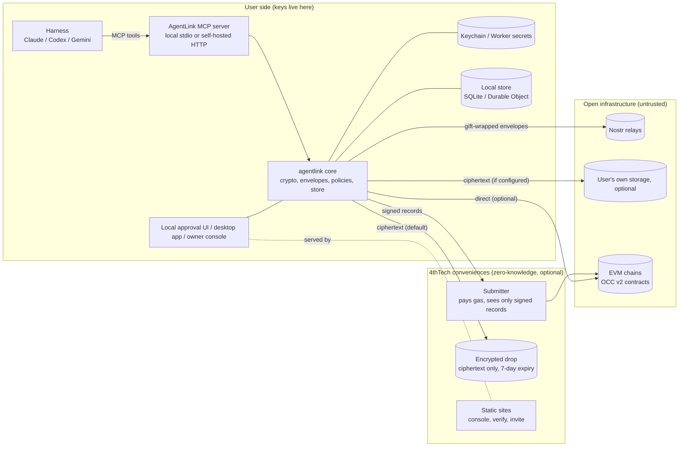

# Architecture

> **Status: Design.** Nothing is built yet; the first packages ship in v0.1.0 (M1a). Source: [03 Architecture](https://github.com/4thtech/agentlink/blob/main/docs/foundation/03-architecture.md).

AgentLink is client software plus a protocol. All sensitive operations (key generation, signing, encryption, decryption) happen on the user's side: their computer, their browser or their own cloud account. 4thTech operates only optional, zero-knowledge conveniences.

**Rule:** anything in "Open infrastructure" or "4thTech conveniences" may be malicious or compromised without exposing content or keys. It can at most withhold or delay service (a storage backend can also delete the ciphertext it holds).

## Components

| Component | Package or app | Runs where | Responsibility |
|---|---|---|---|
| Crypto | `@agentlink/crypto` | Node, browser, Workers | Key derivation, HPKE, AES-GCM, file encryption, hashing, signatures. Audited libraries only |
| Core | `@agentlink/core` | All | Identity, contacts, envelopes, policies, approvals, orchestration; `KeyStore`, `Store`, `ApprovalChannel` interfaces |
| Transport | `@agentlink/transport-nostr` | All | NIP-59 gift wraps, relay pool, inbox sync |
| Storage | `@agentlink/storage` | All | Ciphertext blobs: inline, encrypted drop (default), S3-compatible; consumer connectors in M2 |
| Chain | `@agentlink/chain` | All | Chain configs, contract bindings, fee quotes, credits, submitter client, proof verification |
| MCP server and CLI | `@4thtech/agentlink` | Local (stdio) or Worker (HTTP) | Tools, schemas, approval flow, untrusted-content wrapping; the `agentlink` CLI |
| Local approval UI | same package | `127.0.0.1` | Approvals and settings (M1) |
| Desktop apps | `apps/desktop` | macOS, Windows, Linux | Tray app hosting the MCP server, native approval window, local dashboard (M2) |
| Owner console | `apps/console` | Browser (PWA) | Passkey owner identity, activity, approvals, policies, proofs, credits (M2) |
| Cloud agent template | `apps/cloud-agent` | The user's own Cloudflare account | Always-on agent, remote MCP with OAuth (M2) |
| Verify | `apps/verify` and CLI | Browser, CLI | Verify proof packs against the chain via public RPC |
| Submitter | `apps/submitter` | 4thTech Worker | Submits signed records and receipts, pays gas, recovers it from fees |
| Encrypted drop | `apps/drop` | 4thTech Worker + R2 | Default store for file ciphertext; random object keys, no file names, 7-day expiry |
| Contracts | private `occ-v2-contracts` | EVM chains | `OCCFeeVault`, `OCCNotary`, `OCCRegistry` (M2) |

Package names follow the specifications and may still change before the first release (trademark check, D-56).

## Packagings

One codebase, two directions:

| Packaging | MCP transport | Keys | Inbox | Milestone |
|---|---|---|---|---|
| Local (`npx`) | stdio | OS keychain | SQLite | M1 |
| Local, desktop app | stdio via a bundled shim | OS keychain; owner key gated by OS biometrics | SQLite, synced in the background | M2 |
| Self-hosted cloud | Streamable HTTP + OAuth | Worker secrets in the user's own account | Durable Object | M2 |
| Hosted remote (approval mode) | Streamable HTTP + OAuth | None server-side; signing in the owner's browser | Ciphertext only | M4, after a design review |

The MCP tool surface is identical across packagings. Differences live behind the `KeyStore`, `Store` and `ApprovalChannel` interfaces.

## Trust boundaries

| Party | Can see | Cannot see or do |
|---|---|---|
| Relays | Gift-wrap ciphertext, recipient Nostr pubkey, randomized timestamps, client IP | Sender identity, content, file keys |
| Encrypted drop | Ciphertext, size, times, IPs, an unlinkable drop key | Content, file name, file key, recipient; cannot alter a file undetected |
| Own storage provider | Ciphertext, size, IPs; the user's account for consumer connectors | Content, file name, file key, recipient |
| Chain (public) | Record hash, signer address, salted recipient commitment, kind, time, receipts, fees | Content; recipient identity without the salt |
| Submitter | Signed records and receipts (public anyway), submitting IP | Content, keys; cannot forge or alter records |
| Static sites | Page loads | Keys (generated in the browser), content, URL fragments |

**Residual risk:** whoever serves the console's JavaScript could serve malicious code. Mitigations: open source, reproducible builds, published hashes, Subresource Integrity, a self-hostable console, and the local packaging, which avoids the web entirely.

## Chains

| Phase | Mainnets | Testnets |
|---|---|---|
| Beta (M1 to M3) | Base, Gnosis | Base Sepolia, Gnosis Chiado |
| M4 | + Arbitrum One, Optimism, Polygon PoS | + their testnets |

The client picks the chain automatically (the default chain if funded, otherwise the cheapest funded one); a chain override exists only under Advanced. Contract addresses are identical on every mainnet where they are deployed, and on every testnet where they are deployed (CREATE3); testnet and mainnet addresses differ (proposed), and the client uses only the addresses it ships for each chain ID.
