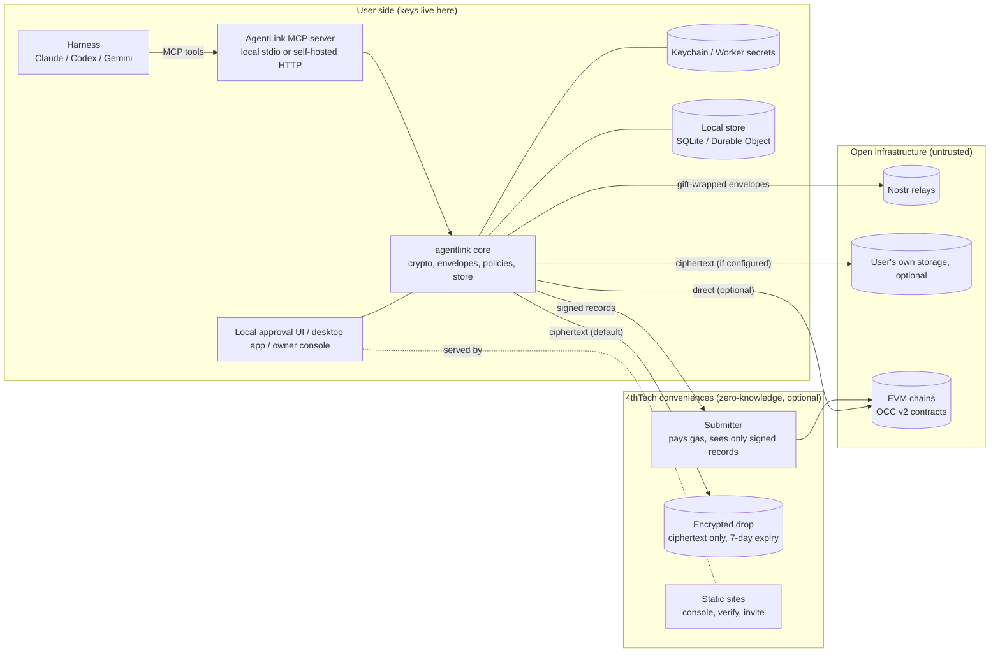

# Architecture

> **Status: Current for v0.5.10.** The released `@4thtech-io/agentlink` holds the crypto, transport, core, CLI, MCP server and local app; the desktop app for Mac and Windows has shipped; proof runs on test networks only (no mainnet before M3). The owner console, the self-hosted cloud agent and the Linux desktop app are planned. Source: [03 Architecture](https://github.com/4thtech/agentlink/blob/main/docs/foundation/03-architecture.md).

AgentLink is client software plus a protocol. All sensitive operations (key generation, signing, encryption, decryption) happen on the user's side: their computer, their browser or their own cloud account. 4thTech operates only optional, zero-knowledge conveniences.

**Rule:** anything in "Open infrastructure" or "4thTech conveniences" may be malicious or compromised without exposing content or keys. It can at most withhold or delay service (a storage backend can also delete the ciphertext it holds).

## Components

| Component | Package or app | Runs where | Responsibility |
|---|---|---|---|
| Crypto | `@4thtech-io/crypto` | Node, browser, Workers | Key derivation, HPKE, AES-GCM, file encryption, hashing, signatures. Audited libraries only |
| Core | `@4thtech-io/core` | All | Identity, contacts, envelopes, policies, approvals, orchestration; `KeyStore`, `Store`, `ApprovalChannel` interfaces |
| Transport | `@4thtech-io/transport-nostr` | All | NIP-59 gift wraps, relay pool, inbox sync |
| Storage | `@4thtech-io/storage` | All | Ciphertext blobs: inline, encrypted drop (default), S3-compatible; consumer connectors in M2 |
| Chain | `@4thtech-io/chain` | All | Chain configs, contract bindings, fee quotes, credits, submitter client, proof verification |
| MCP server and CLI | `@4thtech-io/agentlink` | Local (stdio) or Worker (HTTP) | Tools, schemas, approval flow, untrusted-content wrapping; the `agentlink` CLI |
| Local app | same package | `localhost` | Home, IDs, Activity and Settings, with approvals and an Under the hood view (see [The local app](#the-local-app)) |
| Desktop app | `apps/desktop` | macOS, Windows (Linux planned) | The same app in its own window, with Touch ID or Windows Hello, a menu bar widget and signed updates (see [The desktop app](#the-desktop-app)) |
| Owner console | `apps/console` | Browser (PWA) | Passkey owner identity, activity, approvals, policies, proofs, credits (planned, M2) |
| Cloud agent template | `apps/cloud-agent` | The user's own Cloudflare account | Always-on agent, remote MCP with OAuth (planned, 0.6.0) |
| Verify | `apps/verify` and CLI | Browser, CLI | Verify proof packs against the chain via public RPC |
| Submitter | `apps/submitter` | 4thTech Worker | Submits signed records and receipts, pays gas, recovers it from fees |
| Encrypted drop | `apps/drop` | 4thTech Worker + R2 | Default store for file ciphertext; random object keys, no file names, 7-day expiry |
| Contracts | private `occ-v2-contracts` | EVM test networks today | `OCCFeeVault`, `OCCNotary`; `OCCRegistry` planned (M2) |

## The local app

Source: [08 §1](https://github.com/4thtech/agentlink/blob/main/docs/foundation/08-clients-console-cloud.md). `agentlink` (or `agentlink ui`) starts a server on `localhost` and opens the app in your browser. The page never signs: every owner action is checked by the server and needs the owner's presence: Touch ID, Windows Hello or the master code in the desktop app, a passkey or the master code in a browser (04 §2.5). Every `/api/ui/` route sits behind the same page session, CSRF header, `Host`, `Origin` and fetch-metadata checks.

**Screens.** A top bar (your ID with a live status, the ID menu, Go to with Cmd+K, a "?" Help menu, and the "Under the hood" switch, Cmd+Shift+U) and a left menu: Home (`/`, with approvals on top, then your people and their conversations and files), IDs (the page at `/agents`, with one page per ID at `/agents/<name>`; an ID is your AI app's identity on AgentLink: its inbox, contacts and keys, and it is called an agent in the code, the routes and the `--agent` flag), Activity (`/activity`, and the live stream at `/activity/live` under the hood) and Settings (`/settings`, with pages for backup, AI apps, the files folder, appearance, notifications, rules and proofs; Advanced opens in place and holds rules, proofs, Relays & network, Diagnostics and a Connections map page). Get started runs at `/start/app`, `/start/connect`, `/start/connected` and `/start/invite`, and a waiting invite at `/settings/join`. Messages and Contacts still exist at `/inbox` and `/contacts` as interim pages that Home replaces. Old addresses (`/first-run`, `/start`, `/settings/home`, `/settings/messages`, `/settings/contacts`, `/settings/agents`, `/settings/activity`, `/settings/advanced`, `/settings/about`, `/settings/storage`, `/settings/passkeys`, `/advanced`) redirect to the new ones.

**Live AI-app status** (D-143, W4-LIVE-STATUS, W4-SHELL-LIVE, W4-WIRE-3). Every `agentlink mcp` process, lease holder or not, writes one session row in its agent's store when it answers the MCP `initialize` request and refreshes it every 15 seconds (the beat; a row lapses after 45 seconds). The client's name is mapped through a fixed table to an AI app id (`claude-code`, `claude-desktop`, `codex`, `gemini-cli`, `opencode`, `antigravity`, `cursor`, `windsurf`, else `other`, shown as "Another AI app") and only the id is kept; each tool call stamps the row. A clean exit deletes it, a crash leaves it to lapse. The app host reads the rows (read-only) every 2 seconds and sends only changes, as server-sent events, on `GET /api/ui/events`. The page reads the stream with `fetch` and a streamed body, not `EventSource`, because `EventSource` cannot send the CSRF header. The stream carries only agent names, labels, AI app ids, states and times.

| Level | States |
|---|---|
| AI app | Working (a tool call within 60 s), Ready (a session, last activity within 10 min), Idle (a session, nothing for more than 10 min), Not running (an entry but no live session, with when it was last seen), Not set up |
| Agent | Working in, Ready in, Idle, Offline (with last seen), Paused |

Events are `snapshot` (the whole state, first on every stream), `agents` (only agents that changed, plus the names gone) and `generation` (after a switch); each has an `id` of the form `<boot>.<seq>`, and the last 64 are kept for `Last-Event-ID` replay. A comment line (`: ping`) goes out every 15 seconds, a stream ends after 30 minutes, and at most 4 streams per page session and 8 in all are allowed (more get 429 `busy`). The page reconnects with backoff from 1 second up to 30 seconds. After three failures within a minute, or without a streamed body, it falls back to reading `GET /api/ui/agents` every 5 seconds while the tab is visible. The rows are status only: nothing reads them to authorise anything, and a process of the same user could fake them (G-1).

**Pause and Resume** (D-143 (5), W4-PAUSE; store schema 12, table `agent_pause`). Pause is one click, `POST /api/ui/agents/pause`, with no owner presence: it writes only the pause row and signs nothing, because stopping never adds authority. Every process of the agent checks the row before each tool call and command and at each loop step, and fails closed when it cannot read it. While paused the sending and fetching tools are refused with `AGENT_PAUSED` ([MCP tools](../reference/mcp-tools.md#paused-agents-since-046-d-143-5)), no relay subscription, catch-up, background processing or automatic saving runs, and queued messages stay queued. The AI can still read what the agent holds. Resume, `POST /api/ui/agents/resume`, needs owner presence and signs the owner action `agent.resume` (params: only the agent's ID); it is refused with `not_paused` when the agent is not paused. After resume the subscriptions start again and the usual look-back fetches what the relays kept. Creating, checking and accepting an invite in the app answer `agent_paused`. No MCP tool or command can pause or resume (I-4); a same-user process could delete the row directly, so Pause stops the AI's tools, not a process with shell access.

**Owner actions the app signs.** Besides the earlier ones: `agent.resume`, `file.save` (agent, message ID and file index only; see [Files](files.md#automatic-saving-since-046)) and `agent.label` (rename). Renaming signs a new agent card with the new name in the same confirmation and every contact receives it with the existing card update (D-141); a contact that missed it gets it again at most once a day, an agent can be renamed for its contacts 3 times a day, and no AI app tool or command can rename. `app.connect` and `app.disconnect` add or remove the one `agentlink` entry of an AI app's config; the first confirmation of Get started also creates the agent and connects the app (W4-ONE-TOUCH).

**UI settings.** `GET` and `PUT /api/ui/ui-settings` hold only two booleans, `underTheHood` and `menuExpanded`, in `~/.agentlink/ui-settings.json` (mode 0600), so every window agrees. The PUT needs no owner presence and signs nothing; it changes how the app looks, never a policy, key or approval.

**Short invites** (D-139, W4-SHORT-INVITE; 04 §3.6.2). A new invite link is `https://agentlink.4thtech.io/i#2.<43 characters>`, under 80 characters. The fragment holds one 32-byte secret; HKDF derives from it the drop object ID and the key. The invite is encrypted on your computer (format `ALI1`) and uploaded to the encrypted drop, which only ever holds ciphertext; the key never reaches it. The object is deleted when the invite is used, cancelled or expires, and the drop enforces at most 7 days. If the drop cannot be reached within 10 seconds, the app (or `agentlink invite`) gives the long link instead. `agentlink invite --long` and Advanced make the long link on purpose. Older long links keep working. The metadata residual: the drop can link the inviter's and the recipient's IP addresses. Open invites are listed in the app with a Cancel button.

**Invite flow, end to end (0.4.7 and 0.4.8; W5-INVITE-FEEDBACK, W5-PASTE-ENTRY, W6-INVITE-DESIGN).** The inviter's app creates the invite and shows a short link, `https://agentlink.4thtech.io/i#2.<43 characters>`. The part after `#` is the secret; a browser never sends it to a server, and the invite page, a static site, makes one request: it fetches the encrypted short invite from the drop by an ID derived from the link, and the secret never leaves the browser. The long form (`agentlink invite --long`, or the automatic fallback when the drop cannot be reached within 10 seconds) carries the whole invite in the fragment and stores nothing. The friend opens the page, which offers three cards (Ask your AI, one command, paste the link in AgentLink), or pastes the link on Home ("Someone invited you? Paste link"). The app resolves the link on the friend's computer, shows who invites them, and one owner signature accepts it. The app then follows the pairing without a reload: the pasting side shows "Connecting to {name}…" and then "You're connected with {name}", and the inviter's side shows "{name} accepted your invite" and highlights the contact. Pending invites persist across reloads and can be cancelled. Pasting an invite from a contact you already have asks "Connect again?" first and, after pairing, both sides ask for a new Contact check. When the accept cannot leave the computer yet, the app says it is waiting for the other agent to come online.

**Windows (W5-WINDOWS).** The entry `init` and the app write for an AI app starts with `cmd /c npx -y @4thtech-io/agentlink mcp`, because those apps cannot spawn `npx` directly on Windows; entries written earlier are recognised and rewritten on the next connect. The Claude Desktop extension (`.mcpb`) is built per platform (`darwin-arm64`, `darwin-x64`, `win32-x64`). CI installs the packed CLI on Windows, runs it, connects an AI app into a temporary profile and starts the MCP server on every change to the CLI, and the Windows `.mcpb` is opened on a Windows machine before each release.

**The invite page and its deploy.** `apps/invite` is a static site served as Workers static assets at `https://agentlink.4thtech.io` (Custom Domain), with exactly five files (`_headers`, `index.html`, `i/index.html`, `invite.css`, `invite.js`). `deploy-invite.yml` builds once, then staging (`workers.dev`), then a smoke test that compares the served files with the build byte for byte and checks the security headers, then production after the environment approval, with a health check, an automatic rollback and the deploy freeze (`DEPLOY_FREEZE`).

**CI and release fast lane (owner Decision 54, 2026-11-01).** Pull requests run the checks of the packages a change affects, plus the heavy-lane jobs (macOS and Windows keychain, path guard, node on each OS, Windows smoke, deterministic end-to-end) only when the change is in their area. A push to `main` runs everything and publishes `ci-gate (push)`, which fails if any heavy job was skipped; deploys and `latest` releases require it. There is no merge queue. The class (S0, S1, S2) is computed from the paths; the independent review is required for S2 and sensitive paths only, and `node tools/pr/open-pr.mjs` fills the pull request. Every merge is testable as `@next` within minutes.

## The desktop app

Sources: [08 §8](https://github.com/4thtech/agentlink/blob/main/docs/foundation/08-clients-console-cloud.md), [D-145](https://github.com/4thtech/agentlink/blob/main/docs/foundation/decisions/D-145.md). The Mac and Windows apps are a thin Electron shell around the unchanged Node core, on a bundled, hash-pinned Node.js. They run the same app host on the same `~/.agentlink` and keychain items as `npx`, so moving between the browser and the app needs no migration. Each AI app still starts its own stdio MCP process, now from the app's bundled `node` and CLI. The app runs while you are logged in, so the inbox stays synced between AI-app sessions.

- **Owner presence.** A native helper releases the secret that wraps the owner key only after Touch ID or Windows Hello (`ALKH`, 04 §2.3.4); the master code always works. The window has WebAuthn switched off, so no passkey is asked for there.
- **Menu bar widget** (D-155). A read-only popover in the macOS menu bar or the Windows notification area; a row opens the exact conversation or approval (0.5.10).
- **Updates** (D-151). Installed only when signed by the one update key pinned in the app, after the owner's approval click in CI. The builds themselves are not yet code-signed; see the [security model](security-model.md).
- **Quit order** (0.5.10). Windows close first, then the core shuts down, then the app exits.

## Packagings

One codebase, two directions:

| Packaging | MCP transport | Keys | Inbox | Status |
|---|---|---|---|---|
| Local (`npx`) | stdio | OS keychain | SQLite | Shipped (0.1.0) |
| Local, desktop app | stdio, one process per AI app from the bundled `node` | OS keychain; owner key opened with Touch ID, Windows Hello or the master code | SQLite, synced while you are logged in | Shipped for Mac and Windows; Linux planned |
| Self-hosted cloud | Streamable HTTP + OAuth | Worker secrets in the user's own account | Durable Object | Planned (0.6.0) |
| Hosted remote (approval mode) | Streamable HTTP + OAuth | None server-side; signing in the owner's browser | Ciphertext only | M4, after a design review |

The MCP tool surface is identical across packagings. Differences live behind the `KeyStore`, `Store` and `ApprovalChannel` interfaces.

## Trust boundaries

| Party | Can see | Cannot see or do |
|---|---|---|
| Relays | Gift-wrap ciphertext, recipient Nostr pubkey, randomized timestamps, client IP | Sender identity, content, file keys |
| Encrypted drop | Ciphertext, size, times, IPs, an unlinkable drop key | Content, file name, file key, recipient; cannot alter a file undetected |
| Own storage provider | Ciphertext, size, IPs; the user's account for consumer connectors | Content, file name, file key, recipient |
| Chain (public) | Record hash, signer address, salted recipient commitment, kind, time, receipts, fees | Content; recipient identity without the salt |
| Submitter | Signed records and receipts (public anyway), submitting IP | Content, keys; cannot forge or alter records |
| Static sites | Page loads | Keys (generated in the browser), content, URL fragments |

**Residual risk:** whoever serves the console's JavaScript could serve malicious code. Mitigations: open source, reproducible builds, published hashes, Subresource Integrity, a self-hostable console, and the local packaging, which avoids the web entirely.

## Chains

| Phase | Mainnets | Testnets |
|---|---|---|
| Beta (M1 to M3) | Base, Gnosis | Base Sepolia, Gnosis Chiado |
| M4 | + Arbitrum One, Optimism, Polygon PoS | + their testnets |

Today the contracts run only on the two testnets (pre-audit); mainnet is planned at M3. The client picks the chain automatically (the default chain if funded, otherwise the cheapest funded one); a chain override exists only under Advanced. Contract addresses are identical across the testnets and across the mainnets (CREATE3), but differ between testnet and mainnet, which use separate deployer keys (owner decision D-71); the client uses only the addresses it ships for each chain ID.
