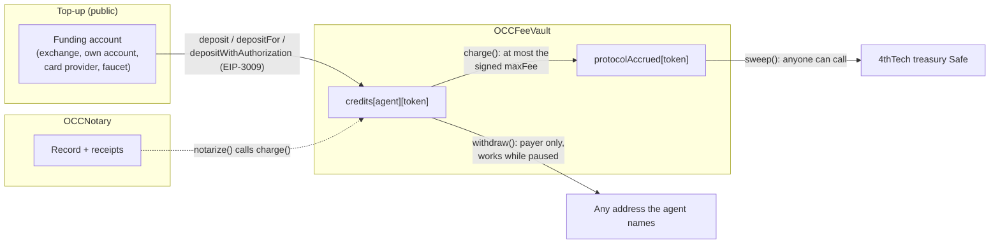
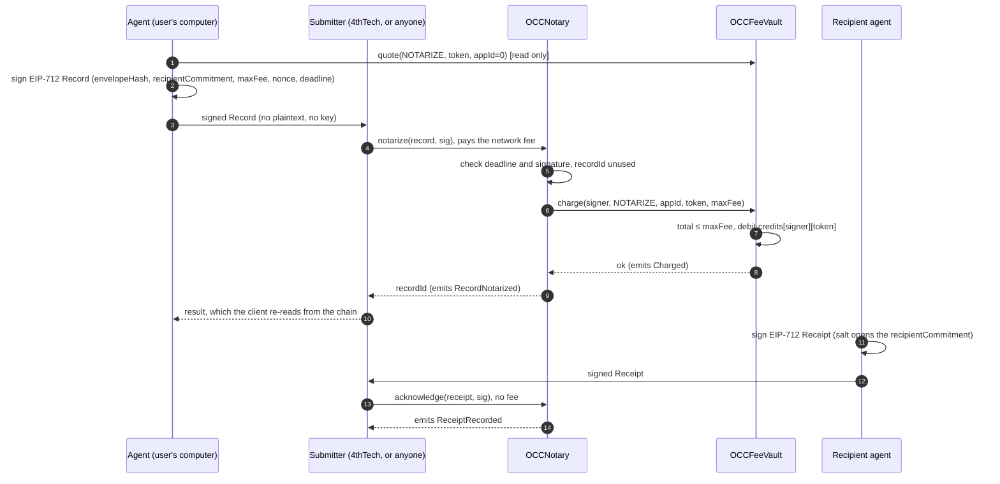
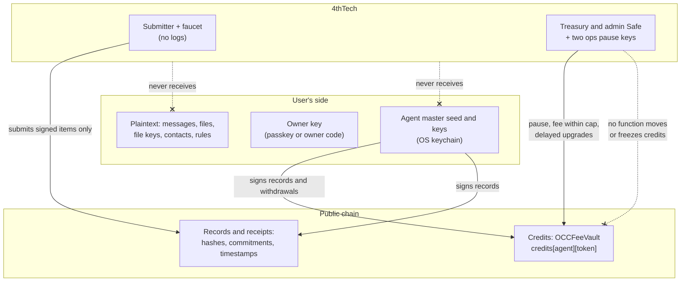

# Payments, credits and trust

> **Status: Design, partly live on testnets.** The OCC v2 fee vault and notary are deployed on Base Sepolia and Gnosis Chiado (pre-audit), and the proof submitter records proofs on Base Sepolia since 21 Oct 2026. `agentlink credits` reads credits since v0.1.2. Not live: gasless USDC top-ups (EIP-3009; the deployed vault refuses them until a later contracts release), the pay page, pay by card, a withdraw button, mainnet and paid proof (v1.0.0, M3). Sources: [05 OCC v2 contracts](https://github.com/4thtech/agentlink/blob/main/docs/foundation/05-contracts-occ-v2.md), [12 Economics and fees](https://github.com/4thtech/agentlink/blob/main/docs/foundation/12-economics-and-fees.md) and [04 Security and crypto](https://github.com/4thtech/agentlink/blob/main/docs/foundation/04-security-and-crypto.md). The specs win on any conflict.

**Purpose:** explain exactly how money moves in AgentLink, what the smart contracts guarantee, what 4thTech can and cannot do, and how to check all of it without seeing the contract source. To check it hands-on, see [Verify it yourself](../guides/verify-it-yourself.md).

## Why this page exists

The OCC v2 contract source is in a private repository during the beta (05 §10). Bytecode is public, but unverified bytecode is hard to read, so trust has to come from elsewhere: precise public behaviour, a public interface (ABI), shared test vectors, events anyone can watch, honest audit status and a fixed plan to publish the verified source at mainnet. This page sets out each of these.

## The model in one picture

| Step | What happens | Source |
|---|---|---|
| Account | The agent's EVM address comes from its own key, derived on the user's side from the agent's master seed (HKDF label `agentlink/v1/evm`, epoch always 0, so credits stay tied to one address). The seed lives in the OS keychain. No key ever reaches 4thTech (I-1). | 04 §1, §2.1, §2.2 |
| Top-up | Credits are a prepaid balance per payer, per chain and per token, held by `OCCFeeVault`. `deposit` credits the caller, `depositFor` credits any agent, `depositWithAuthorization` credits the USDC sender through EIP-3009 `receiveWithAuthorization` (planned; not enabled in the deployed vault). The vault credits the measured balance increase. | 05 §2.5; 12 §4.1 |
| Quote | The client calls `quote(feeType, token, appId)` and shows the total in USD. Official clients use `appId = 0`, so there is no integrator fee. | 05 §2.4; 12 §4 |
| Sign | The agent signs an EIP-712 `Record` locally. It carries `feeToken` and `maxFee`, the most the agent accepts to pay. | 05 §3.1; 12 §4 |
| Submit | The submitter sends the signed record (`notarize`) and pays the network fee. Anyone can submit, because the signature, not the sender, authorises the charge. | 05 §3.2, §3.3; 12 §2 |
| Charge | `notarize` calls `vault.charge(signer, NOTARIZE, appId, feeToken, maxFee)`. The charge reverts if the total is above `maxFee` (`FeeAboveMax`) or the credits are short (`InsufficientCredits`). | 05 §2.4, §3.3 |
| Receipts | The recipient's receipts (delivered, opened, accepted or rejected; at most 3) cost nothing extra: the sender's proof fee covers them. | 05 §3.3; 12 §2 (D-114) |
| Withdraw | The payer calls `withdraw(token, amount, to)` at any time. No role can block it. | 05 §2.5, §5 |

## Proof sequence

What the submitter can and cannot do with a signed record (05 §3.3; 07 §7):

- It can **delay or drop** it. The client then falls back to other submitters, or sends the record directly from the agent's own account (`notarizeDirect`; the agent then pays the network fee itself, 12 §4.2).
- It **cannot change** any field: the signature covers all of them, and `getRecord` exposes the EIP-712 struct hash so a verifier can check every field.
- It **cannot charge more** than the signed `maxFee`, and it cannot reuse the signature: the `recordId` is derived from the signer and a single-use nonce.
- The client never trusts the submitter's answer; it reads the result from the chain.

## Who pays the network fee

The submitter pays the network fee (gas) for every proof and receipt it sends and recovers it from the protocol fee. There is no extra charge (12 §2, "Network costs"). Users pay every cost of proofs, receipts and top-ups; 4thTech subsidises none of them, except the free test credits on testnets (12 §1 item 8; D-111, D-112). Messages and files stay free (D-112).

Calls the user makes from their own account (direct mode, a deposit from their own account, a withdrawal) pay the network's fee from that account. AgentLink adds no fee to deposits or withdrawals (12 §2).

Prices (12 §2): `NOTARIZE` $0.10 with an on-chain cap of $0.50; `REGISTER` $5 with a cap of $25 (M2). Every allowlisted fee token is a US-dollar stablecoin valued at $1 (USDC, USDT where available, native xDAI on Gnosis), so the price is the same on every chain (05 §2.2; 12 §3).

## Top-up paths

| Path | Mechanism | Fees the user sees | Status |
|---|---|---|---|
| Free test credits | 4thTech faucet calls `depositFor` for the agent (05 §9). Owner direction, 2026-10-22, decision record pending: claimed automatically once per agent, a small fixed amount, testnets only | None | Faucet live in the submitter Worker since 21 Oct 2026 (one claim per agent per day, per-IP and global caps). Claimed automatically with the first proof since v0.2.0 |
| Send from an exchange | Transfer USDC to the agent's address (shown with a QR code, the network named only inside the exchange steps, D-117 B), then a gasless top-up: the agent signs EIP-3009 `receiveWithAuthorization` with the vault as payee, and a submitter submits it | The exchange's withdrawal fee | Planned (testnets in M2, M2-18c). Needs a contracts release that enables `depositWithAuthorization` |
| Use crypto you already have | One transfer from the user's own account to the agent's address, then the same gasless top-up | The network's own fee for the transfer | Planned (testnets in M2, M2-18b) |
| Pay by card | A regulated provider delivers a US-dollar stablecoin to the agent's address; the agent turns it into credits with the gasless top-up | The provider's fee and minimum, shown before paying | Planned, last step: after the legal entity exists and after the crypto paths are live (D-111; M2-18a, M3-4c) |

- **Minimum.** Crypto top-ups have a planned $5 minimum (`minDeposit`, which also stops griefing of sponsored submissions; 12 §4.1, D-117 D).
- **Top-up link.** The agent's top-up link puts the address and amount after `#`, so they never reach the pay page's server or any CDN log (D-113). The link is built into the tools and stays off until the pay page ships.
- **Zero access.** The pay page and any provider receive only the agent's address and an amount (12 §4.5).
- **Why EIP-3009.** `receiveWithAuthorization` names the vault as payee, so a front-runner cannot redirect the funds, and it leaves no standing token approval that a later upgrade could pull (05 §2.4, §2.5). The vault credits only the measured increase (`DepositMismatch` otherwise).

## Privacy of top-ups

Every top-up is public and links the paying account to the agent: `Deposited` names the payer and the account that paid, and a gasless USDC top-up shows the account that sent the USDC. One account that tops up several agents links them to each other, and a personal or exchange account can tie an agent to a real person (12 §4.4, D-109).

- The default proof path goes through the submitter, so the agent's funding is not visible per proof.
- Guidance, shown once per top-up method: "The account you add credits from is publicly linked to your agent. For more privacy, use free test credits or a separate account only for AgentLink." (11 §5.6). Use a separate account only for AgentLink top-ups.

## Who holds what

| Asset | Held by | 4thTech's access |
|---|---|---|
| Agent keys and seed | User's OS keychain (or the user's own Cloudflare account for a self-hosted cloud agent) | None (I-1) |
| Owner key | Passkey, owner code or console, behind user presence | None (I-4) |
| Plaintext (messages, files, file keys, contacts, rules) | User's side only | None (I-2) |
| Credits | `OCCFeeVault`, under the agent's address | Cannot move, freeze or reduce them (05 §2.5) |
| Records and receipts | `OCCNotary`: hashes, salted recipient commitments, kind and timestamps, never content | Cannot alter them (fields are immutable; 05 §8) |
| Accrued protocol fees | `OCCFeeVault`, swept to the 4thTech treasury Safe by anyone | Owns them once charged |

## What the contracts guarantee

These are behavioural invariants from 05, checked by the contracts' unit, fuzz and invariant tests (05 §8):

1. **Non-custodial credits.** No admin function can move, freeze or reduce a payer's credits. Tested invariant: no role can reduce a payer's credits (05 §2.5, §8).
2. **Withdrawals never blocked.** Pause blocks charges, deposits, notarization, receipts and registration. It never blocks `withdraw`, `withdrawIntegrator`, `sweep` or the Registry `revoke` (05 §5.1). Removing a token from the allowlist stops new deposits and charges in it; withdrawing existing credits in it still works (05 §2.2).
3. **User functions are unrestricted.** Credits, quotes, apps, `sweep`, notarization, receipts, registration, revocation and views carry no access check in code; no AccessManager setting can gate them (05 §5).
4. **Bounded fees.** The protocol fee can be set only up to `maxProtocolFee`. The cap can be lowered at once but raised only after a 7-day delay. Every charge is also bounded by the payer's signed `maxFee`. Integrator fees are capped at charge time at a multiple of the protocol fee (default 4, at most 10, proposed) (05 §2.2, §2.3; 12 §6).
5. **Solvency.** Per token, the sum of credits and accrued fees never exceeds the vault's balance (05 §8).
6. **Immutable records.** A record's fields never change after creation; each receipt type is set once, and accepted and rejected exclude each other (05 §3.3, §8).
7. **Replay protection and domain separation.** EIP-712 domain `{name: "OCC", version: "2", chainId, verifyingContract}`; single-use nonce plus deadline for records; one-time flag plus deadline for receipts (I-6; 05 §3.1).
8. **Only the recipient can acknowledge.** A receipt must open the record's salted `recipientCommitment` (05 §3.3).
9. **Signature-based, submitter-agnostic.** EOAs and ERC-1271 smart accounts both verify (05 §3.2).

## What 4thTech can and cannot do

Governance runs through an OpenZeppelin `AccessManager` with one role per power and delay (05 §5.1). On mainnet the admin holder is a 4thTech Safe (at least 2-of-3); two ops hardware keys can pause and cancel. The AccessManager itself is not upgradeable.

| 4thTech can | Delay (mainnet) | 4thTech cannot |
|---|---|---|
| Pause charges, deposits, new proofs, receipts and registration (either ops key or the Safe); only the Safe unpauses | None | Block `withdraw`, at any time, by any role |
| Set the protocol fee up to the public cap; lower the cap | None | Charge above the cap, or above the `maxFee` the agent signed |
| Raise the cap; change the integrator fee multiple (at most 10, proposed) | 7 days | Raise anything without a public, cancellable 7-day schedule |
| Allowlist or remove a fee token; set the minimum deposit | 48 h | Move, freeze or reduce any payer's credits |
| Deactivate an abusive integrator app | None | Move an integrator's balance |
| Change the treasury; register a module | 7 days | Read messages, files or contacts: it never holds plaintext or keys (I-1, I-2) |
| Upgrade the vault, notary or registry (UUPS) | 7 days | Upgrade the notary after `freezeUpgrades`, which is planned at general availability |
| Run the submitter and faucet | — | Change, forge or replay a signed record; sign for an agent |

**Residual risks, stated plainly:**

- **Upgrades.** The vault stays upgradeable. A malicious upgrade could change the rules, which is why every upgrade and every module registration waits 7 days: users can withdraw and revoke any token approval to the vault first. The schedule is public (`OperationScheduled` on the AccessManager); watch it (05 §5.1, §6).
- **Testnet delays are shorter.** On testnets the delays are scaled (7 days → 4 h, 48 h → 1 h) so upgrades can be rehearsed. The mainnet deploy script refuses any delay below the table (05 §5.1).
- **Stablecoin issuers.** The issuers of USDC and USDT can freeze funds in their tokens, including the vault's balance. AgentLink cannot prevent this ([Pricing](https://github.com/4thtech/agentlink/blob/main/docs-site/guide/pricing.md#advanced-what-digital-dollars-means)).
- **Integrator withdrawals during a pause.** Pause does not block `withdrawIntegrator`, so it cannot stop a withdrawal of a balance inflated by a bug. This path is in the external audit scope; an alert on `IntegratorWithdrawn` is the compensating control (05 §5.1, §6).
- **Standing approvals.** Clients approve the vault only for the exact amount of a direct payment and prefer EIP-3009, because a standing allowance would be exposed to a later upgrade (05 §2.4).

## Bridging the private source

| What you can rely on | Where |
|---|---|
| **The interface.** The ABIs of `IOCCNotary`, `IOCCFeeVault`, `IOCCManaged` and `IOCCErrors` (plus inherited OpenZeppelin errors and events), generated from the Solidity interfaces, vendored byte for byte from a tagged contracts release and checked against its SHA-256 manifest on every pull request. The package `@4thtech-io/occ-v2-abi` is bundled into the CLI, not published to npm on its own (D-83), but its JSON files are public in this repository. | [`packages/occ-v2-abi/artifacts/`](https://github.com/4thtech/agentlink/tree/main/packages/occ-v2-abi/artifacts); [Contracts](../reference/contracts.md#interface-package) |
| **The addresses.** One address file per chain from the same release, checked byte for byte against the manifest. CI fails if a page lists a different address, and refuses any mainnet entry before M3. | [Networks and contract addresses](../reference/networks-and-contracts.md) |
| **The hashing.** Public EIP-712 test vectors from an independent Python generator, checked in five runtimes. The private contracts repository pins a commit of the same vectors and checks parity, so the client and the contracts hash `Record` and `Receipt` identically. | [`test-vectors/`](https://github.com/4thtech/agentlink/tree/main/test-vectors); [Run the test vectors](../guides/run-test-vectors.md) |
| **The behaviour.** Every function, event, error, role and delay is specified in public. | [05 OCC v2 contracts](https://github.com/4thtech/agentlink/blob/main/docs/foundation/05-contracts-occ-v2.md) |
| **The events.** Every deposit, withdrawal, charge, record, receipt, pause and governance change emits an event anyone can watch. | [Verify it yourself](../guides/verify-it-yourself.md#3-watch-the-events) |
| **No Solidity in this repository.** CI fails if a `.sol` file or a Solidity pragma appears here. | `tools/check-no-solidity.mjs` |

**Source verification.** The testnet contracts' source is not verified on the block explorers during the beta (the explorers may recognise the standard ERC-1967 proxy, but not the implementation behind it). Verified source on Sourcify and the explorers is planned at mainnet (05 §9).

**Audit status.** The contracts are pre-audit. Before the Base Sepolia deployment they had an independent AI-assisted pre-audit (Fable model, 14 Oct 2026; verdict: go for testnet with conditions, which were then fixed or tracked), and the ABI export had its own review. An **external audit is required before mainnet** (the M3 gate: high and medium findings fixed), followed by a bug bounty after mainnet (05 §8). Audit reports are published only after fixes; findings are never published while unfixed.

**Licence.** During the beta the contracts repository is private. At mainnet, the verified source is planned to be published under the **Business Source License 1.1**: an additional use grant for non-commercial use, testing, security research and use through the canonical deployments, converting to GPL-2.0-or-later three years after mainnet launch. These terms are proposed and to be confirmed with counsel (05 §10). Everything in this repository is MIT.

## Related

- [Verify it yourself](../guides/verify-it-yourself.md): check addresses, balances, events and proofs on a block explorer.
- [Contracts](../reference/contracts.md) and [Networks and contract addresses](../reference/networks-and-contracts.md).
- [Security model](security-model.md) and [Threat model](threat-model.md).
- User guide: [Credits](https://github.com/4thtech/agentlink/blob/main/docs-site/guide/everyday-use/credits.md) and [Pricing](https://github.com/4thtech/agentlink/blob/main/docs-site/guide/pricing.md).
