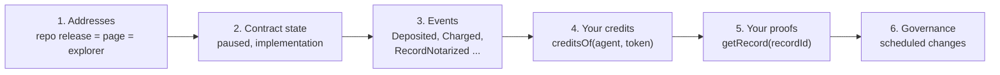

# Verify it yourself

> **Status: Current (testnets).** Every check on this page works today against the pre-audit testnet deployments on Base Sepolia (84532) and Gnosis Chiado (10200). There is no mainnet deployment yet (planned for v1.0.0, M3, after the external audit); mainnet addresses will differ from testnet addresses (D-71). Testnet credits have no value.

**Purpose:** check the AgentLink contracts, your agent's credits and your proofs on public infrastructure, without trusting 4thTech and without the contract source, which stays private until mainnet. For why each check matters, see [Payments, credits and trust](../concepts/payments-credits-and-trust.md).

You need a block explorer, and for the command-line checks either [Foundry's `cast`](https://getfoundry.sh) or `curl`. Public RPC endpoints: `https://sepolia.base.org` (Base Sepolia) and `https://rpc.chiadochain.net` (Gnosis Chiado).



## 1. Check the addresses

The addresses come from a tagged release of the private contracts repository. Three independent places must agree:

1. The vendored release files in this repository: [`packages/occ-v2-abi/artifacts/`](https://github.com/4thtech/agentlink/tree/main/packages/occ-v2-abi/artifacts) (`manifest.json` holds the SHA-256 of every file) and [`packages/occ-v2-abi/src/addresses.generated.ts`](https://github.com/4thtech/agentlink/blob/main/packages/occ-v2-abi/src/addresses.generated.ts) (addresses without the `0x` prefix, so secret scanners don't flag them).
2. The [Networks and contract addresses](../reference/networks-and-contracts.md) page. A CI test fails when it differs from the package.
3. The explorer: the address has code, and its transactions and events match what this page describes.

| Contract | Address (Base Sepolia and Gnosis Chiado) |
|---|---|
| `OCCNotary` (proxy) | `0xB29dEdEe26D480105DAD5b90f549a09d376d855F` |
| `OCCFeeVault` (proxy) | `0x91A40104553Bd1731c3fBe05209A908B40e50f8d` |
| `AccessManager` | `0x7B05B6C56E4f073df60da9Fa640b1f7ffCD9D3A2` |

The addresses are the same on both testnets because the contracts are deployed with CREATE3 through CreateX (05 §9). Use only the addresses listed for each chain ID.

To re-check the vendored files yourself, from a clone of this repository: `node tools/occ-v2-abi/check.mjs`.

## 2. Check the contract state

**Source verification.** The testnet implementation source is not verified on the explorers during the beta; you will see bytecode, and the explorer may label the proxy as a standard ERC-1967 proxy. Verified source on Sourcify and the explorers is planned at mainnet (05 §9). Until then, use the public ABI to read and decode.

**Is anything paused?** `paused()` returns `false` when the contract runs normally. A pause never blocks withdrawals (05 §5.1).

```sh
cast call 0x91A40104553Bd1731c3fBe05209A908B40e50f8d "paused()(bool)" --rpc-url https://sepolia.base.org
cast call 0xB29dEdEe26D480105DAD5b90f549a09d376d855F "paused()(bool)" --rpc-url https://sepolia.base.org
```

Without Foundry, the same call with `curl` (`0x5c975abb` is the selector of `paused()`; a result ending in `0` means not paused):

```sh
curl -s -X POST -H 'content-type: application/json' https://sepolia.base.org \
  -d '{"jsonrpc":"2.0","id":1,"method":"eth_call","params":[{"to":"0x91A40104553Bd1731c3fBe05209A908B40e50f8d","data":"0x5c975abb"},"latest"]}'
```

**Which implementation runs behind the proxy?** Read the ERC-1967 implementation slot. If it changes, an upgrade happened, and an `Upgraded(address)` event marks it.

```sh
cast storage 0x91A40104553Bd1731c3fBe05209A908B40e50f8d \
  0x360894a13ba1a3210667c828492db98dca3e2076cc3735a920a3ca505d382bbc --rpc-url https://sepolia.base.org
```

## 3. Watch the events

Every action emits an event (05 §6). On an explorer, open the contract's **Events** tab (Basescan) or **Logs** tab (Blockscout). Because the source is not verified, events may show undecoded: match the first topic (`topic0`) against this table, which is computed from the ABI files in this repository. Indexed parameters are marked `*` and appear as topics 1–3.

| Event | Contract | Parameters | topic0 |
|---|---|---|---|
| `Deposited` | Vault | `*payer, *token, amount, *from` | `0x4a82d3f4fd2c64329f08a8da5d7b66f87ecfb87e7045120c538eb1f51eb1a1d3` |
| `Withdrawn` | Vault | `*payer, *token, amount, to` | `0x889d364b5102aee044ff370e2e6a836584e5618a16dce4f5b191459cf3903e58` |
| `Charged` | Vault | `*payer, feeType, *appId, token, protocolPart, integratorPart` | `0xf0e2a76a4c4b2139a2f7e118580265811cf61ca81c14c4c8bb40e973e2247e70` |
| `Swept` | Vault | `*token, amount, treasury` | `0xbb3f74f3539ea7725781ff6810125a75c183f5c944318fc94873d1324f0482ae` |
| `RecordNotarized` | Notary | `*recordId, *signer, envelopeHash, recipientCommitment, *parentRecordId, appId, kind, timestamp` | `0x96a2a8d8fd5e6089e779e86911529b2479f3f1e2f44c0a67af6c211bd11895d3` |
| `ReceiptRecorded` | Notary | `*recordId, receiptType, *signer, timestamp` | `0xf86eafb1c6fadd5c67758d7378bf29afa117408744cdbb33e826912dab2e29d1` |
| `Paused` / `Unpaused` | Vault, Notary | `account` | `0x62e78cea01bee320cd4e420270b5ea74000d11b0c9f74754ebdbfc544b05a258` / `0x5db9ee0a495bf2e6ff9c91a7834c1ba4fdd244a5e8aa4e537bd38aeae4b073aa` |
| `FeeSet` | Vault | `feeType, *token, fee` | `0x7b502606b2c44fd974a63ff1d267c7f7160e930edf36f250445813b3f31f5bbc` |
| `CapSet` | Vault | `feeType, *token, cap` | `0x8dd110f187eef9805f7deb4ef887872c412ba50e3f793165b370b6f9ccfc8858` |
| `TreasuryChanged` | Vault | `*oldTreasury, *newTreasury` | `0x8c3aa5f43a388513435861bf27dfad7829cd248696fed367c62d441f62954496` |
| `ModuleSet` | Vault | `*module, registered` | `0x96bf850214e832f3d463d74cdf933b2aa73175e078496bd11f5e8afaeb2bbb9c` |
| `IntegratorWithdrawn` | Vault | `*appId, *token, *to, amount` | `0xcac356a908751f5b49b3ed4189913b3cf47d2c50623119a772130c6aa6432c9c` |
| `RecordSkipped` | Notary | `*recordId` | `0xbafca0253929966140d1793a8425fd8c92ea0dbbbe256619da0662ed30ae7bed` |

- `RecordSkipped` and `ReceiptSkipped` are never evidence of a proof or a payment: anyone can cause them by replaying public calldata. Use `RecordNotarized`, `ReceiptRecorded` and `getRecord` (05 §6).
- Ignore zero-amount `Deposited`, `Swept` and `IntegratorWithdrawn` events, and events from any address other than the listed contracts.

To list the deposits made for your agent with `cast` (replace `<AGENT>` with your agent's address, see step 4):

```sh
cast logs --address 0x91A40104553Bd1731c3fBe05209A908B40e50f8d \
  "Deposited(address indexed payer, address indexed token, uint256 amount, address indexed from)" \
  <AGENT> --from-block 48120712 --rpc-url https://sepolia.base.org
```

Some public RPCs prune or limit old logs. The state reads in steps 4 and 5 do not depend on logs.

## 4. Check your agent's credits

**With AgentLink** (v0.1.2 or later): `agentlink credits` shows your agent ID and your credits in dollars over every proof network. The agent ID it prints is your agent's address.

**On your own:**

```sh
# test USDC on Base Sepolia (6 decimals): 100000 = $0.10
cast call 0x91A40104553Bd1731c3fBe05209A908B40e50f8d "creditsOf(address,address)(uint256)" \
  <AGENT> 0x036CbD53842c5426634e7929541eC2318f3dCF7e --rpc-url https://sepolia.base.org

# native xDAI on Gnosis Chiado (18 decimals; the zero address stands for the native asset)
cast call 0x91A40104553Bd1731c3fBe05209A908B40e50f8d "creditsOf(address,address)(uint256)" \
  <AGENT> 0x0000000000000000000000000000000000000000 --rpc-url https://rpc.chiadochain.net
```

The balance must equal your `Deposited` amounts minus your `Charged` totals and your `Withdrawn` amounts. Only your agent can call `withdraw` for its own credits, and no role can block it (05 §2.5). A withdraw button in AgentLink is planned.

## 5. Check a proof

Every proof has a `recordId`. `getRecord(recordId)` returns the signer, time, kind, envelope hash, recipient commitment, the EIP-712 struct hash of the signed record, and the receipt flags and times, which is everything a proof shows, without relying on logs (05 §3.3).

- **With AgentLink:** `agentlink verify <proof.json>` checks a proof file against the chain (v0.1.2 or later).
- **Independently:** follow [Verify a proof independently](verify-a-proof.md), which recomputes the hashes from the [proof pack](../reference/proof-pack-format.md) and compares them with `getRecord`.
- **On an explorer:** search the `recordId` in the notary's `RecordNotarized` events (topic 1).

## 6. Watch for governance changes

Every power that could hurt users waits: 7 days on mainnet for upgrades, module registration, treasury changes and cap raises; 48 h for fee-token changes (05 §5.1). On testnets these delays are shortened (7 days → 4 h, 48 h → 1 h) for rehearsals.

- On the `AccessManager`, watch `OperationScheduled` (the early warning, with the target and call data), `OperationExecuted` and `OperationCanceled`, plus `RoleGranted` and `RoleRevoked`.
- On the proxies, watch `Upgraded(address)`, `TreasuryChanged`, `CapSet` and `ModuleSet`.

If a scheduled upgrade or module registration worries you, you have the whole delay to withdraw your credits and revoke any token approval to the vault (05 §5.1).

## 7. Check the shared test vectors

The client and the contracts must hash `Record` and `Receipt` identically. The public EIP-712 vectors in [`test-vectors/`](https://github.com/4thtech/agentlink/tree/main/test-vectors) come from an independent Python generator; the private contracts repository pins a commit of them and checks parity. Run them with `pnpm vectors:check` ([Run the test vectors](run-test-vectors.md)).

## What you cannot check yet

- **The implementation source.** Private until mainnet, then planned as verified source under BUSL-1.1 (proposed; 05 §10).
- **Audit reports.** The contracts are pre-audit. Internal pre-audit reports stay private; the external audit before mainnet (M3) is published after fixes.
- **Mainnet.** Not deployed.
