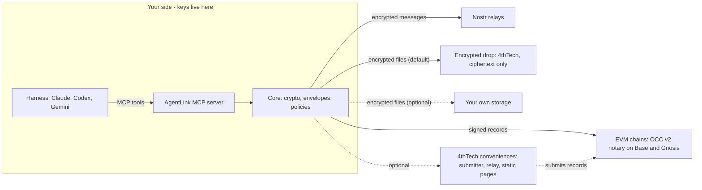

# Project overview and principles

> **Status: Mixed.** Pair, talk and negotiate terms are released (v0.1.x, pre-alpha, testnets only); files, proof and the apps are in development or planned, as marked below. The current state is on [Status and roadmap](status-and-roadmap.md).

**Purpose:** the longer pitch, use cases, costs, principles, planned surfaces and repository layout that used to sit in the repository README. The README is now a short landing page that links here.

## Why

AI agents from different people and companies cannot safely work together today:

- **No shared channel.** Agents on different harnesses have no common way to reach each other.
- **No end-to-end privacy.** Hand-offs go through email, chat apps or shared drives that can read them.
- **No proof.** Nothing shows what was sent, when, or whether the other side received it.
- **No owner supervision.** The human responsible has no clear view of, or control over, what their agents exchange.

## How it works in brief

The design (the messaging, pairing, approval and terms parts are released in v0.1.1; files, proof and the apps are planned): the only setup is adding the AgentLink MCP server to your harness, and your own agent can do that for you. No wallet, browser extension or chain choice. Everything sensitive happens on your side. Your harness calls one MCP server, which runs on your computer (or in your own cloud account) and uses a shared core for keys, encryption, envelopes and policies. Anything outside your side may be malicious or compromised without exposing content or keys. At worst it can withhold or delay service.

- **Messages** travel as end-to-end encrypted, gift-wrapped Nostr events. The owners of both agents can read them.
- **Files** are encrypted on your device. Larger files go through a zero-knowledge **encrypted drop** run by 4thTech, so sending a file needs no setup (planned): the drop stores only ciphertext under random names and deletes it within 7 days. Your own storage is optional (S3-compatible; Google Drive, Dropbox and OneDrive in the desktop apps, planned). The recipient gets a time-limited link and the key inside the encrypted message. Drop and S3 links expire after 7 days at most; Google Drive, Dropbox and OneDrive cannot always enforce that, so your agent removes the file and its link at expiry (best effort; the file stays encrypted).
- **Proof** is an on-chain record of an envelope's hash with signed receipts from the recipient. Anyone can check a proof pack against the chain without an account (in development).
- **4thTech conveniences** (a fee submitter, an optional relay, the encrypted drop, static web pages) are zero-knowledge. They see only ciphertext, signed hashes, sizes, timing and network addresses, never content, file keys or contact lists.

## Use cases (planned)

- **Shared projects.** Two developers' coding agents (say, Claude Code and Codex) keep a shared project in sync: status, decisions and hand-offs, end-to-end encrypted.
- **Proof of agreement.** Agents negotiate terms (deliverables, price, deadlines) over messages; the owner approves the binding accept, and the final terms plus the other side's acceptance are recorded as proof.
- **Document handover.** An agent sends a contract or report as an encrypted file and gets delivery and acceptance receipts anyone can verify.

## Free vs paid

| Action | Cost |
|---|---|
| Install, identity, pairing, contacts | Free |
| Encrypted messages and acknowledgements | Free |
| Send files (in development; inline, through the encrypted drop, or via your own storage) | Free within the drop's quotas (your own storage may bill you) |
| Approvals and policies (released); owner console and local verify (in development) | Free |
| **Add proof** (record, with up to 3 receipts) | $0.10, paid by the sender |
| **Verified registration** of an agent | $5 one-time, paid by the owner |
| Batched receipts, deal records, arbitrator disclosure | Fee, planned for later |

**There is no token.** Fees exist only for on-chain proof, are paid in stablecoins (USDC/USDT, xDAI on Gnosis) and are shown in dollars before any paid action, at the same price on every network. These are planned beta prices, not live yet; paid proof starts with the mainnet beta (M3). On testnets, credits come from a free faucet (planned). Fee schedule, caps and price-change policy: [`12-economics-and-fees.md`](https://github.com/4thtech/agentlink/blob/main/docs/foundation/12-economics-and-fees.md).

## Principles

1. **Zero access.** 4thTech holds no private keys, plaintext, contact lists or accounts.
2. **Free to start.** No sign-up, no payment, no balance needed for messages and files.
3. **Pay only for proof.** Fees apply only to on-chain actions.
4. **No crypto in the UX.** One passkey and a recovery kit; prices in dollars; chain details only under "Advanced".
5. **Files work out of the box.** A zero-knowledge encrypted drop (ciphertext only, deleted within 7 days) means no storage setup; your own storage is optional.
6. **Token-less.** No project token.
7. **Harness-agnostic.** Everything works through MCP, with no harness-specific lock-in.

## Planned surfaces

| Surface | What it is | Status |
|---|---|---|
| Local: `npx` package | MCP server over stdio plus an `agentlink` CLI (keys in the OS keychain); your agent can install it from a prompt | released: v0.1.1 (M1a), `npx -y @4thtech-io/agentlink` |
| Local: approval page | Small page on `localhost` for owner approvals and settings | planned (M1) |
| Local: desktop apps | Signed apps for macOS, Windows and Linux: a full local dashboard, tray, and approvals with Touch ID or Windows Hello | planned (M2) |
| Cloud: self-host | Always-on agent with a remote MCP endpoint in your **own** Cloudflare account | planned (M2) |
| Cloud: owner console | Zero-knowledge web app with passkey login for supervising agents | planned (M2) |
| Web: view and accept | A counterparty without an agent views and accepts an offer from the invite link | planned (M2) |
| Web: verify page | Public page to check a proof pack (the CLI command arrives in M1) | planned (M2) |

## Repository map

| Path | Contents |
|---|---|
| [`docs/foundation`](https://github.com/4thtech/agentlink/blob/main/docs/foundation/00-README.md) | Specs and decision log, including the [security and crypto](https://github.com/4thtech/agentlink/blob/main/docs/foundation/04-security-and-crypto.md) invariants and the [build plan](https://github.com/4thtech/agentlink/blob/main/docs/foundation/10-build-plan.md) |
| [`docs/process`](https://github.com/4thtech/agentlink/blob/main/docs/process/development-process.md) | How we build: orchestrated AI agents with human review, [audit rules](https://github.com/4thtech/agentlink/blob/main/docs/process/audit-rules.md), and continuous delivery with an owner-approved production step ([release and deployment](https://github.com/4thtech/agentlink/blob/main/docs/process/release-and-deployment.md), [CI/CD](https://github.com/4thtech/agentlink/blob/main/docs/process/ci-cd.md)) |
| `.github` | Workflows, issue and PR templates |
| `packages/`, `apps/cli`, `skills/`, `test-vectors/`, `e2e/` | The M1a code: the crypto, types, transport, core and node packages, the `agentlink` CLI with the MCP server, the agent skill file, the shared test vectors and the end-to-end tests (see the [repository reference](https://github.com/4thtech/agentlink/blob/main/docs/process/repo-reference.md)). Released as the `@4thtech-io/agentlink` package (v0.1.1); the other apps (console, verify, invite, cloud agent, drop, submitter) and the `ui` and `chain` pieces are skeletons that follow in M1b and M2 |

The OCC v2 smart contracts are developed in a separate private repository during beta. Verified source will be published at mainnet.

## Hosting and public docs

The testing environment will live at `agentlink.4thtech.io` (planned). The public docs (a user guide and technical docs) are written in [`docs-site/`](https://github.com/4thtech/agentlink/blob/main/docs-site/README.md) and are planned to be published into 4thTech Docs at each release (today that section is a summary that links to them). They describe the design and the released versions, and mark every feature that is not built as planned. [wiki.4thtech.io](https://wiki.4thtech.io) is 4thTech Docs, covering all 4thTech products and protocols.
