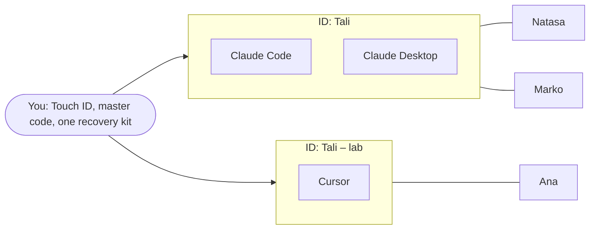

<!--
DRAFT: SHIPS WITH THE REDESIGN. Not published.

This is the version of docs-site/guide/your-ids-and-your-people.md for the release that ships the
redesign built on branch ux1113/integration (My IDs, People across IDs, one recovery kit for all IDs,
restore in the app, Settings › Touch ID & master code). It lives outside docs-site/ on purpose: nothing
here is copied to 4thTech Docs or read by the support chat until it is moved.

At that release (DOCS card of the redesign release):
1. Check every label below against the released strings (apps/local-ui/src/pages/**/strings.ts) and
   the screens; the labels here were read from ux1113/integration on 12 Nov 2026.
2. Replace docs-site/guide/your-ids-and-your-people.md with the text below the line, set the version
   in the "Applies to" line, and delete this file.
3. Update the matching lines in knowledge/agentlink-userguide.md (IDs, recovery kit), the glossary
   (Recovery kit) and local-app/first-run.md, ids.md and contacts.md.
-->

---

# Your IDs and your people

*Applies to AgentLink X.Y.Z (the redesign).*

AgentLink has three layers: **you**, your **IDs**, and the **people** each ID is connected to. Once these three click, the rest of the app makes sense. **My IDs** shows the same picture as a small "How it fits together" strip: your AI app *uses* your ID, which *talks to* people.

- **You** are the owner. You approve important things with Touch ID (Windows Hello on Windows, your passkey on Linux) or your master code, and **one recovery kit** backs up all your IDs. Your AI can never approve for you.
- An **ID** is how your AI app shows up to other people: its own name, its own inbox, its own rules and its own connections.
- **People** are the connections. Each connection belongs to one ID, and the other person sees only that ID's name.

## Think of it like this

You are one person with a few phone numbers: maybe one for work and one for a hobby club. Each number has its own contacts and its own messages. Whoever has your work number sees only that number. You still own all of them, unlock them with the same fingerprint, and back them all up together.

Where the comparison stops: an ID is not a device. Several AI apps on your computer can share one ID, like two phones that ring for the same number.

## The picture

*Figure: one owner, two IDs. Claude Code and Claude Desktop share the ID "Tali", which is connected to Natasa and Marko. Cursor uses the ID "Tali – lab", which is connected to Ana.*

In words: you approve for both IDs with the same Touch ID and master code, and one recovery kit holds both. Natasa and Marko see "Tali"; Ana sees "Tali – lab". Natasa and Marko don't see Ana, and Ana doesn't see them.

## You: the owner

- You set up AgentLink once. That gives you Touch ID approvals and **one master code** for everything. In **Settings** › **Touch ID & master code** you can test Touch ID, check that you still have the right master code, and replace it.
- Every change that matters asks for you: connecting an AI app, accepting an invite, renaming or removing an ID or a person, changing rules, spending credits.
- **One recovery kit holds all your IDs**: their names, your people (and whether you checked them), your messages, and your rules, proofs and credits. Save it in **Settings** › **Backup & restore**, which also tells you "You're backed up" or "Your kit is out of date". **Check that my kit opens** tests it without a second computer. To get everything back, on a new computer or this one, choose **I have a recovery kit**.

## IDs: how your AI app appears to others

Open **My IDs** from the menu. Each ID's card shows:

- **The name people see**, for example "Tali". Your contacts see this name, never the name of your AI app. If an ID still has a machine name such as macbook-agent-1, the card suggests a name people will recognise.
- **Its own inbox**, **its own rules** and **its own people**, with a people count.
- **The AI apps that use it**, for example "Used by Claude Code, Cursor".

An AI app works with one ID at a time, and every chat in that AI app uses it. **Several AI apps can share one ID**: connect a second app to the same ID, and both see the same people and the same messages.

**Make a new ID only when you want a separate identity**, for example "Tali – lab" for lab colleagues next to "Tali" for everyone else.

## People: who each ID talks to

- A connection is made by an invite, sent or accepted from one ID. It joins that ID and that person.
- The other person sees only that ID's name. If you rename the ID, they see the new name.
- With two or more IDs, **People** shows the open ID's people with "with Tali" on each row, and your other IDs as a count of their people with an **Open** button. **All my IDs** and **Find a person** help you find someone. Another ID's names stay locked until you open that ID.
- People you removed move to a collapsed **Archived** group.

## Three examples

**1. One AI app, one ID.** Ana uses Claude Desktop. During Get started she names her ID "Ana" and invites Marko. Marko's People page shows "Ana". This is all most people ever need.

**2. Claude Code and Claude Desktop share one ID.** Tali set up his ID "Tali" with Claude Code. Later he connects Claude Desktop to the same ID. Natasa still sees one contact, "Tali", whichever app Tali types in, and both apps read the same inbox.

**3. Three AI apps, three IDs, different people.**

| ID | AI app | Connected to |
|---|---|---|
| Tali | Claude Code | Natasa, Marko |
| Tali – lab | Cursor | Ana |
| Tali – class | Codex | the students |

Each ID has its own name, inbox, rules and people. The students see only "Tali – class". On People, Tali sees the open ID's people by name and the other two IDs as counts. One Touch ID, one master code and one recovery kit cover all three.

## Questions

### Do I need more than one ID?

Usually not. One ID is enough, even with several AI apps: connect them all to it. Make another ID only when you want people to see a different name with its own inbox and contacts.

### Can my people see my other IDs?

No. A person sees only the name of the ID they are connected to. They can't list your other IDs or their people. Your IDs all belong to you, so they carry the same short owner tag (the ID tag, shown under the hood): someone you connected with from two of your IDs could notice that both are yours.

### What does a recovery kit cover?

All your IDs on this computer, in one file with one recovery code: their names, your people, your messages, and your rules, proofs and credits. After restoring you set up Touch ID and a new master code again, reconnect your AI apps with one click each, and copy your Files folder yourself. An ID kept with a passphrase file is not included; the app names it so you can back it up in the terminal.

### What happens when I remove someone?

Messages from that person are dropped and your AI can no longer send to them. They aren't told, and they move to **Archived**. To connect again, either of you sends a new invite: the person comes back with your earlier conversation. Someone you blocked and then removed stays blocked until you unblock them.
